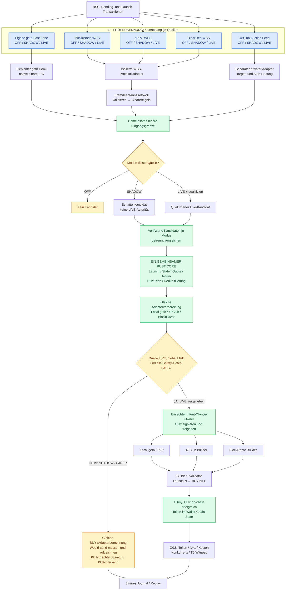
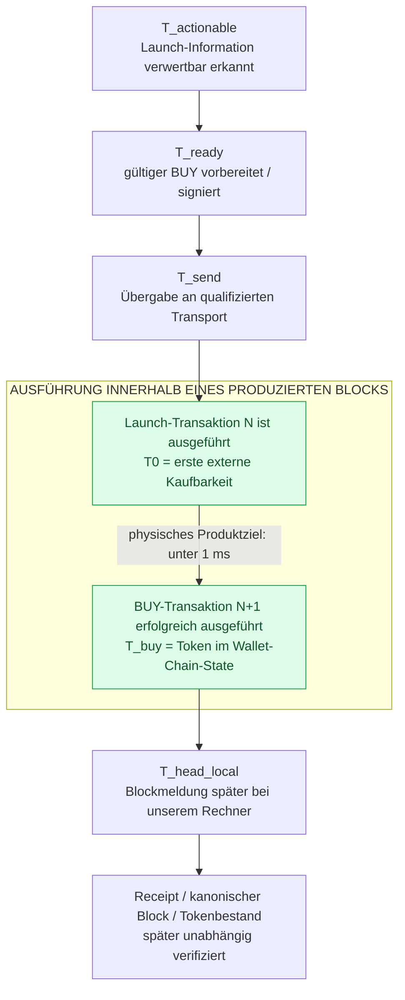

# DarkBot BSC – Early Launch Detection und On-Chain-BUY

**Verbindlicher Plan:** [PHASENPLAN.md (v8)](docs/1_PLAN/PHASENPLAN.md) · **Status:** G0.7/G0.8 vor Produktions-LIVE · **In Arbeit:** ein nativer Rust-BSC-Core, zusätzliche früheste Signaleingänge sind geplant.

DarkBot BSC soll fremde Flap- und Four.meme-Launches möglichst früh erkennen, einen validen BUY rechtzeitig vorbereiten und **als erster unabhängiger externer Käufer direkt auf der BSC ausführen**. Es gibt keinen Trading-Website-, Frontend- oder Browser-Schritt im BUY-Pfad.

**Erfolg = BUY tatsächlich auf der Chain ausgeführt und Token im Wallet-Chain-State erhalten.** Weder das Abschicken noch ein Builder-ACK noch eine Wallet-Anzeige allein zählen als Kauf.

**G0.7-Testprofile (Plan v8):** Für **unseren eigenen Self-Launch** stehen A (bekannter eingefrorener Salt) und B (neuer lokal zufälliger Salt) als getrennt zu prüfende Varianten zur Auswahl; später über einen eigenen Frontend-Schalter, unabhängig von den fünf Ingressmodi. Umschalten erteilt keine LIVE-Freigabe. **Bei fremden Launches** wird der Salt aus rechtzeitig empfangener vollständiger Launch-Calldata ermittelt und die CREATE2-Adresse lokal abgeleitet. Ein bloßer Hash oder nach T0 eintreffende Daten beweisen keine Früherkennung.

## Architektur – fünf parallele Signaleingänge, eine gemeinsame Engine

GitHub rendert dieses **Mermaid-Blockschaltbild direkt**. Es zeigt die **verbindliche Zielarchitektur** aus Phasenplan §5a, nicht den derzeit bereits produktiv verdrahteten Zustand.

### Eingänge und Ausgänge sind verschiedene Schnittstellen

| Anbieter | **VOR dem BUY: Früherkennung** | **NACH dem BUY-Plan: Versand** |
|---|---|---|
| Eigene geth-Node | Native P2P-/Txpool-Fast-Lane | Local-geth-/P2P-Sendeadapter |
| 48Club | Separater Auction Feed, aktuell UNQUALIFIED | Separater 48Club Builder |
| BlockRazor | Separate Public-/Private-Mempool-Streams vorhanden, **nicht im verbindlichen Fünf-Quellen-Plan** und nicht FREE_ONLY | BlockRazor Builder / RPC |
| PublicNode, dRPC, BlockReq | Öffentliche Pending-WebSocket-Feeds | Nicht automatisch qualifizierte BUY-Ausgänge |

**Ein Builder ist nicht automatisch ein Früherkennungs-Feed.** Eigene geth-Node und 48Club können in beiden Bereichen jeweils über **verschiedene** Schnittstellen vorkommen. BlockRazor bietet eigene BSC-Mempool-Streams für frühere Signale, derzeit aber als separate kostenpflichtige Produkte. Der 48Club Auction Feed erfordert Berechtigung und stellt besonders Backrun-/Target-Informationen bereit; ob er Flap-/Four.meme-Launches früh genug erkennt, muss erst bewiesen werden. Die fünf verbindlichen Ingressquellen des Phasenplans werden dadurch **nicht** eigenmächtig erweitert.

### Was im SHADOW-Modus tatsächlich passiert

1. **Dieselben Datenadapter und dieselbe Fachlogik:** Alle eingeschalteten Quellen werden geprüft, ihre externen Frames vor dem Hot-Path ins Binärformat umgewandelt und ihre handlungsfähigen Signale dem **einen Rust-Core** zugeführt. Quellenstatus OFF, SHADOW oder LIVE bleibt am Ereignis gebunden.
2. **SHADOW endet nicht vor der BUY-Vorbereitung.** Derselbe Code prüft Venue, Deployment, Tokenadresse, State, Quote, Risk, Filters, BUY-Aufbau und die Auswahl des geth-, 48Club- oder BlockRazor-Inclusion-Adapters. Die Shadow-Auswertung verwendet aber einen logisch getrennten, nichtwirtschaftlichen Intent-/Nonce-Kontext. **Ein Shadow-Signal darf nie einen Live-Kandidaten verdrängen, dessen Nonce beanspruchen oder die geth-Fast-Lane verlangsamen.**
3. **Einziger Unterschied ist die wirtschaftliche Außenwirkung:** Bei SHADOW/PAPER werden die vorgesehenen Adapter-Payloads, Kosten, Latenz und der hypothetische Übergabezeitpunkt **T_would_send** lokal berechnet und im binären Journal aufgezeichnet. **Keine ausführbaren Mainnet-Bytes signieren, kein Broadcasting, kein Gas, keine BNB-Zahlung.**
4. **LIVE arbeitet mit derselben Kernberechnung und derselben Adapterwahl**, aber nur nach globaler Freigabe werden echte Signatur, Nonce-Fence, Transaktionsversand und spätere On-Chain-Abnahme ausgelöst. **Quellen-LIVE allein erteilt keinerlei Versandfreigabe.**
5. **Kein erfundener Erfolg:** SHADOW kann nicht wissen, ob der echte Builder den BUY übernommen hätte, ob N/N+1 gelungen wäre oder ob Tokens angekommen wären. Das bleibt **UNKNOWN**, bis es echte On-Chain-Nachweise gibt. Für beide Modi gelten dieselben fachlichen Funktionen, nicht zwei Bots und nicht zwei Trading-Engines.

Wichtig sind **zwei unabhängige Steuerschichten**: Jeder der fünf *Dateneingänge* besitzt OFF / SHADOW / LIVE; der *gesamte Bot* besitzt unabhängig REPLAY / PAPER / SHADOW / LIVE und die globale wirtschaftliche Freigabe. Wird ein Eingang nur als SHADOW geschaltet, darf sein Signal niemals direkt einen echten BUY auslösen – auch dann nicht, wenn andere Quellen live sind.

**JSON-Regel:** Fremdes JSON-RPC ist nur an der externen WebSocket- bzw. Provider-Protokollgrenze zulässig. **Alle** DarkBot-internen Datenstrukturen, Übergaben, Konfigurations- und Journalformate bleiben binär. Ein Isolationsadapter ist **nicht** Bestandteil des Rust-BUY-Entscheidungshotpaths.

Weitere Produktinformationen: [48Club Auction Feed](https://docs.48.club/puissant-builder/auction-transaction-feed), [BlockRazor Public Mempool](https://www.blockrazor.io/chains/bsc/), [BlockRazor Stream-Tarife](https://github.com/BlockRazorinc/blockrazor_docs_en/blob/main/get-started/pricing.md).

## Zeitmodell: tatsächlicher BUY im Block, nicht nur abgesendet

**Das 1–2-ms-Ziel darf niemals als bloße Versandlatenz umgedeutet werden.** Gemeint ist: Der tatsächliche BUY muss **beim produzierenden Validator/Builder nach T0 erfolgreich ausgeführt** werden und unseren Tokenbestand im produzierten Chain-State verändern – idealerweise als **direkte Transaktion N+1**. Der verbindliche Grenzwert ist sogar strenger: **T_buy − T0 < 1 ms.** Zwei Millisekunden sind **keine** stillschweigend gelockerte Abnahmeschwelle. Die spätere Anzeige im lokalen Wallet kann länger dauern und gehört nicht zur physischen Kaufzeit.

**BSC-Blockintervall (~450 ms) ist nicht BUY-Latenz.** Das Intervall beschreibt den Rhythmus der Blockproduktion, nicht den Abstand zwischen zwei Transaktionsausführungen innerhalb eines Blocks. **T_head_local ist nicht T0.** Auch 232 ms Vorsprung vor unserer lokalen Blockmeldung beweisen nicht 232 ms Vorsprung vor T0. **N/N+1 beweist die Reihenfolge, aber keine physische Sub-ms-Dauer:** Die benötigt Original-Producer-Ausführungsnachweise; ohne sie gilt die Zeitbewertung **UNKNOWN**.

| Größe | Bedeutung | Beweist tatsächlichen Kauf? |
|---|---|---|
| T_actionable → T_send | Lokale Reaktion und Versand | Nein |
| T0 → T_buy | Tatsächliche erfolgreiche Ausführung nach Launch beim Producer | Strenges Ziel **unter 1 ms**, mit Original-Witness |
| N/N+1 im selben kanonischen Block | Unser BUY direkt nach dem Launch, keine externen erfolgreichen Käufe dazwischen | Beweist Position bei erfolgreicher Akquisition, **nicht** die Zeit |
| T_head_local / lokale Wallet-Anzeige | Späterer Empfang des Blocks / Darstellung des Wallet-Bestands | Weder T0 noch T_buy |

## Entwicklungsstand: Plan und LIVE klar unterscheiden

| Modul | Stand |
|---|---|
| Native geth-Fast-Lane | Bestehende qualifizierte Teilpfade; kein allgemeiner Produktions-LIVE-Nachweis |
| PublicNode | Full-TX-Empfang auf Mac read-only gemessen; noch nicht als Rust-LIVE-Eingang qualifiziert |
| dRPC / BlockReq | Read-only verglichen, teilweise Rate-Limits; keine LIVE-Freigabe |
| 48Club Auction Feed | Berechtigung / Feed-Semantik nicht qualifiziert; kein implizit kostenloser Zugriff |
| Fünf OFF/SHADOW/LIVE-Schalter | Im Phasenplan §5a verbindlich vorgesehen, **noch zu implementieren** |
| G0.7 / G0.8 | **Jetzt vorrangig**: kontrollierter Mainnet-BUY und tatsächliche Token-Akquisitionsprüfung; bis zur gesonderten Freigabe **UNARMED** |
| T_buy − T0 < 1 ms | Unverändertes Ziel, physischer Nachweis noch **UNKNOWN** |

**Verbindliche Reihenfolge:** G0.7 → G0.8 → PASS / ADAPT / STOP → danach C1/C2 und weitere Produktionsphasen. Die fünf Quellen werden nicht als vorgezogene Architekturarbeit umgesetzt. **FREE_ONLY** ist Standard; keine kostenpflichtigen Provider-Abos oder Soul-Point-Kapitalbindung ohne ausdrückliche gesonderte Freigabe.

## Repository-Navigation

| Pfad | Funktion |
|---|---|
| [docs/1_PLAN/PHASENPLAN.md](docs/1_PLAN/PHASENPLAN.md) | **Verbindlicher Phasenplan, Rang 1** – Stop-Regeln, Gesamtfolge, fünf Quellen §5a |
| [docs/1_PLAN/GATE0_TESTPLAN_SHORT.md](docs/1_PLAN/GATE0_TESTPLAN_SHORT.md) | **Abnahmevertrag, Rang 2** – tatsächlicher Kauf und Zeit-/Safety-Evidence |
| [docs/1_PLAN/BSC_PRODUCTION_BUILD_MASTER_PLAN.md](docs/1_PLAN/BSC_PRODUCTION_BUILD_MASTER_PLAN.md) | **Technischer Bauplan, Rang 3** |
| [docs/1_PLAN/STATUS.md](docs/1_PLAN/STATUS.md) / [REVISIONEN.md](docs/1_PLAN/REVISIONEN.md) | Implementierungsstand und Revision v7 |
| [docs/2_REGELN/](docs/2_REGELN/) | Technische Bausteinverträge |
| [docs/3_BEWEISE/](docs/3_BEWEISE/) | Historisches Ledger und getrennte neue Evidence |
| [docs/4_G07_FREIGABE/](docs/4_G07_FREIGABE/) | G0.7-Freigabe-/Requalifikationsunterlagen |
| [docs/5_OFFENE_FEHLER/](docs/5_OFFENE_FEHLER/) | Bug-Register |
| [docs/6_VORSCHLAEGE/](docs/6_VORSCHLAEGE/) | Noch nicht verbindliche Zusatzvorschläge |
| [docs/9_ALT/](docs/9_ALT/) | Historisch, **keine Arbeitsaufträge** |
| [engine/](engine/) | Gemeinsame BSC-Rust-Engine und Tests |
| [geth/](geth/) | Gepinnter bsc-geth und P2P-Fast-Lane |
| [config/](config/) / [tools/](tools/) | Verträge / Diagnose |
| [native/](native/) | Native historische Evidence, keine zweite Trading-Engine |

Die bisherige lange README mit den abgeschlossenen **R1–R13-Refactoring-Aufträgen** wird [unverändert im Archiv](docs/9_ALT/README_BSC_R1_R13_2026-10-16.md) aufbewahrt und ist **keine aktuelle Arbeitsanweisung**.
