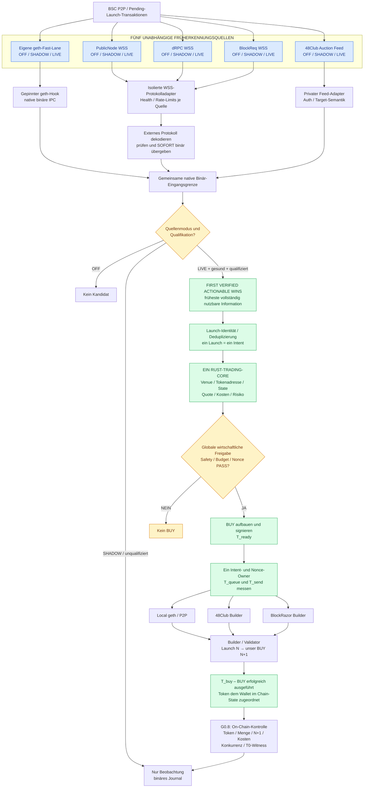
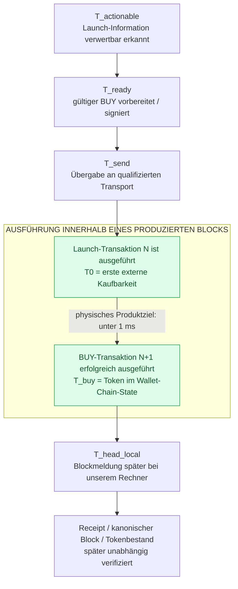

# DarkBot BSC – Early Launch Detection und On-Chain-BUY

**Verbindlicher Plan:** [PHASENPLAN.md (v7)](docs/1_PLAN/PHASENPLAN.md) · **Status:** G0.7/G0.8 vor Produktions-LIVE · **In Arbeit:** ein nativer Rust-BSC-Core, zusätzliche früheste Signaleingänge sind geplant.

DarkBot BSC soll fremde Flap- und Four.meme-Launches möglichst früh erkennen, einen validen BUY rechtzeitig vorbereiten und **als erster unabhängiger externer Käufer direkt auf der BSC ausführen**. Es gibt keinen Trading-Website-, Frontend- oder Browser-Schritt im BUY-Pfad.

**Erfolg = BUY tatsächlich auf der Chain ausgeführt und Token im Wallet-Chain-State erhalten.** Weder das Abschicken noch ein Builder-ACK noch eine Wallet-Anzeige allein zählen als Kauf.

## Architektur – fünf parallele Signaleingänge, eine gemeinsame Engine

GitHub rendert dieses **Mermaid-Blockschaltbild direkt**. Es zeigt die **verbindliche Zielarchitektur** aus Phasenplan §5a, nicht den derzeit bereits produktiv verdrahteten Zustand.

### Technisches Zusammenspiel

1. **Alle fünf Quellen gleichzeitig.** geth, PublicNode, dRPC, BlockReq und 48Club beobachten parallel. Keine Quelle hält eine schnellere auf. 48Club ist ein gesondert zu qualifizierender privater Feed und wird nicht als kostenlos vorausgesetzt.
2. **Externe Protokollgrenze, danach ausschließlich binär.** Ethereum-WebSockets liefern JSON-RPC als **fremdes Netzwerkprotokoll**. Nur der isolierte Provider-Adapter dekodiert diesen Wire-Frame und erzeugt ein geprüftes, typisiertes **Binärereignis**. **Kein internes JSON** – weder IPC, State, Konfiguration, Journal noch HOT0. Die geth-Fast-Lane liefert bereits native binäre IPC.
3. **Individuelle Quellenschalter.** OFF beendet ihren Kandidaten-Ingress; SHADOW empfängt und misst ohne BUY-Auslösung; LIVE darf **nur qualifizierte** Signale an den Core liefern. Jeder Provider hat getrennten Health-/Rate-Limit-/Reconnect-Zustand. Ein LIVE-Signal **schaltet niemals den globalen Handels-Guard scharf**. Notwendige Chain-/Reorg-/Safety-Dienste dürfen nicht mit der geth-Trade-Quelle versehentlich abgeschaltet werden.
4. **First Verified Actionable Wins.** Nicht der früheste nackte Hash, sondern die früheste **vollständig und unabhängig als kaufvorbereitungsfähig verifizierte** Information gewinnt. Keine serielle Providerabfrage und kein Remote-Lookup im nativen HOT0. Doppelte Quellenmeldungen erzeugen keinen zweiten Intent.
5. **Nur eine Trading-Engine.** Derselbe Rust-Core verantwortet Venue-/Deployment-Verifikation, Tokenableitung, Quote, Risiko, Signatur, Intent, Nonce und Exposure. Der BUY geht anschließend über einen **separat qualifizierten** geth-, 48Club- oder BlockRazor-Inclusion-Adapter.
6. **Echter Kauf und unabhängige Prüfung.** Der Produzent führt die Launch-Transaktion und danach unseren BUY aus. G0.8 weist kanonischen Tokenzugang, richtige Walletadresse, Kaufposition N/N+1, konkurrierende erfolgreiche Käufe, Kosten und die getrennte Producer-Timing-Evidence nach.

## Zeitmodell: tatsächlicher BUY im Block, nicht nur abgesendet

**Das 1–2-ms-Ziel darf niemals als bloße Versandlatenz umgedeutet werden.** Gemeint ist: Der tatsächliche BUY muss **beim produzierenden Validator/Builder nach T0 erfolgreich ausgeführt** werden und unseren Tokenbestand im produzierten Chain-State verändern – idealerweise als **direkte Transaktion N+1**. Der verbindliche Grenzwert ist sogar strenger: **T_buy − T0 < 1 ms.** Zwei Millisekunden sind **keine** stillschweigend gelockerte Abnahmeschwelle. Die spätere Anzeige im lokalen Wallet kann länger dauern und gehört nicht zur physischen Kaufzeit.

**BSC-Blockintervall (~450 ms) ist nicht BUY-Latenz.** Das Intervall beschreibt den Rhythmus der Blockproduktion, nicht den Abstand zwischen zwei Transaktionsausführungen innerhalb eines Blocks. **T_head_local ist nicht T0.** Auch 232 ms Vorsprung vor unserer lokalen Blockmeldung beweisen nicht 232 ms Vorsprung vor T0. **N/N+1 beweist die Reihenfolge, aber keine physische Sub-ms-Dauer:** Die benötigt Original-Producer-Ausführungsnachweise; ohne sie gilt die Zeitbewertung **UNKNOWN**.

| Größe | Bedeutung | Beweist tatsächlichen Kauf? |
|---|---|---|
| T_actionable → T_send | Lokale Reaktion und Versand | Nein |
| T0 → T_buy | Tatsächliche erfolgreiche Ausführung nach Launch beim Producer | Strenges Ziel **unter 1 ms**, mit Original-Witness |
| N/N+1 im selben kanonischen Block | Unser BUY direkt nach dem Launch, keine externen erfolgreichen Käufe dazwischen | Beweist Position bei erfolgreicher Akquisition, **nicht** die Zeit |
| T_head_local / lokale Wallet-Anzeige | Späterer Empfang des Blocks / Darstellung des Wallet-Bestands | Weder T0 noch T_buy |

## Entwicklungsstand: Plan und LIVE klar unterscheiden

| Modul | Stand |
|---|---|
| Native geth-Fast-Lane | Bestehende qualifizierte Teilpfade; kein allgemeiner Produktions-LIVE-Nachweis |
| PublicNode | Full-TX-Empfang auf Mac read-only gemessen; noch nicht als Rust-LIVE-Eingang qualifiziert |
| dRPC / BlockReq | Read-only verglichen, teilweise Rate-Limits; keine LIVE-Freigabe |
| 48Club Auction Feed | Berechtigung / Feed-Semantik nicht qualifiziert; kein implizit kostenloser Zugriff |
| Fünf OFF/SHADOW/LIVE-Schalter | Im Phasenplan §5a verbindlich vorgesehen, **noch zu implementieren** |
| G0.7 / G0.8 | **Jetzt vorrangig**: kontrollierter Mainnet-BUY und tatsächliche Token-Akquisitionsprüfung; bis zur gesonderten Freigabe **UNARMED** |
| T_buy − T0 < 1 ms | Unverändertes Ziel, physischer Nachweis noch **UNKNOWN** |

**Verbindliche Reihenfolge:** G0.7 → G0.8 → PASS / ADAPT / STOP → danach C1/C2 und weitere Produktionsphasen. Die fünf Quellen werden nicht als vorgezogene Architekturarbeit umgesetzt. **FREE_ONLY** ist Standard; keine kostenpflichtigen Provider-Abos oder Soul-Point-Kapitalbindung ohne ausdrückliche gesonderte Freigabe.

## Repository-Navigation

| Pfad | Funktion |
|---|---|
| [docs/1_PLAN/PHASENPLAN.md](docs/1_PLAN/PHASENPLAN.md) | **Verbindlicher Phasenplan, Rang 1** – Stop-Regeln, Gesamtfolge, fünf Quellen §5a |
| [docs/1_PLAN/GATE0_TESTPLAN_SHORT.md](docs/1_PLAN/GATE0_TESTPLAN_SHORT.md) | **Abnahmevertrag, Rang 2** – tatsächlicher Kauf und Zeit-/Safety-Evidence |
| [docs/1_PLAN/BSC_PRODUCTION_BUILD_MASTER_PLAN.md](docs/1_PLAN/BSC_PRODUCTION_BUILD_MASTER_PLAN.md) | **Technischer Bauplan, Rang 3** |
| [docs/1_PLAN/STATUS.md](docs/1_PLAN/STATUS.md) / [REVISIONEN.md](docs/1_PLAN/REVISIONEN.md) | Implementierungsstand und Revision v7 |
| [docs/2_REGELN/](docs/2_REGELN/) | Technische Bausteinverträge |
| [docs/3_BEWEISE/](docs/3_BEWEISE/) | Historisches Ledger und getrennte neue Evidence |
| [docs/4_G07_FREIGABE/](docs/4_G07_FREIGABE/) | G0.7-Freigabe-/Requalifikationsunterlagen |
| [docs/5_OFFENE_FEHLER/](docs/5_OFFENE_FEHLER/) | Bug-Register |
| [docs/6_VORSCHLAEGE/](docs/6_VORSCHLAEGE/) | Noch nicht verbindliche Zusatzvorschläge |
| [docs/9_ALT/](docs/9_ALT/) | Historisch, **keine Arbeitsaufträge** |
| [engine/](engine/) | Gemeinsame BSC-Rust-Engine und Tests |
| [geth/](geth/) | Gepinnter bsc-geth und P2P-Fast-Lane |
| [config/](config/) / [tools/](tools/) | Verträge / Diagnose |
| [native/](native/) | Native historische Evidence, keine zweite Trading-Engine |

Die bisherige lange README mit den abgeschlossenen **R1–R13-Refactoring-Aufträgen** wird [unverändert im Archiv](docs/9_ALT/README_BSC_R1_R13_2026-10-16.md) aufbewahrt und ist **keine aktuelle Arbeitsanweisung**.
