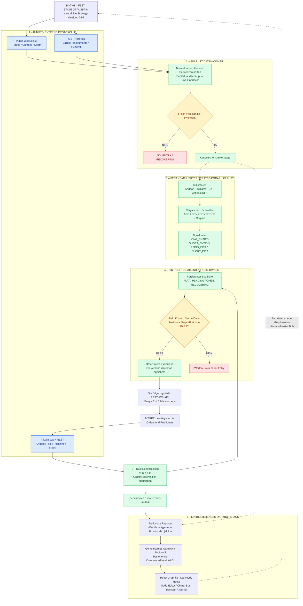
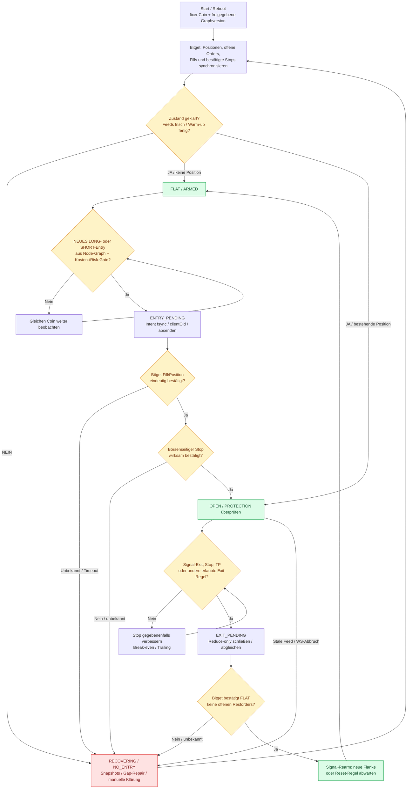
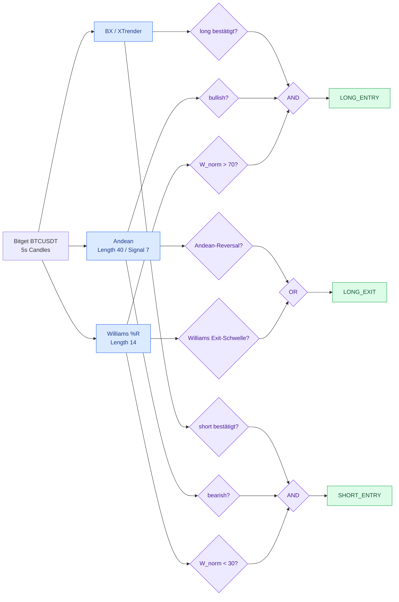

# DarkNode – Bitget 24/7 Rule Trading

> **Status: GATE 1 – KONZEPT / RECHERCHE / PHASENPLAN (OPEN)** · Stand: 26.10.2026  
> **Eigenständiges DarkBot-Projekt** neben `bsc/` und `project_0/`. Kein produktiver Connector, keine Handelsfreigabe, kein deployter Bot.  
> **Verbindliche Planung:** [docs/GATE_1.md](docs/GATE_1.md) · [docs/PHASENPLAN.md](docs/PHASENPLAN.md)

## 1. Produktziel – was DarkNode tun soll

**Ein Bot handelt dauerhaft exakt ein vom Benutzer gewähltes Bitget-Futures-Handelspaar (z. B. BTCUSDT) nach genau einer aktiven, versionierten, unveränderlichen Regelstrategie.** Der Bot arbeitet 24/7 ohne Browser: Marktdaten empfangen, Indikatoren berechnen, Entry-Schwellen prüfen, Position eröffnen, initialen börsenseitigen Stop bestätigen, Stop/Break-even/Trailing und Signal-Exit verwalten, vollständig schließen, auf ein **neues** gültiges Signal warten, wieder einsteigen. Gleicher Coin; keine Coin-Suche, keine autonomen Strategieänderungen.

Der **visuelle Node-Editor gehört zu V1**: Ein Indikator wird als standardisierter Rust-Node hinzugefügt, seine Perioden und Timeframes sowie LONG-/SHORT-/EXIT-Schwellen werden eingestellt, und typisierte Ausgänge per AND/OR/XOR/NOT, Vergleich, CROSS, Confirmation usw. verbunden. Ein neuer Indikator erfordert nur ein konformes Indikator-Modul und sein Registry-Metadatenmodell, keine neue Börsen- oder Trading-Engine.

Später mehrere Bot-Instanzen mit je festem Coin/Graph/Budget auf demselben Bitget-Konto; zunächst **ein Bot Ende-zu-Ende**, danach 4-Bot-Betrieb. Zwei unabhängige Bots auf demselben Kontrakt werden in V1 ausgeschlossen, bis Positionseigentum und Order-Arbitration nachgewiesen sind.

**Nichtziel:** Northtrader-Pro-Vollklon, KI-gesteuerte Trades, Universalplattform für alle Exchanges, TradingView-Webhook als Trade-Authority, beliebige Node-Skripte in der Live-Engine, zweites Frontend/Gateway, garantierte Gewinne.

## 2. Das Gesamtbild – wie in Project_0

Die Systemgrenzen sind absichtlich gleich aufgebaut wie das Mermaid-Systemdiagramm der [Project_0-README](../project_0/README.md): getrennte Datenquellen, eine kanonische Engine, Entscheidung/Gates, eindeutiger Execution-Owner, Exchange-Abgleich und Reporter. **Keine fachliche Vermischung mit Project_0 oder BSC.**

**Datenweg:** externes Bitget-JSON nur im Bitget-Adapter; danach typisierte Rust-Daten, deterministische Strategieevaluation und persistente Orderereignisse. **Frontend-Datenweg:** bestehender Reporter → vorhandenes Gateway → Protobuf-WebSocket → Graphite-React. Browser, React Flow und Charts sind **nie** Order-Authority.

## 3. Trading-Zyklus: immer dasselbe Paar

Ein positiver API-Request ist **kein bestätigter Fill**. Keine blinde Wiederholung nach Timeout. Bei offenem Trade darf die Engine nicht irrtümlich neu eröffnen. Serverbestätigte Bitget-Schutzorders können bei einem lokalen Ausfall bestehen bleiben; lokal berechnete Break-even-/Trailing-Anpassungen laufen ohne Engine nicht weiter. Exakte Kontomodus-/Schutzordersemantik wird in Gate 1 geprüft.

## 4. Node-System V1 – nur die Regeln sind frei verdrahtbar

**Beispiel, keine aus dem Pine-Script abgeleitete feste Entry-Regel:** Benutzer stellt Williams-LONG `>70 %` und SHORT `<30 %` ein. Klassischer Williams %R liegt in **−100 bis 0**. Normierte Anzeige `W_norm = W_raw + 100`: 70 % entspricht −30; 30 % entspricht −70. Rohwert und normalisierter Wert werden im Typ-/Einheitenvertrag unterschieden.

Der User-Graph erzeugt ausschließlich **Signalabsichten**. Entry/Exit sind getrennt. Stop-Management, Kapitalreservierung, Sicherheits-Gates, Bitget-Orders und Reconciliation **liegen außerhalb des frei editierbaren Graphen**. Zusätzliche Signalindikatoren (z. B. RLS) werden später einfach angeschlossen.

### Verbindliches Node-Template

| Einheitlicher Vertrag | Pflicht |
|---|---|
| `type_id / type_version / instance_id` | Fester Typ und reproduzierbare Instanz |
| `parameter_schema` | Typen, Wertebereiche, Defaults, Validation |
| `timeframe / clock / evaluation_policy` | Event, Kerzenschluss oder explizites Intrabar-Verhalten |
| `input_ports / output_ports` | Typisierte Ports **mit Einheit und Domain**: Candle, Scalar, PercentNormalized, Bool3, Signal, PositionRef |
| `warmup / validity / freshness` | Historienbedarf; INVALID/UNKNOWN sperrt neue Entries |
| `snapshot / restore / deterministic_hash` | Zustandswiederaufnahme, Replay, unveränderliche Version |
| `evaluator` | Rust-Modul; gleiche Funktion bei Replay, Backtest und Live |

Logic-Nodes: Compare, GT/LT/GTE/LTE, Between, CrossAbove/Below, AND/OR/XOR/NOT/NOR/NAND, Confirm-N-bars, Rising/Falling, Hysteresis/Reset. Ein Logik-Node verarbeitet `TRUE/FALSE/INVALID` (Kleene/fehlersichere Semantik verbindlich definieren). Kein implizites Umrechnen verschiedener Einheiten oder Timeframes. Zyklen nur als explizit definierte zustandsbehaftete Nodes; sonst DAG und Topologiesortierung. Eine reine Leitung bedeutet **Daten-/Wertabhängigkeit, keinen Thread, keinen WS-Subscribe, keinen Netzwerkaufruf**.

React Flow ist die Oberfläche; Rust validiert/kompiliert das typisierte, via Protobuf gespeicherte Strategy-IR. Dieselben Indikatoren werden nicht pro ausgehendem Kabel neu berechnet. Graphänderung → neue Version/Hash → erneute Backtest-/Freigabeprüfung; laufende Version nicht stillschweigend überschreiben.

## 5. Indikatorreferenz / Pine-Status

Bereitgestelltes Referenzscript: `DarkMa MTF Pressure Scalp v1.0` (Pine v6, derzeit als `indicator()` definiert, **kein ausführender Bitget-Bot**). Sichtbar enthalten: sechs Standard-TFs 5s/10s/30s/1m/5m/10m, Andean 40/7, Williams 14, BX, RLS/Burg/Ghost, OOS-/Triple-Barrier-Labeling und virtuelle Outcome-Kosten. Referenzparameter ≠ bereits gültige Handelsfreigabe. Eintritts-, Exit-, Intrabar-/Barclose- und MTF-Semantik vor Implementierung in eine Golden-Test-Matrix überführen. Nicht alle Visualisierungs-/Forecast-Features müssen in V1 handelnd sein.

## 6. Sicherheit, Kapital und Reconnect

- Bitget-CEX verwahrt Tradingkapital; **MetaMask ist für Bitget-CEX-Futures nicht der Ausführungsaccount**. Bot nutzt restriktiven Trade-/Read-Key ohne Withdrawal; Secrets nur backendseitig, IP-Allowlist.
- Bevorzugt exchange-native Initial-SL mit Bestätigung. Fehlende/unklare Schutzorder: keine neuen Entries, Position anhand qualifizierter Notfallpolicy behandeln.
- Ein Account- und Order-Owner; Bot-Budgets sind zunächst **interne Reservations** und keine automatisch separaten Bitget-Wallets.
- Schutz: Positionslimits, Netto-Break-even unter Gebühren/Slippage/Funding, Stop-Monotonie, Tagesverlustgrenze, eindeutige Position-/Order-Korrelation und UNKNOWN-Holds.
- Datenausfall, Timeouts, Teilfills, Abbruch zwischen Send/ACK/Fill, Fremdorders und Neustarts gehören zur verpflichtenden Fault-Injection-Testmatrix.
- Keine Gewinnzusage durch Schwellen/Stopps. Positives Nettoergebnis ist **nach Kosten und Out-of-Sample** zu messen, nicht durch den automatischen Wiedereinstieg garantiert.

## 7. Technologie und Integrationsgrenzen

| Ebene | Festlegung für Planung |
|---|---|
| Exchange | Bitget; **zunächst USDT-M Futures**; UTA-V3-/Kontomodus-Kompatibilität in G1 prüfen |
| Realtime | Ein Rust Bitget Public/Private Adapter; benötigte REST-Aufrufe isoliert |
| Historie | Backfill, Dedupe, Qualität, zeitkausales Replay, Arrow/Parquet als Kandidat |
| Indikatoren / Graph | Rust, ein deterministischer Evaluator; Graphversionen immutable |
| Stops / Execution | Zentraler Rust Order-/Risk-/Reconcile-Owner |
| Backtest | Gleicher Rust Strategie-/Event-Kern, realistische Gebühren/Fills; NautilusTrader vs eigener Kern und HftBacktest evaluieren |
| Node-Editor | `@xyflow/react` / React Flow; **ab V1 funktional**, nicht erst optional nach Live |
| Charts | TradingView Lightweight Charts, technische Kompatibilität prüfen |
| Frontend | Vorhandene React-Graphite-SPA; keine zweite Navigation oder Styles |
| Transport | `prost` (Rust) / `protobuf-es` (TS) und das **eine** DarkBot-Gateway; kein neues WS-System |
| Status/Belege | Echtes Order-/Trade-Journal; keine Mock-PnL oder simulierten READY-Zustände |

Die aktuellen DarkBot-Projektnummern/Topics sind in [topics.proto](../protocol/schemas/darkbot/control/v1/topics.proto) definiert, die Navigation in [projectRegistry.ts](../frontend/src/app/projectRegistry.ts). Erweiterung nur versioniert nach Schema-Governance. Nummern `70–89` sind **Vorschlag, noch keine Reservierung**. Bestehende Reiter und BSC-/P0-Funktion unverändert.

## 8. Dokumente, Research und Umsetzungsfolge

- **[Gate 1 – Stand, Quellen, Entscheidungen, offene Punkte](docs/GATE_1.md)** – Discovery-/Konzept-Gate; noch nicht abgenommen.
- **[Verbindlicher Phasenplan als Planungsbaseline](docs/PHASENPLAN.md)** – Implementierungsfolge, Nachweise und PASS-Bedingungen. Noch keine Freigabe zur Echtgeld-Ausführung.
- Technisches Vorbild: [Project_0 README](../project_0/README.md), gemeinsamer Vertrag [frontend/README](../frontend/README.md).
- Externe Referenzen (Bitget-Docs, Open-Source-Projekte, Lizenzen) mit Verifikationsstatus im Gate-1-Dokument.

**Oberstes Prinzip:** _Ein Coin · ein festes Regelwerk pro Bot · exakt ein Rust Trading-Kern · sauber typisierte Nodes · Stop/Order-Sicherheit · gleicher Backtest/Live-Code · bestehendes Protobuf-Frontend._
