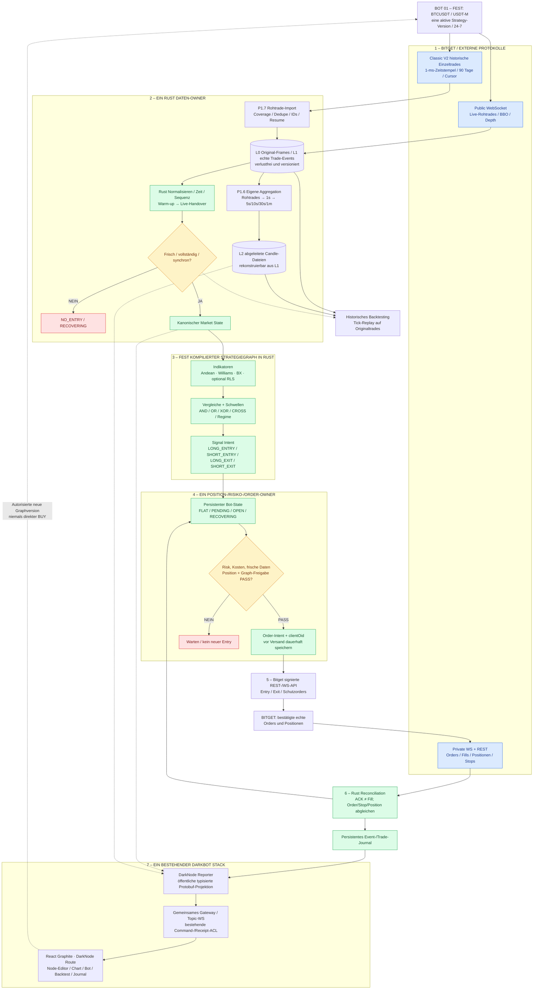
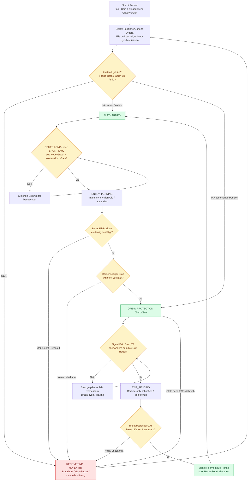
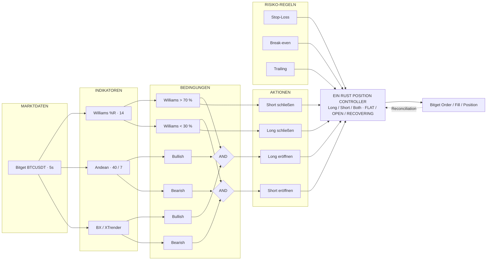
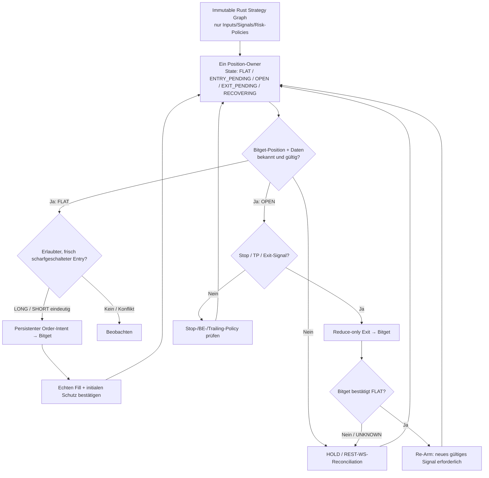

# DarkNode – Bitget 24/7 Rule Trading

> **Status: GATE 1 – KONZEPT / RECHERCHE / PHASENPLAN (OPEN)** · Stand: 26.10.2026  
> **Eigenständiges DarkBot-Projekt** neben `bsc/` und `project_0/`. Kein produktiver Connector, keine Handelsfreigabe, kein deployter Bot.  
> **Verbindliche Planung:** [docs/GATE_1.md](docs/GATE_1.md) · [docs/PHASENPLAN.md](docs/PHASENPLAN.md) · [P1-Phasenplan V1.1](docs/PHASENPLAN_P1_V1.md) · [Endpoint-Registry](docs/ENDPOINT_REGISTRY.md)

## 1. Produktziel – was DarkNode tun soll

**Ein Bot handelt dauerhaft exakt ein vom Benutzer gewähltes Bitget-Futures-Handelspaar (z. B. BTCUSDT) nach genau einer aktiven, versionierten, unveränderlichen Regelstrategie.** Der Bot arbeitet 24/7 ohne Browser: Marktdaten empfangen, Indikatoren berechnen, Entry-Schwellen prüfen, Position eröffnen, initialen börsenseitigen Stop bestätigen, Stop/Break-even/Trailing und Signal-Exit verwalten, vollständig schließen, auf ein **neues** gültiges Signal warten, wieder einsteigen. Gleicher Coin; keine Coin-Suche, keine autonomen Strategieänderungen.

Der **visuelle Node-Editor gehört zu V1**: Ein Indikator wird als standardisierter Rust-Node hinzugefügt, seine Perioden und Timeframes sowie LONG-/SHORT-/EXIT-Schwellen werden eingestellt, und typisierte Ausgänge per AND/OR/XOR/NOT, Vergleich, CROSS, Confirmation usw. verbunden. Ein neuer Indikator erfordert nur ein konformes Indikator-Modul und sein Registry-Metadatenmodell, keine neue Börsen- oder Trading-Engine.

Später mehrere Bot-Instanzen mit je festem Coin/Graph/Budget auf demselben Bitget-Konto; zunächst **ein Bot Ende-zu-Ende**, danach 4-Bot-Betrieb. Zwei unabhängige Bots auf demselben Kontrakt werden in V1 ausgeschlossen, bis Positionseigentum und Order-Arbitration nachgewiesen sind.

**Nichtziel:** Northtrader-Pro-Vollklon, KI-gesteuerte Trades, Universalplattform für alle Exchanges, TradingView-Webhook als Trade-Authority, beliebige Node-Skripte in der Live-Engine, zweites Frontend/Gateway, garantierte Gewinne.

## 2. Das Gesamtbild – wie in Project_0

Die Systemgrenzen sind absichtlich gleich aufgebaut wie das Mermaid-Systemdiagramm der [Project_0-README](../project_0/README.md): getrennte Datenquellen, eine kanonische Engine, Entscheidung/Gates, eindeutiger Execution-Owner, Exchange-Abgleich und Reporter. **Keine fachliche Vermischung mit Project_0 oder BSC.**

**Datenweg:** **Historisch echte öffentliche Einzeltrades (Unix-ms, im Test 1 ms) vollständig laden und verlustfrei in L1 speichern. Die 1s-, 5s-, 10s-, 30s- und 1m-Candles für Backtest und Charts erzeugt DarkNode selbst aus den Rohtrades; Bitget-REST-1m-Candles sind nur Referenz. Original-Rohtrades bleiben für Tick-Replay erhalten, aus Candles kann man die vollständigen Trades nicht wiederherstellen.** Siehe [P1-Phasenplan V1.2](docs/PHASENPLAN_P1_V1.md) und [historische Mess-Evidenz](docs/P1_EVIDENCE/BITGET_HISTORICAL_RAW_TRADES_TIME_RATE_2026-10-27.md). **DN-D18: kein internes JSON** – externes Bitget-JSON nur im Bitget-Adapter (opake Originalframes zulässig in L0); danach typisierte Rust-/Protobuf-/Binärdaten. **DN-D19:** SQLite als kleiner Control-/Registry-Store, Marktvolumen in eigenen L0/L1/L2-Dateien; deterministische Strategieevaluation und persistente Orderereignisse. **Frontend-Datenweg:** bestehender Reporter → vorhandenes Gateway → Protobuf-WebSocket → Graphite-React. Browser, React Flow und Charts sind **nie** Order-Authority.

## 3. Trading-Zyklus: immer dasselbe Paar

Ein positiver API-Request ist **kein bestätigter Fill**. Keine blinde Wiederholung nach Timeout. Bei offenem Trade darf die Engine nicht irrtümlich neu eröffnen. Serverbestätigte Bitget-Schutzorders können bei einem lokalen Ausfall bestehen bleiben; lokal berechnete Break-even-/Trailing-Anpassungen laufen ohne Engine nicht weiter. Exakte Kontomodus-/Schutzordersemantik wird in Gate 1 geprüft.

## 4. Node-Builder V1 – verbindliche visuelle Referenz

**[Interaktiven Builder herunterladen / als HTML lokal öffnen](docs/visuals/builder_examples.html)** · [Gate-1-Node-Spezifikation](docs/GATE_1.md#node-builder-referenz-und-drei-verbindliche-beispiele).

**Wichtig zur Darstellung auf GitHub:** Mermaid wird direkt in dieser README gerendert; GitHub führt eingebettetes HTML/JavaScript nicht als interaktive App aus. Die Datei `docs/visuals/builder_examples.html` ist deshalb ein **eigenständiger, offline lauffähiger HTML-Prototyp**. Datei herunterladen und im Browser öffnen. Sie ist kein produktiver React-Flow-Build und speichert weder in Git noch im Backend. Der visuelle Rahmen entspricht dem bestehenden **Graphite-Design**, die DarkNode-Reiter sind ausschließlich **Overview, Builder, Backtest, Live, Wallet**. Im Builder links nur **Nodes** mit fünf Kategorien; Parameter **direkt im Node**, kein Node Inspector, keine Signalprüfung, keine eigenen Monitoring-/Gate-Anzeigen.

### Gemeinsamer Signalweg

**Action-Nodes erzeugen nur typisierte Intents, niemals unmittelbare Bitget-Orders.** Der einzig autoritative Rust-Position-/Risk-/Execution-Owner löst widersprüchliche Signale, Stop/Exit-Priorität, echten Positionsstatus und Re-Arm. Die beispielhaften Exit-Eingänge oben sind einfache Anschlüsse; in der Strategie können sie eigene unabhängige Vergleichs- oder Logikketten besitzen.

### Drei umschaltbare Builder-Vorlagen

| Vorlage | Entry-Regeln | Exit-Regeln | Zweck |
|---|---|---|---|
| **01 · Williams Long/Short** | LONG: Wnorm > 70 %, SHORT: Wnorm < 30 % | LONG-Exit: Wnorm < 55 %, SHORT-Exit: Wnorm > 45 % | Vier unabhängige Signalpfade auf **einen** Controller |
| **02 · Williams + Andean + BX** | LONG: (Wnorm > 70) AND Andean Bull AND BX Bull; SHORT spiegelbildlich mit Wnorm < 30 | Separate Schwellen (Beispiel 55/45) | Mehrere Indikatoren per AND kombinieren |
| **03 · Cross / Exit / Re-Entry** | LONG: CrossAbove Wnorm 70, SHORT: CrossBelow Wnorm 30 | Exit über neue 55-/45-Cross-Ereignisse | Edge-Signale und erneutes Scharfschalten nach bestätigtem Schließen |

**Alle Zahlen und Signalpfade sind ausschließlich Entwurfs-/UX-Beispiele und keine validierte Pine-Strategie oder Handelsfreigabe.** Klassischer Williams %R: −100 bis 0; `Wnorm = Wraw + 100`, Einheit und Zeitrahmen im Node-Typ prüfen. Ab V1 sind die fünf Kategorien **Marktdaten, Indikatoren, Bedingungen, Aktionen, Risiko** sichtbar. Erlaubte Verbindungen sind typisiert (`Candle`, `Scalar<unit>`, `Bool3`, `SignalIntent`, `RiskPolicy`); unpassende Einheiten/Ports, Rückkopplung ohne Delay, STALE/INVALID werden vor Handel geblockt. Der Controller hat **keine** frei verknüpfbare Möglichkeit, die Risk-/Execution-Gates zu umgehen.

### 24/7-Laufzeit und wichtigste Prioritäten

**24/7 bedeutet:** die Rust-Engine läuft auf einem dauerhaft betriebenen Host und bleibt unabhängig von einem geöffneten DarkBot-Frontend. Exchange-native bestätigte Stops können weiterbestehen, lokale dynamische Stopanpassungen benötigen die laufende Engine. Erst Backtest/Replay → Bitget Demo → Fault-Gates → separat autorisiertes LIVE.

## 5. Indikatorreferenz / Pine-Status

Bereitgestelltes Referenzscript: `DarkMa MTF Pressure Scalp v1.0` (Pine v6, derzeit als `indicator()` definiert, **kein ausführender Bitget-Bot**). Sichtbar enthalten: sechs Standard-TFs 5s/10s/30s/1m/5m/10m, Andean 40/7, Williams 14, BX, RLS/Burg/Ghost, OOS-/Triple-Barrier-Labeling und virtuelle Outcome-Kosten. Referenzparameter ≠ bereits gültige Handelsfreigabe. Eintritts-, Exit-, Intrabar-/Barclose- und MTF-Semantik vor Implementierung in eine Golden-Test-Matrix überführen. Nicht alle Visualisierungs-/Forecast-Features müssen in V1 handelnd sein.

## 6. Sicherheit, Kapital und Reconnect

- Bitget-CEX verwahrt Tradingkapital; **MetaMask ist für Bitget-CEX-Futures nicht der Ausführungsaccount**. Bot nutzt restriktiven Trade-/Read-Key ohne Withdrawal; Secrets nur backendseitig, IP-Allowlist.
- Bevorzugt exchange-native Initial-SL mit Bestätigung. Fehlende/unklare Schutzorder: keine neuen Entries, Position anhand qualifizierter Notfallpolicy behandeln.
- Ein Account- und Order-Owner; Bot-Budgets sind zunächst **interne Reservations** und keine automatisch separaten Bitget-Wallets.
- Schutz: Positionslimits, Netto-Break-even unter Gebühren/Slippage/Funding, Stop-Monotonie, Tagesverlustgrenze, eindeutige Position-/Order-Korrelation und UNKNOWN-Holds.
- Datenausfall, Timeouts, Teilfills, Abbruch zwischen Send/ACK/Fill, Fremdorders und Neustarts gehören zur verpflichtenden Fault-Injection-Testmatrix.
- Keine Gewinnzusage durch Schwellen/Stopps. Positives Nettoergebnis ist **nach Kosten und Out-of-Sample** zu messen, nicht durch den automatischen Wiedereinstieg garantiert.

## 7. Technologie und Integrationsgrenzen

| Ebene | Festlegung für Planung |
|---|---|
| Exchange | Bitget; **zunächst USDT-M Futures**; UTA-V3-/Kontomodus-Kompatibilität in G1 prüfen |
| Realtime | Ein Rust Bitget Public/Private Adapter; benötigte REST-Aufrufe isoliert |
| Historie | **Classic-V2 öffentliche Einzeltrades (1-ms-Zeitstempel, 90-Tage-API-Grenze), selbst zu 1s/5s/10s/30s/1m aggregieren.** L0/L1-Rohdaten für Tick-Replay erhalten, L2-Candle-Cache rekonstruierbar, SQLite nur Control-/Gap-/Manifestdaten; ClickHouse ausschließlich Benchmarkreferenz R2c |
| Indikatoren / Graph | Rust, ein deterministischer Evaluator; Graphversionen immutable |
| Stops / Execution | Zentraler Rust Order-/Risk-/Reconcile-Owner |
| Backtest | Gleicher Rust Strategie-/Event-Kern, realistische Gebühren/Fills; NautilusTrader vs eigener Kern und HftBacktest evaluieren |
| Node-Editor | `@xyflow/react` / React Flow; **ab V1 funktional**, nicht erst optional nach Live |
| Charts | TradingView Lightweight Charts, technische Kompatibilität prüfen |
| Frontend | Vorhandene React-Graphite-SPA; keine zweite Navigation oder Styles |
| Transport | `prost` (Rust) / `protobuf-es` (TS) und das **eine** DarkBot-Gateway; kein neues WS-System |
| Status/Belege | Echtes Order-/Trade-Journal; keine Mock-PnL oder simulierten READY-Zustände |

Die aktuellen DarkBot-Projektnummern/Topics sind in [topics.proto](../protocol/schemas/darkbot/control/v1/topics.proto) definiert, die Navigation in [projectRegistry.ts](../frontend/src/app/projectRegistry.ts). Erweiterung nur versioniert nach Schema-Governance. Nummern `70–89` sind **Vorschlag, noch keine Reservierung**. Bestehende Reiter und BSC-/P0-Funktion unverändert.

## 8. Dokumente, Research und Umsetzungsfolge

- **[Gate 1 – Stand, Quellen, Entscheidungen, offene Punkte](docs/GATE_1.md)** – Discovery-/Konzept-Gate; noch nicht abgenommen.
- **[Verbindlicher Phasenplan als Planungsbaseline](docs/PHASENPLAN.md)** – Implementierungsfolge, Nachweise und PASS-Bedingungen. Noch keine Freigabe zur Echtgeld-Ausführung.
- Technisches Vorbild: [Project_0 README](../project_0/README.md), gemeinsamer Vertrag [frontend/README](../frontend/README.md).
- Externe Referenzen (Bitget-Docs, Open-Source-Projekte, Lizenzen) mit Verifikationsstatus im Gate-1-Dokument.

**Oberstes Prinzip:** _Ein Coin · ein festes Regelwerk pro Bot · exakt ein Rust Trading-Kern · sauber typisierte Nodes · Stop/Order-Sicherheit · gleicher Backtest/Live-Code · bestehendes Protobuf-Frontend._
