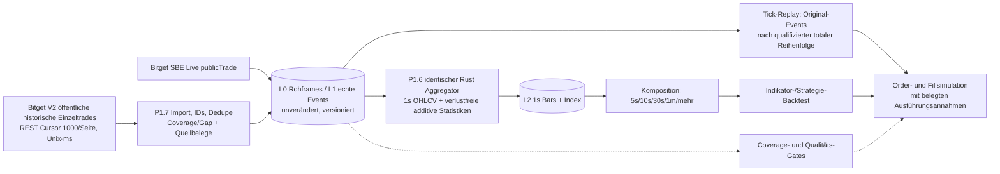

# DarkNode P1 – Zusammensetzbare Trade-Bars und Reihenfolge V1.0

**Stand:** 27.10.2026 · **Scope:** Bitget BTCUSDT USDT-M Futures · **Status:** Vertragsentwurf, Implementierung/Abnahme NOT_RUN.  
**Verbindlicher Zusammenhang:** [P1-Phasenplan](PHASENPLAN_P1_V1.md) P1.6/P1.7, Tests T25–T27; [gemessene Zeit-/Datenrate](P1_EVIDENCE/BITGET_HISTORICAL_RAW_TRADES_TIME_RATE_2026-10-27.md).

## 1. Grundsatz: Rohtrades sind die Autorität

Alle verfügbaren echten öffentlichen Einzeltrades werden verlustfrei und mit Herkunft, Instrumentversion, Original-ID, ursprünglichem Preis/Menge/Side, Exchange-Time und Quellenreihenfolge in **binärem L1** gehalten (vorherige Raw-Frames in L0 soweit verfügbar). **Niemals** 1-Minuten-Candles in 1-Sekunden-Candles rückrechnen. Historische `/api/v2/mix/market/fills-history`-Trades (Unix-ms, im Test kleinster positiver Abstand 1 ms, bis 90 Tage zurück) fließen über denselben versionierten Rust-Aggregationskern wie die live aufzeichneten SBE-Trades. Nur qualifizierte Zeitintervalle dürfen einen Backtest als vollständig abdecken; `UNKNOWN`/`GAP` sperren den qualitätsabhängigen Backtest.

## 2. L2-Bar-Vertrag – genau zusammensetzbar wo mathematisch möglich

| Feldgruppe | Kanonische Felder pro 1s-Bar | Regeln für 1s → MTF |
|---|---|---|
| Intervall/Quelle | `start_ns/end_ns`, `instrument_id`, `dataset_version`, `policy_version`, `source_scope`, `quality/coverage` | Halboffene Intervalle; Dataset- und Versionsgleichheit zwingend; `quality`/Gap wird vereint, nicht wegaggregiert |
| OHLC | `open/high/low/close` **Fixed-Point**, `first/last_trade_order_key` | Open vom ersten, Close vom letzten Trade nach **qualifizierter** Ordnung; High/Low als Extrema |
| Extrem-/Rand-Ticks | `first_ts,last_ts,high_ts,low_ts` plus vollständige Tie-Break-Order-Keys / Multi-Extrema-Tie-Policy | Auf MTF korrekte früheste/späteste Ereignisse und Gleichstände deterministisch fortsetzen |
| Mengen | `base_volume`, `quote_notional_sum`, `trade_count` als exakte skalierte Ganzzahlen/überlaufgeprüfte Summen | Volumina/Zähler addieren; VWAP **erst am Ende** als quote_sum/base_sum berechnen; Zwischenbar-VWAP nicht ungewichtet mitteln |
| Richtung (nur bestätigte Semantik) | `buy/sell_base_volume`, `buy/sell_quote_sum`, `buy/sell_count` | Je Side addieren; `delta=buy-sell`; Exchange-`side` ist vor Interpretation als Aggressor gegen Vertrag/echte Beispiele zu qualifizieren |
| Größe | `max_trade_qty` + Order-Key; für **vorab versionierte** Schwellen `count/volume_above_threshold` | Max/Order-Key deterministisch wählen; vorab definierte Schwellen summieren; **beliebig nachträglich veränderbare Schwellen** benötigen Rohtrade-Replay |
| Millisekunden-Cluster | `max_trades_per_ms` mit Zeit-/Tie-Key; optional gruppierte Counts je Millisekunde nur über Rohdaten | Maximum nur bei exakt disjunkten 1s-Intervallen zusammensetzbar; **gleiche ms ≠ bewiesener Sweep einer einzigen aggressiven Order** |
| Herkunft | geordnete erste/letzte Original-Trade-ID mit `source`, `order_key`, Input-Hash/Range-Index, L1-Version | Zeigt auf originale Trades; allein erste/letzte ID beweist weder vollständige Kontiguität noch dieselbe Markt-Reihenfolge |
| Unsicherheit | `ORDER_UNRESOLVED`, `GAP`, `TIME_UNCERTAIN`, `SIDE_UNQUALIFIED` und provenienzgebundene Flags | Downstream propagieren; keine exakte Intrabar-Reihenfolge/Fill-Sicherheit behaupten |

**Notwendige Mathematik:** Integer/fixed-point mit instrument-versionierter Preis-/Mengen-Skalierung, gesichert gegen Overflow. `quote = price × size` braucht eine passende Produktskala/breiten Integer und darf bei Zwischenschritten **nicht** gerundet werden. Nulltrade-Sekunden nur nach dokumentierter R4-Policy (echtes leeres Intervall vs. unbekannte Abdeckung). Median, Quantile, Preis-/Volumenprofile, frei wechselnde Großtrade-Schwellen und beliebige Sequenz-/Sweep-Muster lassen sich aus dieser kompakten L2-Projektion **nicht** exakt zurückgewinnen und müssen aus L1 berechnet werden.

**MTF-Gleichheit (T27):** dieselben versionierten und vollständig geordneten Trades, gleiche Side- und Tie-Policy, gleiche Bar-Intervallgrenzen, `DirectAggregate(L1, 1m)` ≡ `Merge(Aggregate(L1, 1s), 1m)` **für jedes als kompositionsfähig spezifizierte Feld**, bei unveränderter Integerrepräsentation. Nichtkomponierbare Merkmale dürfen diesen Gleichheits-Test weder still fehlen noch fälschlich als exakt beworben werden.

## 3. Zeitkollisionen und Trade-Ordnung – offene fachliche Abnahme (T26)

Gemessen: **20.000** aktuelle Futures-Trade-Records mit **13.989 redundanten Millisekunden-Zeitstempeln**; **5.000** ältere Trades mit **3.216** solchen Kollisionen. **0 doppelte Trade-IDs** in beiden Abrufen. REST-V2 liefert `tradeId` **absteigend** sortiert; Bitgets SBE-Trade-Guide bezeichnet `execId` als **monoton steigend** und für Message Ordering nutzbar. Das **stützt** eine Ordnungshypothese, ersetzt aber keinen Beweis, dass REST-`tradeId` und SBE-`execId` im gewählten Markt und Zeitraum dieselbe Ordnungssemantik haben.

**T26 Prüfplan:** Gleichzeitigen Live-SBE-Trade-Mitschnitt und REST-Overlap sammeln; jedes gemeinsame (Instrument, Trade-ID, Preis, Menge, Side, Zeit) matchen; für gleiche Millisekunden das ID-Monotonieverhalten, Push-Batch-Order und REST-Absteigreihenfolge vergleichen; Gruppe mit mehreren Preisstufen und gleichgerichteten `side` als **Plausibilitätsindiz** für Sweep-Richtung auswerten. Gegenbeispiele zwingend protokollieren. Der Sweep-/Preisverlauf ist **keine hinreichende Evidenz** für eine gemeinsame Mutterorder, da öffentliche Trade-Felder normalerweise keine vollständige Aggressor-Order-ID garantieren.

**Wenn T26 offen/negativ:** Tick-Total-Order als `UNRESOLVED` markieren, `open/close/high_ts/low_ts` bei Gleichstand nur unter deklarierter deterministischer Policy; Backtest-Simulator darf nicht exakte First-Touch-Fills in dieser Millisekunde behaupten. Der kanonische deterministische Replay-Order-Key muss eine formell qualifizierte Policy und Quellsequenz enthalten, nicht nur `ts` oder rohe Frame-Listenposition.

## 4. Backtest und Fill-Semantik

- **Indikatoren** (Williams/Andean/BX) lesen qualifizierte selbstaggregierte 1s-/MTF-Bars; **Fill-Simulation** verarbeitet vollständige Rohtrades mit qualifizierter Ordnung. Backtest und Live nutzen denselben verifizierten Indikator-/Graph-/Risikocode, Ausführung wird modelliert, nicht als tatsächlich getätigter Fill ausgegeben.
- Aus Trade-Ticks kann man die Reihenfolge von beobachteten **letzten Preisen** nachvollziehen, **sofern** T26 sie eindeutig bestätigt. Dies **löst nicht** in jedem Fall die SL/TP-Intrabar-Frage: bei identischem Zeitstempel ohne beweisbare Ordnung bleibt die Reihenfolge unklar. Für Orders mit Mark-/Index-/BBO-Trigger oder Limit-Queue sind diese Daten ohnehin **nicht genug**.
- Marktpreisberührung durch öffentliche Trades garantiert weder eigene Limit-Ausführung noch Queue-Priorität; Taker/Spread/Fees/Funding/Slippage, Trigger-Referenz (last/mark/index) und im Zweifel fehlende historische BBO/Depth-Daten sind als explizite Simulation-/Quality-Annahmen zu prüfen, sonst Teststatus `INSUFFICIENT_DATA` statt präzisem Fill.

## 5. Zusätzliche zeitlich getrennte BBO-/Depth-Daten

Nur bei echter lokaler Aufzeichnung oder getrennt verifiziertem Depth-Historienarchiv: Spread min/max/zeitgewichtete Integrale **plus Expositionsdauer**, BBO Mid/Size zum Bar-Ende und Depth50-Ungleichgewicht, Mark-/Index-Close/Funding-Gültigkeitsbereich. Die Zeitgewichtung von Spread ist nur korrekt zusammensetzbar, wenn **Integralsumme und Zeitdauer** über belegte Intervalle addiert werden; ein Mittelwert pro 1s alleine reicht nicht. Daten mit anderer Herkunft/Zeitskala dürfen nicht ohne synchronisierten Zeit-/Coverage-Vertrag in Trade-Bars eingerechnet werden.

## 6. Verbindliche Tests und Beweisstatus

| Test | PASS-Bedingung | Status 27.10.2026 |
|---|---|---|
| **T25** | Echte historische Futures-Einzeltrades → 1s/MTF, ohne 1m-Rückrechnung, nach Coverage qualifiziert | **NOT_RUN** im Rust-Code |
| **T26** | Reale Live-SBE-/REST-ID-Parität **und** qualifizierte eindeutige Ordnung gleicher Millisekunden; Gegenbeispiele/Unklarheiten fail-closed | **NOT_RUN** |
| **T27** | **Für alle dokumentierten kompositionsfähigen L2-Felder** direkter MTF-Aggregat-Hash = 1s→MTF-Hash; gleiche Ties, Qualitätsmerkmale, Integer-Summen, Versionsbindung | **NOT_RUN** |
| **R2 V5** | Fehlschlagende **echte** Frames gesichert, XML-Schema gehasht, generierter typisierter Decoder, ausreichend langer Demo-Lauf ohne Parserfehler, Resnapshot- und Sequenzlückentest | **FAIL/INCONCLUSIVE**: 8 Parserfehler in 62 empfangenen V5-Frames im 60s-Lauf |

**Abnahme-/Scope-Regel:** Kein Mock als Live-Evidenz, keine unbestätigten Aussagen über eindeutige Sweep-Order oder exakte SL-/TP-Fills. Die 7-Tage-P1-Gesamtabnahme bleibt NOT_RUN, Gate 1 OPEN.

## 7. Primärquellen

- [Bitget UTA SBE Schema V5, XML und Depth50](https://www.bitget.com/docs/uta/websocket/sbe/sbe-intro)
- [Bitget SBE Trade Integration Guide – `execId` monoton](https://www.bitget.com/legacy-docs/uta/sbe/sbe-trade)
- [Bitget Classic Futures History – `tradeId` absteigend, Millisekunden](https://www.bitget.com/docs/catalog/classic-contract-market/classic-contract-market)
- [Bitget Update Preview – books50 V5 ab 05.11.2026](https://www.bitget.com/docs/uta/update-preview)
