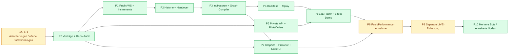

# DarkNode – Verbindlicher Phasenplan (Planungsbaseline)

**Version:** 0.2 · **Stand:** 27.10.2026 · **Status:** DRAFT / GATE 1 OPEN · **Änderung:** verbindlicher Projekt-/Protobuf-Feldabgleich als durchgehendes P0–P10-Entwicklungsgate (nur Planung, keine Implementierung)  
**Scope:** `darknode/` mit eigenem Rust-Owner; ein vorhandenes DarkBot-Frontend/Gateway; Bitget als initiale einzige Exchange. Kein LIVE, kein Deploy und keine Implementation durch diesen Dokumentations-Commit.  
**Maßstab:** Jede Phase ist erst fertig, wenn ihre Nachweise am festen Commit reproduzierbar sind. **P0–P10** sind Umsetzungsphasen **nach** dem vorgeschalteten Research-**GATE 1**.

## 0. Erfolgsdefinition und Reihenfolge

Der Benutzer wählt **BTCUSDT** (Beispiel), erzeugt im Node-Editor eine STRATEGIE V1, definiert Williams-/Andean-/BX-Regeln, testet sie und schaltet einen Bot auf Bitget Demo. Dieser handelt niemals andere Coins oder unfreigegebene Strategien. Ein bestätigter Trade wird nach expliziter Exit-Regel geschlossen und nach erfolgreicher Bestandsprüfung wird auf ein neues Entry-Ereignis gewartet. Der initiale Stop ist möglichst börsenseitig bestätigt; nach Reconnect werden Order, Position und Schutzstatus abgeglichen. Dieselbe Indikator-/Graphsemantik wird in Live und Replay verwendet.

**Reihenfolge der kritischen Abhängigkeiten:**

**Node-Editor ist Teil des ersten nutzbaren V1-Produkts.** UI-Arbeit kann parallel zu Adapter-/Engine-Arbeit vorbereitet werden; der qualifizierte E2E-Pfad wartet auf beide. Ein zweiter Simple-/Advanced-Strategiekern ist ausdrücklich verboten.

## P0 – Baseline, Source-Audit, ADRs und Protobuf-Verträge

**Auftrag:** `darkbot` und `ws_ai` auf SHA fixieren, `project_0/` und `bsc/` ausdrücklich unverändert lassen; alle vorhandenen WS-/Order-/DB-/Historien-/Chartpfade prüfen. Fremdbibliotheken/Lizenzen inventarisieren. Exakten Bitget-Futures-/Kontomodus und fachliche Besitzer festlegen. Neue Projektdomäne, Topic-ID-Plan, Protobuf-Payloads, Commands/Receipts, Readiness und Anti-Mock-Regeln gegen das tatsächliche Gateway/Wire-Protokoll erstellen. **Vor der Umsetzung** die in Abschnitt „Querschnittsvertrag DN-PROTO“ definierte dreifach getrennte Projektidentität, Feldinventur und kontinuierliche Rust→Proto→Gateway→Frontend-Testkette festlegen; kein Projekt-ID-/Topic-Push vor dem Governance-Gate.

**Artefakte:** `SOURCE_BASELINE.md`, `WS_AI_PORT_INVENTORY.md` (KEEP/PORT/REPLACE/DELETE), `ADRS.md`, `PROTO_FIELD_CENSUS.md` (**vollständige Source-to-UI-Feld-/Parameter-/Aktionsmatrix, inklusive absichtlich interner Felder und Begründung**), versionierter Protobuf-Schemaentwurf, `EXCHANGE_CAPABILITIES.md` sowie `DN_PROTO_CONTRACT_CHECKS.md` (geplante Gate-IDs DN-PROTO-001–008, Automations-/CI-Pfade und Verantwortliche).

**Abnahme:** keine kollidierenden IDs/Topics, vorhandene Protobuf-Codegenerierung und Schema-/Breaking-Tests bestehen, ACL/Command-Lifecycle getestet; keine Parallel-Frontend-/Gateway-Struktur, keine Liveautorisierung. **DN-PROTO-001–003**: Eigentum/ID/Topic-Bereich und vollständig inventarisierter Feldvertrag geprüft; neue fachliche Felder ohne nachvollziehbare UI-Projektion oder dokumentierte Nichtanzeige führen zu `FAIL`, nicht still zu „fertig“.

## P1 – Bitget öffentliche Daten (Rust)

**Auftrag:** eindeutiger Public-WS-Owner pro Exchange-Konto/Instrument; Instrument-Katalog (Tick, Step, Mindestgrößen, Futures-Funding/Contractspecs), Trades, marktbezogene Candles, Orderbook-Events und Markprice gemäß getesteter API. Bounded Queues, Sequenz-/Gap-Kontrolle, Heartbeat, Reconnect und Resubscribe. Fremdprotokoll nur im Adapter.

**Artefakte:** Feed-Adapter, Event-Typen, Health-Metriken, konfigurierbare Quellen, rohe und kanonische Testcaptures.

**Abnahme:** Determinismus, keine doppelten Events, keine verlorenen Book-Deltas ohne `STALE`, geplanter längerer Capture mit simuliertem Offline/Online; p50/p95/p99, Backpressure, Recovery-Success dokumentiert. Noch keine Orders.

## P2 – Historie, Warm-up, Data Handover und Storage

**Auftrag:** REST-History/Pagination, echte Trades und Candles; Seconds-TFs (5s/10s/30s) nur aus zeitlich passenden Trade- oder fein genug vorhandenen Daten aggregieren; Funding/Mark-Price-History soweit nötig. Datenmanifest mit Quellen, Zeithorizont, UTC, Nanosekunden/Zeiteinheit, Gaps, Dedupe, Revisionsverhalten; lokaler Parquet/Arrow-Cache optional nach Messung. Erst Historie/Indikatorwarmup, dann überlappungsfreies Live-Handover.

**Artefakte:** verifizierbare Datasets, Capture/Backfill-CLI, `DATA_QUALITY.md` und Replay-Testfixtures.

**Abnahme:** Datenlücken/Fehlfolgen werden erkannt statt übersprungen, bei ungenügender Historie `NO_ENTRY`; Wiederholungsdownload derselben Quelle liefert identische Zeitreihen, Lookahead ausgeschlossen.

## P3 – Rust-Indikatoren + standardisierte Node-Engine (V1 Pflicht)

**Gate-1-Referenz:** [Drei interaktive Builder-Beispiele](visuals/builder_examples.html) und [Node-Logik](../README.md#4-node-builder-v1--verbindliche-visuelle-referenz). Markt-Source → Indikator-Wert → Compare/Cross → Bool3 Logic → getrennte Long/Short-Open/Close-Action-Intents; Risiko-Policies gehen parallel an genau einen Rust Controller. Keine Browser-/Node-Execution. Die drei Vorlagen dienen als reproduzierbare Golden-Graph-Fixtures; echte Pine-Entry-Regeln bleiben zu qualifizieren.

**Auftrag:** Pine-Referenz formelgetreu portieren und versionieren. Erste Nodes: CandleSource, Andean, Williams %R, BX/XTrender, Compare, CrossAbove/Below, AND/OR/XOR/NOT/NOR/NAND, Confirm, Threshold, Long/Short/Exit, ggf. Range/MTF; RLS/Burg als separate qualifizierte Erweiterung. Rust Node Registry/Schema mit Instance-ID, typed input/output ports, scalar units, normiert vs raw, Timeframe, Warmup, Validity, State Snapshot/Restore und Evaluationspolitik.

**Sonderregeln:** `W_norm=W_raw+100`; Userbeispiel LONG `>70`, SHORT `<30`. `TRUE/FALSE/INVALID` muss in allen booleschen Operatoren definierte Fail-Closed-Entry-Semantik haben. AND mit INVALID darf kein TRUE erzeugen. Cycles nur explizit verzögert; DAG validieren. Getrennte Entry-/Exit-Outputs und definierte Priorität; keine Ordernodes mit direktem Exchangezugriff. State Machine schützt vor Dauer-Signal-Doppelorders und definiert Rearm/Reset.

**Artefakte:** `NODE_CONTRACT.md`, `INDICATOR_PARITY_MATRIX.md`, `STRATEGY_IR.md`, Golden-Vectors, Fuzz-/Property-/Negative-Tests, gehashte immutable Graphversion.

**Abnahme:** Pine-vs-Rust Output innerhalb dokumentierter Toleranzen für exakt dieselben Inputs und MTFs; gleiche Zeitreihen→gleiche Signale; invalide Kanten/Typen/Unit-Mixes geblockt; grafische Änderungen nur an einer neuen Graphversion.

## P4 – Backtesting und Market Replay in demselben Kern

**Auftrag:** gleicher Rust-Indikator-, Strategie- und Signalcode wie Live, keine Zukunftsdaten. Historische Kerzen/Trades, optional L2/Tick-Queue-Simulation; Fees, Spread, Slippage, Funding, Positionsgröße, Intrabar-Stop-Reihenfolge, Same-Bar-SL+TP konservativ oder datenbelegt. Walk-forward/OOS, Ergebnis-/Signaljournal, Debug-Replay (Node→Bedingung→Trade).

**Engineering-Spike:** NautilusTrader vs Barter/eigene Rust-Implementierung am gleichen Dataset und identischer Teststrategie; HftBacktest für Tick/L2-Microstructure. Entscheidung anhand Kompatibilität, Nachweis, Lizenz, Codeumfang und p99 – kein blindes Replatforming.

**Artefakte:** wiederholbare Backtestjobs, Qualifikationsreport, gebundene Kostenparameter, Replay-Trace, Vergleichsmatrix.

**Abnahme:** gleiche Daten + Graph/Engine-Version → identischer Event-/Trade-Trace; kein OOS-Leakage; Backtest-Metriken werden nicht als Echtgeld-PnL ausgegeben. Kostendeckende positive Erwartung nicht voraussetzen. **Separater ökonomischer Qualifikationsreport**: vorab definierter OOS-/Walk-forward-Zeitraum, tatsächliche kontospezifische Maker-/Taker-Gebühren, Spread, Slippage, Funding, Non-Fills/Adverse Selection, Netto-PnL, Stichprobengröße und Unsicherheit; Markt-/Post-only-Varianten getrennt. Technisches P4-PASS beweist keinen Profit und blockiert nicht die parallele technische P5-Arbeit.

## P5 – Bitget Private API, Orderowner, Recovery und Risiko

**Verbindlicher Detailplan:** [P5 V1.0 – UTA V3 Private API, Kontomodi, Hebel, Strategy-Orders, Sicherheits- und Recovery-Gates](PHASENPLAN_P5_V1.md). **P3 bleibt die Indikator-/Node-Engine**, P5 verwaltet die private Bitget-Anbindung. **Die vollständige USDT-Futures-Instruments-Liste ist noch nicht real abgefragt; bislang nur BTCUSDT.**

**Auftrag:** serverseitige Secrets, Trade-/Read-Rechte ohne Withdrawal, IP-Whitelist; Private WS/REST für Account, offene Orders, Fills, Positionen, Schutzorders und Orderstatus. Ein persistenter zentraler Order-Owner. Vor Senden `clientOid`, Payloadhash, Bot/Graph-Version und Risk-Reservation fsync/persistent; Orderzustände von SUBMIT_PENDING über ACK/WORKING/PARTIAL/FILLED bis CLOSED/UNKNOWN. Initialen Bitget-Stop nur auf bestätigte Venue-Capability gestützt. Break-even/Trailing/Reduce-only/TP-SL und Exit-Prioritäten testbar.

**Recovery:** WS/Netz weg → neue Entries sperren. Nach timeout: Order-/Fill-Lookup vor jeglichem Retry. Crash an jeder Persistenz-/Request-/ACK-/Fill-Grenze; beim Neustart REST+WS-Snapshot und lokales Journal abgleichen. Unbekannte Fremdorders/offene Positionen/fehlende Stops: HOLD mit definierter Betreiberaktion. Gebührennetto-BE, Drawdown, Margin, Funding-/Liquidationsabstände kontrollieren.

**Verbindlicher Wallet-/Kontosynchronisationsvertrag:** [WALLET_ACCOUNT_SYNC_V1.md](WALLET_ACCOUNT_SYNC_V1.md) – privater UTA-WS für Account/Position/Order/Fill/Schutzstatus und REST-Readback für Vollständigkeit/Recovery. Derselbe autoritative Rust-Account-State treibt Risiko und Protobuf-UI; kein eigenes Browser-Exchange-Polling. **P5-Publishervertrag:** `AccountSnapshot`, `CoinBalance`, `ExchangePosition`, `ExchangeOrder`, `StopCoverage`, `BotRiskReservation` und `AccountSyncState` werden je benötigtem Wallet-/Overview-/Live-Anzeigefeld über typisierte, versionierte DarkNode-Domänenprojektionen abgebildet. Quellen-/Währungs-/Einheiten-/Zeit-/Quality-/Presence-Semantik und Stale-/Unknown-Grenzen sind Bestandteil der Feldinventur und der Rust-/TS-Goldens; keine Scheinwerte durch leere/fehlende Felder.

**Artefakte:** `ORDER_STATE_MACHINE.md`, `CRASH_RECOVERY_MATRIX.md`, dauerhaftes Journal, Risk-Budget-Modell, Demo-Testcaptures.

**Abnahme:** verlorenes ACK, verlorener privater/public WS, Partial Fill, externe Orderänderung, Schutzorderverlust, Neustart mit offenem Trade, Doppel-Signal; null unkontrollierte Doppelorders in qualifizierten Szenarien. Kein Echtgeld.

## P6 – Ein realitätsnaher Bot E2E: Replay/Paper/Bitget Demo

**Auftrag:** für einen fixen Coin das gesamte Verhalten automatisieren: Feed → Indikator → Graphversion → LONG/SHORT-Entry → risk check → echte Bitget-Demo-Order → Fill/Stop → Exit → Reconciliation → Rearm → nächster Entry. Backend unabhängig vom geöffneten Frontend. Moduswechsel PAPER/DEMO darf kein Echtgeld autorisieren.

**Artefakte:** End-to-End-Testjournal, reproduzierbare Laufzeit-/Konnektivitäts-/Positionsreports, Operations-Runbook.

**Abnahme:** ein durchgehender Testlauf mit vielen Zyklen und Reconnects, korrekte Position-/Kapital-/Stopzustände; sämtliche Signalentscheidungen mit IDs/Reason Codes rückverfolgbar; kein Mock-Feed als vermeintliche Live-Quelle. **DN-PROTO-005:** zu jedem E2E-Szenario identische Rust-Source-IDs, Protobuf-IDs und Frontend-Anzeige-/Quality-Zuordnung; keine fehlenden oder abweichend skalierten Variablen, Events oder Command-Parameter.

## P7 – DarkBot-Graphite-Frontend inklusive Node-Editor

**UX-Contract ab Gate 1:** fünf Tabs exakt **Overview / Builder / Backtest / Live / Wallet**. Im Builder links **Nodes**, fünf Gruppen **Marktdaten / Indikatoren / Bedingungen / Aktionen / Risiko**, editierbare Felder im Node (kein dauerhafter Inspector), drei wählbare Vorlagen. Visuelle Referenz: [builder_examples.html](visuals/builder_examples.html) (nur Browser-Demo). Keine Signalprüfungs-Ansicht und kein zusätzlicher Monitoring-Tab.

**Auftrag:** Route `darknode` in existierender Projekt-Registry, keine zweite App/Sidebar. Vorhandene Graphite-Tokens, React/TS, Protobuf-Topics, Gateway-Commands/Receipts und Quality States. **Node-Editor V1** per React Flow: Palette, typisierte Ports, Parameter-/Threshold-Inspector (Williams-Werte), AND/OR/NOT/XOR, Entry/Exit-Gruppen, save draft→validate→immutable version→backtest→qualify→activate. Lightweight Charts für BTCUSDT/Indikatoren/Position/SL. Bot-Übersicht, Replay, Journal, Zustands-/Recovery-Anzeige. Live-/PnL-Anzeigen ausschließlich echte Publisherdaten.

**Wallet-Reiter V1 (verbindlich):** Bitget-Unterkonto/DEMO-LIVE/Sync-Age, Equity USD, USDT Coin-Balance/Available, Margin/Reservations, Gebühren/Funding, PnL, **alle** Exchange-Positionen (Menge/Notional/Entry/Hebel/Liquidation), offene Orders und bestätigte Stops; Bot-Budgets explizit von tatsächlichen Exchange-Salden unterscheiden. `STALE/RECONCILING` zeigt letzte belegte Werte mit Zeitstempel, niemals erfundene 0/FLAT. Für Details und Gate-Tests siehe [WALLET_ACCOUNT_SYNC_V1.md](WALLET_ACCOUNT_SYNC_V1.md). Overview/Live teilen denselben Rust-Publisher, Frontend nur Protobuf.

**Verbindliche laufende P7-Feldpflege:** Für jedes neue/umbenannte/entfallene/normierte Rust-Statusfeld, jeden Node-Parameter, Bot-/Risk-Wert, Wallet-Betrag, Order-/Stopstatus, Gate-/Readiness-Wert und Command-Parameter **im selben Änderungspaket** Protobuf-Payload, Gateway-Topic-Descriptor, TypeScript-Codegen, DarkNode-Adapter/Store, konkreten UI-Verwendungsort (oder nachweislich bewusstes `EXCLUDED_INTERNAL`), Einheiten-/Presence-/Quality-Regeln und Tests/Feldinventur nachführen. **Keine** generische `name/value`-String-Fläche als Ersatz für kritische Money-/Risk-/Positions-/Order-Variablen; `unknown` wird nicht zu 0, `FLAT`, `PASS` oder `LIVE`. Backend und Frontend werden **parallel und kontinuierlich**, nicht nachträglich als „Restarbeit“ gekoppelt.

**Artefakte:** Graphite-Seite, FE-Adapter und Store, Node UI, validierte Graph-Editor→Rust-Roundtrips, Pixeldiff/Regressionstests, **aktualisierte Proto-Field-Census-/UI-Placement-Matrix und reproduzierbarer DN-PROTO-Gate-Report**.

**Abnahme:** kein User-Graph kann Risk/Orderowner umgehen; keine ungetypten JSON-Blobs als gültige Strategy-IR; keine Mock-Fills/PnL in produktiven Topics; alle neuen Topics mit passenden Publisher/Quality/ACL. **DN-PROTO-004/006/007:** generierte Rust-/TS-Protos und beide Topic-Tabellen konsistent; Goldens für echte gesetzte/fehlende/ungültige/überlaufende Werte und Commands; alle für V1 vorgesehenen Anzeigefelder durch echte Publisher-/Adapter-/UI-Tests abgedeckt. Bewusst zukünftige Felder tragen `FUTURE_PHASE_BLOCKED` und sind nicht als fertige V1-Verbindung zählbar. Falls Editor noch nicht vollständig bedienbar, V1 nicht fertig.

## P8 – Stresstests, Fehler-Evidenz und Performance

**Auftrag:** lange 24/7-ähnliche Demo-Läufe, Netzwerkunterbrechungen, Restarts, API-Rate-Limits, fehlerhafte Clock, Feed-Gaps, Partial Fills, Spread-/Fee-Spikes, Crash-Recovery. Ressourcenprofil für Rust (p50/p95/p99, Heap, CPU, Backpressure) von WS-Ingress über Indikatoren/Graph/Risk bis Send/ACK/FILL getrennt. Geschäftsstrategie nur netto nach realitätsnahen Kosten evaluieren. **P8-Wirtschaftlichkeitsnachweis:** vorab fixierte Netto-OOS-/Walk-forward-Kriterien und Unsicherheitsgrenzen gegen dieselbe Strategy-/Engine-/Datenversion; keine Demo-Fill-Statistik als Beweis echter Slippage.

**Artefakte:** reproduzierbare Fault-Inject-Suite, Latenzledger, Strategy-OOS-Report, Gate-Report, Rollback-Plan.

**Abnahme:** alle obligatorischen Recovery-/Safety-Gates PASS am exakten Commit; BLOCKED/UNKNOWN sperrt LIVE. **DN-PROTO-008:** vollständiger Rust→Reporter→Gateway→TS-Adapter→UI-Roundtrip plus Negativfälle (Cross-Project-/falsche Topic-Klasse, fehlender Publisher, fehlender Wert, alt/neu-Schema, Reconnect, Teilfill, Wallet-STale, Command-Receipt) am finalen SHA. Ein fehlgeschlagener oder nicht gelaufener Pflicht-Feld-/Protobuf-Check blockiert P8/P9, nicht nur eine Warnung. BSC-/P0-1ms-Ziel ist kein DarkNode-Versprechen.

## P9 – Separater Echtgeld-LIVE-Gate

**Auftrag:** erst nach P8 und ausdrücklicher Entscheidung: separate Echtgeld-API-Berechtigung/Whitelist, initial kleine Position, Limits, Kontobestand, Stop-Existenz, manuelle Notfallprozedur, Monitoring/Alerts, Rollback, lokaler oder dauerhaft verfügbarer 24/7-Host. Keine Hardware-/Frontend-Abhängigkeit für bereits börsenseitige Stops; Trading darf bei Engine-Ausfall nicht heimlich weiterberechnet werden.

**Artefakte:** datierte Freigabe für exakten Strategy-/Engine-/Adapter-Hash, Runbook, kleine Pilot-Trade-Evidenz.

**Abnahme:** manuelle autorisierte LIVE-Freigabe; alle technischen und **separat qualifizierten ökonomischen** Kriterien nachweislich erfüllt (Netto-OOS/Walk-forward nach kontospezifischen Gebühren, Spread, Slippage, Funding, Fill-Risiko und dokumentierter Unsicherheit; keine bloße positive In-Sample-Kurve). Bis dahin kein Echtgeldhandel.

## P10 – Mehrere identische Bot-Instanzen und zusätzliche Nodes

**Auftrag:** von einem bewährten Bot auf mehrere unabhängige Instanzen erweitern (z. B. vier), je eigenem fixen Coin, Kapitalbudget, immutable Graphversion; zentrale Account-Risk-Authority. Gleicher Futures-Kontrakt für zwei Bots bleibt gesperrt bis spezieller Order-/Netting-Mechanismus getestet. Zusätzliche Indikatoren RLS/Burg, Orderflow-/Range-, weitere Timeframes, Optimierungen erst nach Golden-Parität.

**Artefakte:** Fleet-/Portfolio-Testmatrix, neue Node-Typen mit Tests, skalierbare Grafik-/Analytics-Ansichten.

**Abnahme:** pro-Bot-Fills/Orders/Positions-/Budgetzuordnung eindeutig, globale Limits eingehalten, keine Interferenz oder Doppelorders, Graphengine bleibt dieselbe.

## Querschnittsvertrag DN-PROTO – Project_0, BSC und DarkNode getrennt; durchgängige Feldpflege (verbindliche Planung)

**Warum:** Ein Protobuf-Schema allein stellt weder sicher, dass ein Rust-Owner die Felder tatsächlich publiziert, noch dass alle sichtbaren Daten im React-Frontend ankommen. DarkNode bekommt **eine dritte fachlich unabhängige Produktdomäne neben Project_0 und BSC**; die bestehende, noch nicht angebundene Solana-Domäne bleibt **ProjectId 3**. DarkNode ist daher **nicht** ProjectId 3. Gleicher Transport ist keine gemeinsame Fachlogik.

### DN-PROTO-A – Domänen-/Nummernplan, vor tatsächlicher Vergabe durch P0 bestätigen

| Fachdomäne | Paket | bestehende ProjectId | bestehender Topic-Bereich | Status |
|---|---|---:|---|---|
| Project_0 | `darkbot.project0.v1` | 1 | 10–29 | Bestehend; unverändert lassen |
| BSC | `darkbot.bsc.v1` | 2 | 30–49 | Bestehend; unverändert lassen |
| Solana | eigene Domäne noch nicht produktiv angebunden | 3 | 50–69 | Bereits als Platzhalter reserviert; nicht übernehmen |
| **DarkNode** | **`darkbot.darknode.v1` (vorgesehen)** | **4 (Kandidat)** | **70–89 (Kandidat)** | **`DN-D14=OPEN` bis P0-Governance**, nicht heute in `topics.proto` reservieren |

Nach Governance-Ergebnis ist DarkNode in **denselben** bereits vorhandenen Mechanismen (nicht als zusätzliche Anwendung) einzutragen: `protocol/schemas/darkbot/control/v1/topics.proto`, eigenes `protocol/schemas/darkbot/darknode/v1/*.proto`, `gateway/build.rs`/`gateway/src/proto.rs`, `gateway/src/topics.rs` (projekt- und payloadgebundene Descriptoren), `gateway/src/engine.rs`/`gateway/src/config.rs` (Feed-Owner/Supervision), `gateway/src/overview.rs` (ehrlicher Source-/Readinessstatus) sowie `frontend/src/core/realtime/topicTable.ts`, `frontend/src/app/projectRegistry.ts` und `frontend/src/features/darknode/`. Eine neue Navigation führt in die bereits geplanten **fünf DarkNode-internen Tabs**; keine fremden Projekt-Reiter umbauen. Ein noch nicht existierender Publisher/Adapter führt zu `available=false`/`UNAVAILABLE` und nicht zu einer fiktiv verbundenen Engine.

**Vorgesehene fachliche Projektionen** (Nummern erst P0 zuordnen, nur wenn tatsächlich gebraucht): `darknode.status` (Health/Readiness), `darknode.market.state` (Feed/Qualität), `darknode.strategy.state` (Graph/Parameter/Version), `darknode.backtest.state` (qualifizierte Jobs/Ergebnisse), `darknode.wallet.state` (Account/Equity/Assets/Exposure), `darknode.positions.state` (Position/Menge/Margin/Liquidation), `darknode.orders.state` (Orders/Stops/Unknown), `darknode.execution.events` (durable Order-/Fill-/Emergency-Ereignisse), `darknode.control.state` (autorisierte Steuerungs-/Receipt-Zustände). **Kein** Freigeben leerer Topics nur zum Erreichen einer Topiczahl. Topic-Typ/STATE-EVENT, ACL, Publisher, max. Payload, Dedupe-/Sequenz-/Epoch-/Freshness-Vertrag pro Topic festlegen.

### DN-PROTO-B – kontinuierliche Source→Wire→Anzeige-Feldinventur

`PROTO_FIELD_CENSUS.md` wird **während P0–P10 bei jeder fachlichen Änderung** aktualisiert, nicht erst am Ende. Jede Zeile repräsentiert ein **semantisches** Feld bzw. einen Parameter (nicht nur einen String-Schlüssel) und enthält:

`field_id, domain_owner, feature/tab/section, Rust source type+file/function, value/unit/currency/scale, optional/presence/default semantics, source timestamp+quality+staleness, Proto message+field_number, TopicId/class/publisher, Gateway descriptor/ACL, TS adapter path+mapping, Store selector, UI consumer (oder ausdrücklicher Ausschluss), producer- und consumer-test_id, evidence_SHA, phase/status, reason`.

**Pflicht-Klassifikation für jedes relevante Feld:** `CONNECTED_VERIFIED` (über komplette Publisher-/Gateway-/UI-Strecke getestet), `SOURCE_ONLY_MISSING_WIRE`, `WIRE_MISSING_PUBLISHER`, `WIRE_MISSING_ADAPTER`, `UI_UNMAPPED`, `MAPPING_BUG`, `FUTURE_PHASE_BLOCKED`, `EXCLUDED_INTERNAL`. Eine Planungszeile/Mockanzeige darf nie `CONNECTED_VERIFIED` heißen. Sicherheitsgeheimnisse, Exchange-Credentials, interne Order-Signer-/HFT-Details und reine Implementierungsvariablen werden **ausdrücklich ausgeschlossen**, niemals ins Protobuf „zur Vollständigkeit“ gespiegelt. Ein neues Feld ohne zugeordnete Zeile ist **automatisch ein Gate-Fehler**.

**Monetäre und Trading-Daten** verpflichtend stark typisiert: Geldbetrag mit Währung/Scale, Preis, Base-Menge, Nominalwert, Equity, verfügbarer Betrag, Reservations, Hebel, PnL, Stop-/Orderstatus, AccountSyncState/Quality, Bot-ID, Strategy-Version, Exec-/Order-IDs und korrelierte Zeiten. Keine lose String-`NativeField`-/`name/value`-Tabelle als alleinige Contracts dieser kritischen Daten. Protobuf `optional`/Presence, Enum-/INVALID-/UNKNOWN-Verhalten und exakte Decimal-Konvertierung in Rust/TS mit Goldens testen. Wo ein Feld aus Bitget nicht belegbar ist, `UNAVAILABLE/UNKNOWN` statt erfundener `0` oder `FLAT` ausgeben.

### DN-PROTO-C – Tests und CI werden bei **jeder** DarkNode-Entwicklung mitgeführt

| Gate-ID | Geplante Abnahmebedingung |
|---|---|
| `DN-PROTO-001` | `ProjectId`-/Topic-ID-Einzigartigkeit, fest vergebener DarkNode-Namespace und keine Besitzrechte an BSC/Project_0/Solana-Topics |
| `DN-PROTO-002` | Vollständiges Feld-/Parameter-/Command-Census inkl. Status und begründetem `EXCLUDED_INTERNAL`; keine unbekannten fachlichen Backend-Felder |
| `DN-PROTO-003` | `buf lint`, `buf breaking`, Schema-Fingerprint, Rust/TS-Codegen und eingecheckte generierte Dateien gegen **echten vorherigen Commit** reproduzierbar |
| `DN-PROTO-004` | Gateway-Rust-/Frontend-TS-Descriptor-Tabellen, Protobuf-Payloadtypen, Publisher-Owner, STATE/EVENT-Klasse, Availability und ACL stimmen **1:1** |
| `DN-PROTO-005` | Golden-Roundtrips Rust→Protobuf→TS und zurück für Wallet/Positions-/Ordermengen, Graph-/Threshold-Parameter, Fehlwerte, Dezimal-Grenzen, Version/Presence/Quality |
| `DN-PROTO-006` | Jeder für V1 verwendete Feldwert besitzt einen echten nativen Publisher und einen Frontend-Adapter/Store/Verbraucher-Test; `SOURCE_ONLY` oder `UI_UNMAPPED` ist `FAIL`, sofern die Funktion als implementiert gilt |
| `DN-PROTO-007` | Command-/Receipt-/Aktivierungsparameter, ACL, erwartete Versions-/Request-IDs und Neustart-/Idempotenzfälle typisiert und fail-closed; Frontend kann weder Risk-Owner noch Order-Gate umgehen |
| `DN-PROTO-008` | Integration-/Negativtests für Cross-Project-Leak, Status-/Feld-Drift, fehlenden Publisher, Gateway-/Client-Schemaabweichung, STALE/UNKNOWN, Replay/Reconnect und echte UI-Darstellung |

**Workflow-Plan:** Bestehendes `protocol/scripts/check.sh`, Rust-/Gateway-Tests, `frontend`-Typecheck/Vitest/Build/Boundary-Checks und Gateway-Wire-Tests **wiederverwenden und im P0/P7 um den DarkNode-Feld-Census-Check erweitern**; keine alternative Protobuf-/CI-Infrastruktur. Die zukünftige CI/Required-Checks-Konfiguration muss bei Änderungen an `darknode/**` (soweit Code/Schemas/Census), `protocol/**`, `gateway/**`, `frontend/**` und den betreffenden Workflows die einschlägigen DN-PROTO-Gates ausführen. Insbesondere darf eine **reine DarkNode-Rust-Änderung** den Rust→Proto→UI-Vertragscheck nicht überspringen. Für eine reine Dokumentationsänderung nur die geeigneten Doc-/Link-/Planprüfungen und keine fingierten Laufzeit-PASS erzwingen; CI-Pfadfilter konkret testen.

**Änderungsregel:** Änderung nur am Backend und „Frontend später“ ist für V1-relevante Felder **keine fertige Paket-Abnahme**. Ein Paket enthält denselben SHA für native Publisher/Parameter, Protobuf-Schema/Topic-Registrierung, generierten Rust-/TS-Code, Gateway-Descriptor, FE-Adapter/Store/Anzeige, Inventur und passende Golden-/Negativtests. **Sichere gestufte Entwicklung** bleibt erlaubt, jedoch Zwischenstand ausdrücklich `IN_PROGRESS/FUTURE_PHASE_BLOCKED`; keine vollständig verbundenen Werte behaupten. Tests nur `PASS` bei realem Exit=0 und konkreten Assertion-/Artefaktbelegen. Domain-Owner = DarkNode, niemals BSC/Project_0; Fremdprojektdateien bleiben unverändert, abgesehen von gemeinsamer, additiver Infrastruktur, wo es für die Domänenregistrierung notwendig und getestet ist.

## Globale Qualitäts- und Integrationsregeln

- **Source/Evidence:** pro Paket aktueller Repo-Commit, Dateien/Funktionen/Tests, PASS/FAIL/BLOCKED/NOT_RUN; nicht nur Fortschrittsbehauptungen.
- **No mocks in prod:** kein Fallback auf erfundene Kurse, Gewinne, Positionen, Wallet- oder Tradezahlen; `UNAVAILABLE` statt Fake.
- **No legacy:** keine zweiten WS-Manager/Trading-Loops, kein unqualifiziertes Portieren alter `ws_ai`-V1-/V2-API-Strecken.
- **Exact authority:** ein Portfolio-/Order-Owner je Konto, eine aktive Strategy-Version je Bot, ein Publisher/Topic, Bitget ist Positionsautorität.
- **Safety:** Fail-closed bei unklaren Entry-Daten, durable Intent/Fill, Position-/Stop-Check, keine doppelte Aktion nach Restart.
- **Isolation:** keine BSC-/Project_0-Fachregeln oder Latenzziele übernehmen; deren Programme/Dateien/Design-Freeze nicht nebenbei verändern.
- **Reuse:** mindestens Open-Source-Vergleich bei Bitget-Connector, Rust-Kern, L2-Backtest, Chart und Node-Editor; Bibliothek nur nach Lizenz/Version/Capability-Evidenz.
- **Testarten:** Unit, Property/Fuzz, Pine-Golden, Protobuf Breaking, Integration Demo, Replay, Latency, Fault, End-to-End, GUI/Pixeldiff.
- **Kontinuierlicher DN-PROTO-Vertrag:** Kein fertiger DarkNode-Paketstatus bei vergessenem Backend-Feld, fehlendem Protobuf-Publisher, falscher Topic-/Projektzuordnung, fehlender UI-Anbindung oder übersprungenen Required-CI-Checks. Querschnittsvertrag DN-PROTO gilt in P0–P10 ohne neues UI-Tab und ohne zweiten Gateway/WS.
- **Kein Push anderer uncommitted Änderungen:** Umsetzung nur in freigegebenen, klar begrenzten Projektdateien.

## Definition of Done für DarkNode V1

Ein fix gewähltes Futures-Handelspaar; versionierter editierbarer Node-Graph; Pine-paritäre Kernindikatoren; deterministische Live-/Backtest-Evaluation; bestands-/schutzorderkonsistente Bitget-Demo-Ausführung; reconnect-/restart-sichere Trading-Engine; Protobuf/Graphite-UI **mit vollständig gegen Rust-Publisher, Protobuf-Schemas, Gateway-Descriptoren und Frontend-Verwendung abgeglichenem V1-Feld-Census (DN-PROTO-001–008 PASS)**; belegte Testmatrix. **V1 heißt hier technisch fertig im Demo-Betrieb** – Echtgeld-LIVE ist **P9 separat**. Mehrere Bots und umfangreiche Orderflow-/Pro-Widgets sind keine V1-Voraussetzung.
