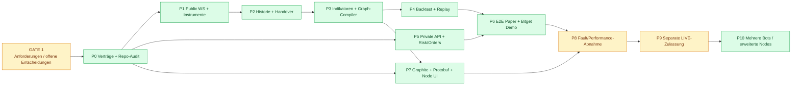

# DarkNode – Verbindlicher Phasenplan (Planungsbaseline)

**Version:** 0.3 · **Stand:** 27.10.2026 · **Status:** DRAFT / GATE 1 OPEN · **Änderung:** P1/P2- und UX-Konsistenz, automatisierte Protobuf-Feldpflege, M1-Durchstich, P5-Betriebssicherheit (nur Planung, keine Implementierung)  
**Scope:** `darknode/` mit eigenem Rust-Owner; ein vorhandenes DarkBot-Frontend/Gateway; Bitget als initiale einzige Exchange. Kein LIVE, kein Deploy und keine Implementation durch diesen Dokumentations-Commit.  
**Maßstab:** Jede Phase ist erst fertig, wenn ihre Nachweise am festen Commit reproduzierbar sind. **P0–P10** sind Umsetzungsphasen **nach** dem vorgeschalteten Research-**GATE 1**.

## 0. Erfolgsdefinition und Reihenfolge

Der Benutzer wählt **BTCUSDT** (Beispiel), erzeugt im Node-Editor eine STRATEGIE V1, definiert Williams-/Andean-/BX-Regeln, testet sie und schaltet einen Bot auf Bitget Demo. Dieser handelt niemals andere Coins oder unfreigegebene Strategien. Ein bestätigter Trade wird nach expliziter Exit-Regel geschlossen und nach erfolgreicher Bestandsprüfung wird auf ein neues Entry-Ereignis gewartet. Der initiale Stop ist möglichst börsenseitig bestätigt; nach Reconnect werden Order, Position und Schutzstatus abgeglichen. Dieselbe Indikator-/Graphsemantik wird in Live und Replay verwendet.

**Reihenfolge der kritischen Abhängigkeiten:**

**Node-Editor ist Teil des ersten nutzbaren V1-Produkts.** UI-Arbeit kann parallel zu Adapter-/Engine-Arbeit vorbereitet werden; der qualifizierte E2E-Pfad wartet auf beide. Ein zweiter Simple-/Advanced-Strategiekern ist ausdrücklich verboten. **M1** ist ein früher Integrationsmeilenstein, keine zusätzliche Handelsfreigabe.

## M1 – früher vertikaler Durchstich (Meilenstein, keine eigene Handelsphase)

**Ziel:** Echte Daten, einen minimalen Rust-Strategiepfad, denselben Risk-/Order-Owner, vorhandenes Gateway und React-UI **früh** integrieren. Keine Aussetzung der P0–P10-Abnahmen und kein Entfernen des vollständigen V1-Node-Editors.

- **M1-A – rein lesend:** BTCUSDT echte Bitget-Rohtrades → eigener Rust-1s-/5s-Aggregator (P1.6/T25–T27) → zunächst Williams %R als typisierter Node → SignalIntent → Rust-Risk-Entscheid im `NO_SEND`-Modus → eigene DarkNode-Protobuf-Projektion → Gateway → Browser. Wallet zunächst ehrlich `UNAVAILABLE`, solange noch kein qualifizierter privater Read-only-Kontosync besteht. Später echte Wallet-/Positionswerte aus qualifiziertem Read-only-API-Zugang, nie Mock-Balances.
- **M1-B – ausschließlich gesondert freigegebene Bitget-Demo-Orders:** Erst nach zuständigen P5-Demo-Capability-/Journal-/Stop-/Partial-Fill-/Emergency-/Reconciliation-Vorgates und **expliziter** Demo-Mutationsfreigabe: streng begrenzter Entry mit serverseitigem Initial-SL → tatsächlicher Fill → Stop-Readback → Exit → REST/WS-Abgleich → Darstellung von Position/Wallet/Order. Ein unbekannter Order-/Schutzstatus blockiert alle weiteren Entries; keine blinde Wiederholung. Ohne qualifizierten Schutz/Mode bleibt M1-B **BLOCKED**, auch wenn M1-A erfolgreich ist.
- **Nachweis pro Stufe:** eingefrorener Code-SHA, Quellen-/Signal-/Schema-Goldens, echte (oder ausdrücklich markierte Fault-)Fixtures, Rust→Protobuf→Gateway→UI-Roundtrip, realer Readback und eindeutige Zustands-/Order-/Fill-IDs. Weder Demo-PASS noch M1-PASS autorisiert P9-LIVE.

## P0 – Baseline, Source-Audit, ADRs und Protobuf-Verträge

**Auftrag:** `darkbot` und `ws_ai` auf SHA fixieren, `project_0/` und `bsc/` ausdrücklich unverändert lassen; alle vorhandenen WS-/Order-/DB-/Historien-/Chartpfade prüfen. Fremdbibliotheken/Lizenzen inventarisieren. Exakten Bitget-Futures-/Kontomodus und fachliche Besitzer festlegen. Neue Projektdomäne, Topic-ID-Plan, Protobuf-Payloads, Commands/Receipts, Readiness und Anti-Mock-Regeln gegen das tatsächliche Gateway/Wire-Protokoll erstellen. **Vor der Umsetzung** den [DN-PROTO-Vertrag](DN_PROTO_CONTRACT_V1.md) für getrennte Projektidentität, **automatisch generierte** Feldinventur und laufenden Rust→Proto→Gateway→Frontend-Nachweis festlegen; keine Projekt-ID-/Topic-Vergabe vor dem Governance-Gate.

**Artefakte:** `SOURCE_BASELINE.md`, `WS_AI_PORT_INVENTORY.md` (KEEP/PORT/REPLACE/DELETE), `ADRS.md`, **generierter** `PROTO_FIELD_CENSUS.md` aus `.proto`-Deskriptoren + qualifizierten UI-/Publisher-Mappings, versionierter Protobuf-Schemaentwurf, `EXCHANGE_CAPABILITIES.md` und [DN_PROTO_CONTRACT_V1.md](DN_PROTO_CONTRACT_V1.md). Keine handgepflegte 20-Spalten-Feldkopie.

**Abnahme:** keine kollidierenden IDs/Topics, vorhandene Protobuf-Codegenerierung und Schema-/Breaking-Tests bestehen, ACL/Command-Lifecycle getestet; keine Parallel-Frontend-/Gateway-Struktur, keine Liveautorisierung. **DN-PROTO-001–003**: Eigentum/ID/Topic-Bereich und vollständig inventarisierter Feldvertrag geprüft; neue fachliche Felder ohne nachvollziehbare UI-Projektion oder dokumentierte Nichtanzeige führen zu `FAIL`, nicht still zu „fertig“.

## P1 – Bitget öffentliche Marktdaten und Rohtrade-Historie (Rust)

**Verbindlicher Detailplan:** [PHASENPLAN_P1_V1.md](PHASENPLAN_P1_V1.md), inhaltliche Revision **V1.3**, mit P1.1–P1.10, T01–T27 und P1-K-Gates. Dieser Detailplan ist die **einzige fachliche Autorität** für P1-Speicher-/Bar-/Historien-/V5-Semantik.

**Auftrag:** verifizierte Bitget-Public-SBE-/REST-Daten, Instrumente, echte Einzeltrades, L0-Raw-Frames/L1-normalisierte Trades/L2-eigene 1s-/MTF-Bars, Backfill/Coverage, Snapshot-/Delta-Recovery und 24/7-Betrieb. **1s/5s/10s/30s/1m-Barwerte werden ausschließlich aus hinreichend geordneten echten Rohtrades selbst erzeugt**; Bitget-REST-Kerzen sind unabhängige Referenz, keine künstlich subdividierten 1s-Bars. Der V5-Depth50-Decoder bleibt ein offenes kritisches Gate, nicht durch alte V4-Captures qualifiziert.

**Abnahme:** P1-Detailgates inklusive T25 (Historie→1s/MTF), T26 (gleicher ms-Timestamp, Trade-Reihenfolge) und T27 (direkte MTF-Aggregation = aus 1s komponierte MTF), Gap/Crash/Replay/Soak- und p50/p95/p99-Belege am genauen Commit; kein scheingültiges PASS aus Public-Research-Skripten. Noch keine Handelsfreigabe.

## P2 – qualifiziertes Historie→Live-Handover und Strategie-Warm-up

**Abgrenzung:** Erfassung, echter Rohtrade-Import, L0/L1/L2-Speicher, SQLite-Registry, Bar-Aggregation und Reparatur gehören ausschließlich zu [P1.5–P1.7](PHASENPLAN_P1_V1.md). **Kein zweites Parquet-/Arrow-Produktionsformat, keine zweite Historiendatenbank und kein zweiter Aggregator in P2.**

**Auftrag:** konsistenter, deduplizierter und qualitätsgeprüfter Übergang aus der P1-Historie zum P3-Indikator-/Graph-Warm-up und anschließenden Live-Stream. Gleiche Instrument-/Schema-/Bar- und Zeitversion, vollständige Warm-up-Fenster, keine Zukunftsdaten oder History-Live-Doppelzählung; mangelnde Coverage ⇒ `NO_ENTRY`.

**Artefakte/Abnahme:** Handover-/Warm-up-Vertrag, Tick-/Bar-Trace-/Gap- und Neustart-Fixtures, verifizierte Identität von Live-gegen-Replay-Signalen am Cutover. Keine Wiederholung der P1-Tests als vermeintliche P2-Laufzeitabnahme.

## P3 – Rust-Indikatoren + standardisierte Node-Engine (V1 Pflicht)

**Gate-1-Referenz:** [Drei interaktive Builder-Beispiele](visuals/builder_examples.html) und [Node-Logik](../README.md#4-node-builder-v1--verbindliche-visuelle-referenz). Markt-Source → Indikator-Wert → Compare/Cross → Bool3 Logic → getrennte Long/Short-Open/Close-Action-Intents; Risiko-Policies gehen parallel an genau einen Rust Controller. Keine Browser-/Node-Execution. Die drei Vorlagen dienen als reproduzierbare Golden-Graph-Fixtures; echte Pine-Entry-Regeln bleiben zu qualifizieren.

**Auftrag:** Pine-Referenz formelgetreu portieren und versionieren. Erste Nodes: CandleSource, Andean, Williams %R, BX/XTrender, Compare, CrossAbove/Below, AND/OR/XOR/NOT/NOR/NAND, Confirm, Threshold, Long/Short/Exit, ggf. Range/MTF; RLS/Burg als separate qualifizierte Erweiterung. Rust Node Registry/Schema mit Instance-ID, typed input/output ports, scalar units, normiert vs raw, Timeframe, Warmup, Validity, State Snapshot/Restore und Evaluationspolitik.

**Sonderregeln:** `W_norm=W_raw+100`; Userbeispiel LONG `>70`, SHORT `<30`. `TRUE/FALSE/INVALID` muss in allen booleschen Operatoren definierte Fail-Closed-Entry-Semantik haben. AND mit INVALID darf kein TRUE erzeugen. Cycles nur explizit verzögert; DAG validieren. Getrennte Entry-/Exit-Outputs und definierte Priorität; keine Ordernodes mit direktem Exchangezugriff. State Machine schützt vor Dauer-Signal-Doppelorders und definiert Rearm/Reset.

**Artefakte:** `NODE_CONTRACT.md`, `INDICATOR_PARITY_MATRIX.md`, `STRATEGY_IR.md`, Golden-Vectors, Fuzz-/Property-/Negative-Tests, gehashte immutable Graphversion.

**Abnahme:** Pine-vs-Rust Output innerhalb dokumentierter Toleranzen für exakt dieselben Inputs und MTFs; gleiche Zeitreihen→gleiche Signale; invalide Kanten/Typen/Unit-Mixes geblockt; grafische Änderungen nur an einer neuen Graphversion.

## P4 – Backtesting und Market Replay in demselben Kern

**Auftrag:** gleicher Rust-Indikator-, Strategie- und Signalcode wie Live, keine Zukunftsdaten. Historische Kerzen/Trades, optional L2/Tick-Queue-Simulation; Fees, Spread, Slippage, Funding, Positionsgröße, Intrabar-Stop-Reihenfolge, Same-Bar-SL+TP konservativ oder datenbelegt. Walk-forward/OOS, Ergebnis-/Signaljournal, Debug-Replay (Node→Bedingung→Trade).

**Engineering-Spike:** NautilusTrader vs Barter/eigene Rust-Implementierung am gleichen Dataset und identischer Teststrategie; HftBacktest für Tick/L2-Microstructure. Entscheidung anhand Kompatibilität, Nachweis, Lizenz, Codeumfang und p99 – kein blindes Replatforming.

**Artefakte:** wiederholbare Backtestjobs, Qualifikationsreport, gebundene Kostenparameter, Replay-Trace, Vergleichsmatrix.

**Abnahme:** gleiche Daten + Graph/Engine-Version → identischer Event-/Trade-Trace; kein OOS-Leakage; Backtest-Metriken werden nicht als Echtgeld-PnL ausgegeben. Kostendeckende positive Erwartung nicht voraussetzen. **Separater ökonomischer Qualifikationsreport**: vorab definierter OOS-/Walk-forward-Zeitraum, tatsächliche kontospezifische Maker-/Taker-Gebühren, Spread, Slippage, Funding, Non-Fills/Adverse Selection, Netto-PnL, Stichprobengröße und Unsicherheit; Markt-/Post-only-Varianten getrennt. Technisches P4-PASS beweist keinen Profit und blockiert nicht die parallele technische P5-Arbeit.

## P5 – Bitget Private API, Orderowner, Recovery und Risiko

**Verbindlicher Detailplan:** [P5 V1.4 – UTA V3 Private API, S0–S7, Order-/Stop-Recovery, Low-Latency und Operations](PHASENPLAN_P5_V1.md). **P3 bleibt die Indikator-/Node-Engine**, P5 verwaltet die private Bitget-Anbindung. **Die vollständige USDT-Futures-Instruments-Liste ist noch nicht real abgefragt; bislang nur BTCUSDT.**

**Auftrag:** serverseitige Secrets, Trade-/Read-Rechte ohne Withdrawal, IP-Whitelist; Private WS/REST für Account, offene Orders, Fills, Positionen, Schutzorders und Orderstatus. Ein persistenter zentraler Order-Owner. Vor Senden `clientOid`, Payloadhash, Bot/Graph-Version und Risk-Reservation fsync/persistent; Orderzustände von SUBMIT_PENDING über ACK/WORKING/PARTIAL/FILLED bis CLOSED/UNKNOWN. Initialen Bitget-Stop nur auf bestätigte Venue-Capability gestützt. Break-even/Trailing/Reduce-only/TP-SL und Exit-Prioritäten testbar.

**Recovery:** WS/Netz weg → neue Entries sperren. Nach timeout: Order-/Fill-Lookup vor jeglichem Retry. Crash an jeder Persistenz-/Request-/ACK-/Fill-Grenze; beim Neustart REST+WS-Snapshot und lokales Journal abgleichen. Unbekannte Fremdorders/offene Positionen/fehlende Stops: HOLD mit definierter Betreiberaktion. Gebührennetto-BE, Drawdown, Margin, Funding-/Liquidationsabstände kontrollieren.

**Verbindlicher Wallet-/Kontosynchronisationsvertrag:** [WALLET_ACCOUNT_SYNC_V1.md](WALLET_ACCOUNT_SYNC_V1.md) – privater UTA-WS für Account/Position/Order/Fill/Schutzstatus und REST-Readback für Vollständigkeit/Recovery. Derselbe autoritative Rust-Account-State treibt Risiko und Protobuf-UI; kein eigenes Browser-Exchange-Polling. Protobuf-Feld-/Money-/ID-Goldens und UI-Verfügbarkeit gemäß [DN-PROTO](DN_PROTO_CONTRACT_V1.md), nicht aus WebSocket-Login allein abgeleitet. **P5-Publishervertrag:** `AccountSnapshot`, `CoinBalance`, `ExchangePosition`, `ExchangeOrder`, `StopCoverage`, `BotRiskReservation` und `AccountSyncState` werden je benötigtem Wallet-/Overview-/Live-Anzeigefeld über typisierte, versionierte DarkNode-Domänenprojektionen abgebildet. Quellen-/Währungs-/Einheiten-/Zeit-/Quality-/Presence-Semantik und Stale-/Unknown-Grenzen sind Bestandteil der Feldinventur und der Rust-/TS-Goldens; keine Scheinwerte durch leere/fehlende Felder.

**Artefakte:** `ORDER_STATE_MACHINE.md`, `CRASH_RECOVERY_MATRIX.md`, dauerhaftes Journal, Risk-Budget-Modell, Demo-Testcaptures.

**Abnahme:** verlorenes ACK, verlorener privater/public WS, Partial Fill, externe Orderänderung, Schutzorderverlust, Neustart mit offenem Trade, Doppel-Signal; null unkontrollierte Doppelorders in qualifizierten Szenarien. Kein Echtgeld.

## P6 – Ein realitätsnaher Bot E2E: Replay/Paper/Bitget Demo

**Auftrag:** für einen fixen Coin das gesamte Verhalten automatisieren: Feed → Indikator → Graphversion → LONG/SHORT-Entry → risk check → echte Bitget-Demo-Order → Fill/Stop → Exit → Reconciliation → Rearm → nächster Entry. Backend unabhängig vom geöffneten Frontend. Moduswechsel PAPER/DEMO darf kein Echtgeld autorisieren.

**Artefakte:** End-to-End-Testjournal, reproduzierbare Laufzeit-/Konnektivitäts-/Positionsreports, Operations-Runbook.

**Abnahme:** ein durchgehender Testlauf mit vielen Zyklen und Reconnects, korrekte Position-/Kapital-/Stopzustände; sämtliche Signalentscheidungen mit IDs/Reason Codes rückverfolgbar; kein Mock-Feed als vermeintliche Live-Quelle. **DN-PROTO-005:** echte Rust-/Proto-/UI-Parität für IDs, Skalierungen, fehlende Werte, Events und Command-Parameter.

## P7 – DarkBot-Graphite-Frontend inklusive Node-Editor

**UX-Contract ab Gate 1:** fünf Tabs exakt **Overview / Builder / Backtest / Live / Wallet**. Im Builder links **Nodes**, fünf Gruppen **Marktdaten / Indikatoren / Bedingungen / Aktionen / Risiko**, editierbare Felder im Node (kein dauerhafter Inspector), drei wählbare Vorlagen. Visuelle Referenz: [builder_examples.html](visuals/builder_examples.html) (nur Browser-Demo). Keine Signalprüfungs-Ansicht und kein zusätzlicher Monitoring-Tab.

**Auftrag:** Route `darknode` in existierender Projekt-Registry, keine zweite App/Sidebar. Vorhandene Graphite-Tokens, React/TS, Protobuf-Topics, Gateway-Commands/Receipts und Quality States. **Node-Editor V1** per React Flow: Palette, typisierte Ports, Parameter/Schwellenwerte **direkt in den Nodes** (kein dauerhaftes Inspector-Panel), AND/OR/NOT/XOR, Entry/Exit-Gruppen, save draft→validate→immutable version→backtest→qualify→activate. Lightweight Charts für BTCUSDT/Indikatoren/Position/SL. Bot-Übersicht, Replay, Journal, Zustands-/Recovery-Anzeige. Live-/PnL-Anzeigen ausschließlich echte Publisherdaten.

**Wallet-Reiter V1 (verbindlich):** Bitget-Unterkonto/DEMO-LIVE/Sync-Age, Equity USD, USDT Coin-Balance/Available, Margin/Reservations, Gebühren/Funding, PnL, **alle** Exchange-Positionen (Menge/Notional/Entry/Hebel/Liquidation), offene Orders und bestätigte Stops; Bot-Budgets explizit von tatsächlichen Exchange-Salden unterscheiden. `STALE/RECONCILING` zeigt letzte belegte Werte mit Zeitstempel, niemals erfundene 0/FLAT. Für Details und Gate-Tests siehe [WALLET_ACCOUNT_SYNC_V1.md](WALLET_ACCOUNT_SYNC_V1.md). Overview/Live teilen denselben Rust-Publisher, Frontend nur Protobuf.

**Verbindliche laufende P7-Feldpflege:** `.proto`-Felder, Einheiten/Presence/Quality, erforderliche Frontend-Verwendung und Zuständigkeit werden **generiert und automatisiert auf Abdeckung geprüft** nach [DN_PROTO_CONTRACT_V1.md](DN_PROTO_CONTRACT_V1.md); bestehende Felder nicht händisch in 20-Spalten-Tabellen verdoppeln. Bei V1-relevanten Backend-Änderungen muss die Rust→Proto→Gateway→UI-Kette im **selben Änderungspaket** stimmen; `NO_ENTRY/UNKNOWN` darf nicht zu `0/FLAT/PASS` umgedeutet werden. Kein generisches `name/value` als Ersatz für sicherheitskritische Money-/Positions-/Orderdaten.

**Artefakte:** Graphite-Seite, FE-Adapter/Store, Node UI, Graph-Editor→Rust-Roundtrips, Pixeldiff/Regressionstests, **generierter** DN-PROTO-Census und reproduzierbarer Gate-Report.

**Abnahme:** kein User-Graph kann Risk/Orderowner umgehen; keine ungetypten JSON-Blobs als gültige Strategy-IR; keine Mock-Fills/PnL in produktiven Topics; alle neuen Topics mit passenden Publisher/Quality/ACL. **DN-PROTO-004/006/007:** generierte Rust-/TS-Protos und beide Topic-Tabellen konsistent; Goldens für echte gesetzte/fehlende/ungültige/überlaufende Werte und Commands; alle für V1 vorgesehenen Anzeigefelder durch echte Publisher-/Adapter-/UI-Tests abgedeckt; UI-Pfadreferenzen aus dem Schema müssen durch Tests bestätigt statt nur deklariert sein. Bewusst zukünftige Felder tragen `FUTURE_PHASE_BLOCKED` und sind nicht als fertige V1-Verbindung zählbar. Falls Editor noch nicht vollständig bedienbar, V1 nicht fertig.

## P8 – Stresstests, Fehler-Evidenz und Performance

**Auftrag:** lange 24/7-ähnliche Demo-Läufe, Netzwerkunterbrechungen, Restarts, API-Rate-Limits, fehlerhafte Clock, Feed-Gaps, Partial Fills, Spread-/Fee-Spikes, Crash-Recovery. Ressourcenprofil für Rust (p50/p95/p99, Heap, CPU, Backpressure) von WS-Ingress über Indikatoren/Graph/Risk bis Send/ACK/FILL getrennt. Geschäftsstrategie nur netto nach realitätsnahen Kosten evaluieren. **P8-Wirtschaftlichkeitsnachweis:** vorab fixierte Netto-OOS-/Walk-forward-Kriterien und Unsicherheitsgrenzen gegen dieselbe Strategy-/Engine-/Datenversion; keine Demo-Fill-Statistik als Beweis echter Slippage.

**Artefakte:** reproduzierbare Fault-Inject-Suite, Latenzledger, Strategy-OOS-Report, Gate-Report, Rollback-Plan.

**Abnahme:** alle obligatorischen Recovery-/Safety-Gates PASS am exakten Commit; BLOCKED/UNKNOWN sperrt LIVE. **DN-PROTO-008:** vollständiger Rust→Reporter→Gateway→TS-Adapter→UI-Roundtrip plus Negativfälle (Cross-Project-/falsche Topic-Klasse, fehlender Publisher, fehlender Wert, alt/neu-Schema, Reconnect, Teilfill, Wallet-STale, Command-Receipt) am finalen SHA. Ein fehlgeschlagener oder nicht gelaufener Pflicht-Feld-/Protobuf-Check blockiert P8/P9, nicht nur eine Warnung. BSC-/P0-1ms-Ziel ist kein DarkNode-Versprechen.

## P9 – Separater Echtgeld-LIVE-Gate

**Auftrag:** erst nach P8 und ausdrücklicher Entscheidung: separate Echtgeld-API-Berechtigung/Whitelist, initial kleine Position, Limits, Kontobestand, Stop-Existenz, manuelle Notfallprozedur, Monitoring/Alerts, Rollback, lokaler oder dauerhaft verfügbarer 24/7-Host. Keine Hardware-/Frontend-Abhängigkeit für bereits börsenseitige Stops; Trading darf bei Engine-Ausfall nicht heimlich weiterberechnet werden.

**Artefakte:** datierte Freigabe für exakten Strategy-/Engine-/Adapter-Hash, Runbook, kleine Pilot-Trade-Evidenz.

**Abnahme:** manuelle autorisierte LIVE-Freigabe; alle technischen und **separat qualifizierten ökonomischen** Kriterien nachweislich erfüllt (Netto-OOS/Walk-forward nach kontospezifischen Gebühren, Spread, Slippage, Funding, Fill-Risiko und dokumentierter Unsicherheit; keine bloße positive In-Sample-Kurve). Bis dahin kein Echtgeldhandel.

## P10 – Mehrere identische Bot-Instanzen und zusätzliche Nodes

**Auftrag:** von einem bewährten Bot auf mehrere unabhängige Instanzen erweitern (z. B. vier), je eigenem fixen Coin, Kapitalbudget, immutable Graphversion; zentrale Account-Risk-Authority. Gleicher Futures-Kontrakt für zwei Bots bleibt gesperrt bis spezieller Order-/Netting-Mechanismus getestet. Zusätzliche Indikatoren RLS/Burg, Orderflow-/Range-, weitere Timeframes, Optimierungen erst nach Golden-Parität.

**Artefakte:** Fleet-/Portfolio-Testmatrix, neue Node-Typen mit Tests, skalierbare Grafik-/Analytics-Ansichten.

**Abnahme:** pro-Bot-Fills/Orders/Positions-/Budgetzuordnung eindeutig, globale Limits eingehalten, keine Interferenz oder Doppelorders, Graphengine bleibt dieselbe.

## DN-PROTO – eigenständige DarkNode-Domäne und automatisch nachgeführte Feldverträge

**Verbindlicher Detailvertrag:** [DN_PROTO_CONTRACT_V1.md](DN_PROTO_CONTRACT_V1.md); für **P0–P10** durchgehende Gates `DN-PROTO-001–008` mit CI und reproduzierbarem Schema-/Gateway-/Publisher-/Frontend-Roundtrip. Ein `PASS` ist ausschließlich nach echter Ausführung erlaubt.

- Bereits vergeben: `Project_0=1 / Topics 10–29`, `BSC=2 / 30–49`, `Solana=3 / 50–69`. **DarkNode als eigenes Paket `darkbot.darknode.v1`, ProjectId 4 und Topics 70–89 nur P0-Governance-Kandidaten** (`DN-D14=OPEN`); heute nichts reservieren/implementieren.
- Protobuf-Deskriptoren sind Quelle für Feldnummern/Typen/Optionen. Zusätzliche fachliche Metadaten (Einheit/Scale, Presence/Quality, UI-Zuordnung oder expliziter Ausschluss) einmalig deklariert, Feldinventur daraus **generiert**, nicht manuell gepflegt. **Quellcode-/Testbeweise** müssen unabhängig bestätigen, dass Publisher und UI-Konsumenten tatsächlich existieren; Schema-Metadaten allein sind kein `CONNECTED_VERIFIED`.
- Auch **reine DarkNode-Rust-Änderungen** müssen bei relevanten Änderungen die Rust↔Proto↔Gateway↔TS-/UI-Prüfung in der künftigen CI auslösen. Kein Paket fertig, wenn relevante Variablen/Commands/Quality-/Wallet-/Order-/Risikofelder fehlen; staged Implementierungen bleiben ehrlich `IN_PROGRESS/NOT_RUN`. Nicht sicherheitsrelevante rein interne Rust-Variablen dürfen ausgeschlossen bleiben.

## Globale Qualitäts- und Integrationsregeln

- **Source/Evidence:** pro Paket aktueller Repo-Commit, Dateien/Funktionen/Tests, PASS/FAIL/BLOCKED/NOT_RUN; nicht nur Fortschrittsbehauptungen.
- **No mocks in prod:** kein Fallback auf erfundene Kurse, Gewinne, Positionen, Wallet- oder Tradezahlen; `UNAVAILABLE` statt Fake.
- **No legacy:** keine zweiten WS-Manager/Trading-Loops, kein unqualifiziertes Portieren alter `ws_ai`-V1-/V2-API-Strecken.
- **Exact authority:** ein Portfolio-/Order-Owner je Konto, eine aktive Strategy-Version je Bot, ein Publisher/Topic, Bitget ist Positionsautorität.
- **Safety:** Fail-closed bei unklaren Entry-Daten, durable Intent/Fill, Position-/Stop-Check, keine doppelte Aktion nach Restart.
- **Isolation:** keine BSC-/Project_0-Fachregeln oder Latenzziele übernehmen; deren Programme/Dateien/Design-Freeze nicht nebenbei verändern.
- **Reuse:** mindestens Open-Source-Vergleich bei Bitget-Connector, Rust-Kern, L2-Backtest, Chart und Node-Editor; Bibliothek nur nach Lizenz/Version/Capability-Evidenz.
- **Testarten:** Unit, Property/Fuzz, Pine-Golden, Protobuf Breaking, Integration Demo, Replay, Latency, Fault, End-to-End, GUI/Pixeldiff.
- **Kontinuierlicher DN-PROTO-Vertrag:** Nach [DN_PROTO_CONTRACT_V1.md](DN_PROTO_CONTRACT_V1.md) ist bei fehlendem Backend-Feld, Protobuf-Publisher, korrekter Projektzuordnung, UI-Verbraucher oder Required-Check kein vollständiger Paket-PASS möglich.
- **Kein Push anderer uncommitted Änderungen:** Umsetzung nur in freigegebenen, klar begrenzten Projektdateien.

## Definition of Done für DarkNode V1

Ein fix gewähltes Futures-Handelspaar; versionierter editierbarer Node-Graph; Pine-paritäre Kernindikatoren; deterministische Live-/Backtest-Evaluation; bestands-/schutzorderkonsistente Bitget-Demo-Ausführung; reconnect-/restart-sichere Trading-Engine; Protobuf/Graphite-UI **mit aus Schemas generiertem Feld-Census und separat nachgewiesener Rust-/Gateway-/UI-Integration (DN-PROTO-001–008 PASS)**; belegte Testmatrix. **V1 heißt hier technisch fertig im Demo-Betrieb** – Echtgeld-LIVE ist **P9 separat**. Mehrere Bots und umfangreiche Orderflow-/Pro-Widgets sind keine V1-Voraussetzung.
