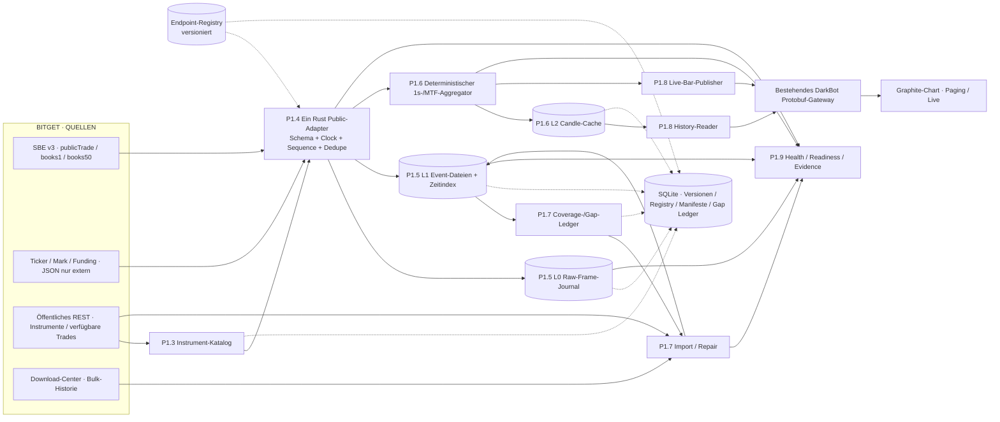
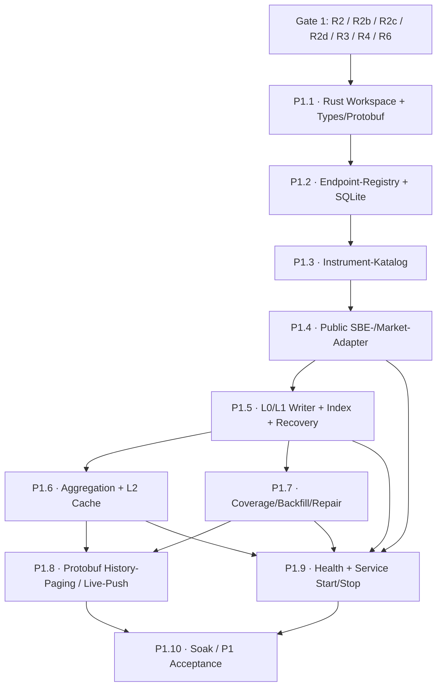

# DarkNode – PHASENPLAN P1 V1

**Bitget-Marktdaten: Rust-WebSocket, Rohdaten, Historie, Aggregation, Cache, Gateway und Betrieb**

| Dokumentfeld | Wert |
|---|---|
| Dokument | `darknode/docs/PHASENPLAN_P1_V1.md` |
| Version | **1.0 – Planungsbaseline** |
| Stand | **26.10.2026** |
| Status | **DRAFT · GATE 1 OFFEN · KEINE IMPLEMENTIERUNGSFREIGABE** |
| Projekt | DarkNode im vorhandenen DarkBot-Monorepo |
| P1-Instrument | **Bitget USDT-Futures · BTCUSDT** (exakte Produkt-/Account-Konvention in R2 verifizieren) |
| Sprache | **Rust**, React/TypeScript nur im bestehenden Frontend |
| Referenzen | `GATE_1.md`, `WS_AI_IDEEN.md`, `ENDPOINT_REGISTRY.md`, `TEIL1_MARKTDATEN.md`, vorhandener DarkBot-Phasenplan |
| Historische Codebasis | [`sawyerma/ws_ai` @ `1f27ed319b70eb94ba6990799f120743819f1534`](https://github.com/sawyerma/ws_ai/tree/1f27ed319b70eb94ba6990799f120743819f1534) |
| Handelsfreigabe | **Keine**: P1 enthält weder Orders noch Live-Trading |

> **Verbindlich ist der Scope und die Nachweispflicht; nicht abschließend entschieden sind Speicherlayout, Library-Auswahl, Zeit-/Gap-Policy, Historienreichweite und Host-Standort.** Dies ist ein sauberer Ausgangsplan für die P1-Recherche und die nachfolgende Implementierungsfreigabe. Offene Punkte werden nicht durch Annahmen als PASS erklärt.

## 0. Ziel, Scope und Ergebnis von P1

### 0.1 Ziel

P1 liefert eine in Rust gebaute, vom Browser **vollständig unabhängige, dauerhaft betreibbare Marktdatenkette** für **ein** Bitget-Futures-Instrument:

**Live abonnieren → vollständig dekodieren → identifizieren/normalisieren → raw und typisiert aufzeichnen → zeitlich korrekt aggregieren → fehlende Historie importieren/qualifizieren → Datenlücken dokumentieren → Candle-Seiten rückwärts über das vorhandene Gateway liefern → Live-Bars pushen.**

Die Engine aus Teil 2 (Indikatoren, Node-Graph, Backtest-Simulator) und der Execution-Owner aus Teil 3 sind ausdrücklich **nicht** Bestandteil von P1. P1 stellt ihnen später eine stabile, typisierte Schnittstelle bereit.

### 0.2 Architektur – exakt eine Marktdatenautorität



**Trennung der Besitzer:** Ein logischer Rust-Market-Data-Owner pro Instrument verwaltet die Exchange-Lane und die Reihenfolge der Events. Writer, Importer, Aggregator, Gateway und spätere Backtest-Reader sind klar abgegrenzte Abnehmer. **Ein Chart besitzt niemals eine Exchange-Verbindung.** Eine optionale zweite physische WS-Leitung (A/B) bleibt demselben logischen Owner unterstellt.

### 0.3 P1 Definition of Done

| ID | Muss nachweisbar sein |
|---|---|
| **D01** | Öffentliche Bitget-Daten laufen ohne API-Key in einem Rust-Dienst weiter, auch wenn kein Browser verbunden ist. |
| **D02** | Alle tatsächlich vom Decoder angenommenen Frames/Events sind gezählt, typisiert, per Herkunft verfolgbar und gemäß dokumentierter Persistenzgrenze recoverbar; keine stillen Drops. |
| **D03** | L0-L2, Zeitindex, SQLite-Metadaten, Versionen und Crash-Recovery funktionieren konsistent; ein Datenverlustfenster ist begrenzt und sichtbar. |
| **D04** | 1s-Bars und benötigte höhere Auflösungen sind zeitlich korrekt; Replay desselben **fixierten** Eingangsdatensatzes mit derselben Policy liefert identische Ergebnisse. |
| **D05** | Historienquellen, verfügbare Zeiträume, unbehebbare Lücken und Konflikte sind im Coverage-Ledger nachvollziehbar; kein Datenbereich wird ohne Beleg als vollständig erklärt. |
| **D06** | Mehrere Charts laden über das **bestehende** Gateway ältere Seiten mit exklusivem Cursor, ohne doppelte Bars, Scrollsprung oder zusätzliche Bitget-Lanes. |
| **D07** | Intern keine JSON-Nachrichten, -Dateien oder -Konfigurationen; unveränderte externe Bitget-JSON-Frames dürfen ausschließlich **als opake Rohbytes** in L0 liegen. |
| **D08** | Integrierte Mess-, Fehler- und Dauerlauftests bestanden; Evidenz an einem fixierten Git-Commit; keine Mocks oder Scheinwerte als Laufzeitnachweis. |

---

## 1. Grundregeln und technische Grenzen

| Kennung | Verbindliche Vorgabe |
|---|---|
| **P1-R01 · Rust** | Exchange-Adapter, Timekeeping, Event-Owner, Writer, Aggregator, History-Reader und Backfill werden in Rust implementiert. UI ausschließlich vorhandene Graphite-SPA. |
| **P1-R02 · No JSON / DN-D18** | Bitget darf externe JSON-Textframes vorgeben (Subscription, Ticker, REST); allein der Adapter parst sie direkt in Rust-Typen. Danach: Protobuf/typisierte Rust-Structs/binäre persistente Formate; Textlogs ohne JSON. |
| **P1-R03 · Ein Owner** | Keine Parallelarchitektur, kein Python/Redis/zweiter Event-Bus, keine von einer Chart-Instanz erzeugte Exchange-Lane. |
| **P1-R04 · Keine produktiven Hardcodes** | Endpoint/Version/Channels, Limits, Markt-/Instrument-Parameter und Laufzeit-Policies liegen in versionierter, validierter Konfiguration. **Konstante Protokolltypen, Sicherheitsinvarianten und Fallback-Abbruchregeln gehören ausdrücklich in überprüfbaren Code.** |
| **P1-R05 · Zeit** | Jedes Event trägt den originalen Exchange-Zeitwert einschließlich dokumentierter Genauigkeit sowie die tatsächliche Empfangszeit; für Reihenfolge zusätzlich fortlaufende lokale Ingress-Nummer/Clock-Information. Fehlende Pflichtzeit wird nicht durch erfundene Exchange-Zeit ersetzt. |
| **P1-R06 · Quelle** | LIVE, ARCHIVE, REST_REPAIR und etwaige A/B-Leitungen sind immer unterscheidbar. Quellenkonflikte werden erhalten und geprüft, niemals blind überschrieben. |
| **P1-R07 · Vollständigkeit** | `LIVE` bedeutet aktuell und verarbeitbar, **nicht automatisch historisch vollständig**. Unbelegte Abschnitte behalten `UNKNOWN` oder `GAP`. |
| **P1-R08 · Determinismus** | Dieselbe Engine-Funktion/gleiche Policy + geordnete, versionierte Eingangsevents → gleiche Ergebnisse. Historischer nachträglich korrigierter Datenstand erhält eine **neue Dataset-Version**. |
| **P1-R09 · Sicherheit** | Öffentliche Feeds benötigen keinen Trading-Key. Kein Secret in Logs, Frontend, Marktdatenfiles oder Endpoint-Registry. Host-Allowlist ist serverkontrolliert; kein freier HTTP-/WS-Proxy über editierbare URLs. |
| **P1-R10 · Bewiesene Fertigstellung** | Jeder Test nennt Commit, Tool-/Schema-Version, exakt verwendete Fixture/Capture, Messsystem, Ergebnis und PASS/FAIL/BLOCKED/NOT_RUN. |

### 1.1 Daten- und Speicherschichten

| Ebene | Verantwortlich für | Gewählter Architekturansatz | Recovery-/Änderungsregel |
|---|---|---|---|
| **L0** | Originale Exchange-Frames samt Kanal, Verbindung, Ingress-Sequence, Empfangszeit | Append-only **Binär-Journal**, block-/segmentiert, nach Rotation optional zstd | Rohbytes unverändert; Teilrecord am Dateiende bei Recovery erkennen und sauber abschneiden/markieren |
| **L1** | Trade, BBO, BookSnapshot/BookDelta, Mark/Funding als verlustfrei typisierte Events | Binäre Event-Dateien mit Zeit-/Blockindex, Instrument-/Decoder-Version | Neu aufbaubar aus L0 soweit L0 vollständig; Imports als eigene belegte Quellen |
| **L2** | Abgeleitete Bars (1s und gezielt weitere TFs), Chart-Zufallszugriff | **Binärer Candle-Cache** mit Versionen und Index | Jederzeit aus qualifiziertem L1 neu aufbaubar; atomarer Versionswechsel |
| **Control** | Registry, Endpoint-/Instrument-Version, Dateimanifeste, Gap Ledger, Writer-Watermarks, Audit | **SQLite** mit binären Protobuf-BLOBs und expliziten Indexspalten; transaktionale Änderungen | WAL und Durability-Policy; nach Crash Dateien gegen Metadaten rekonstruieren |

**Nicht Teil der Zielarchitektur:** Redis, Python-Hot-Path, Parquet, ClickHouse als produktiver Marktdatenspeicher. ClickHouse bleibt ausschließlich **R2c-Benchmarkreferenz**, nicht Pflichtsystem. Diese Auswahl setzt die Nutzerentscheidung um; die konkrete Dateiformat-/Cache-Ausprägung bleibt bis R2c messpflichtig.

**Wichtig:** SQLite-Commit und Dateisystem-Commit sind **keine gemeinsame atomare Transaktion**. P1.5 definiert deshalb ein geordnetes Commit-Protokoll mit verifizierbaren Segment-Footern/Hashes, `fsync` der betroffenen Dateien/Verzeichnisse, SQLite-Watermark und einem idempotenten Startup-Reconciler. Ein erfolgreicher SQLite-Eintrag darf nie auf nicht dauerhaft bestätigte Nutzdaten zeigen.

### 1.2 Öffentliche und private Bitget-API auseinanderhalten

- **Public SBE**: anonymes öffentliches Marktdatenabo; externe JSON-Subscription, dann binäre Frames.
- **Public REST**: Instrument-/Marktinformation sowie *nur die im aktuellen Endpunkt tatsächlich dokumentierten* öffentlichen historischen/aktuellen Trades.
- **Private Fills**: eigene ausgeführte Orders, **kein** Ersatz für öffentliche BTCUSDT-Tickhistorie; Teil 3.
- Gebühren/Trading-Tiers können als externe Metadaten für spätere Phasen untersucht werden; private Auth ist **keine P1-Betriebsvoraussetzung**.
- VIP-/Lo-La-Hosts sind optional und bedürfen dokumentierter Berechtigung; kein hostbezogener Automatismus ohne Abnahme.

### 1.3 Bitget-Protokollstand / Änderungsmanagement

- Der offizielle öffentliche SBE-WS-Endpunkt ist `wss://ws.bitget.com/v3/ws/public/sbe` (nur **Registry-Seed**, nicht im kompilierten Runtime-Hot-Path).
- `publicTrade` kann mehrere Trades in **einem** SBE-Frame liefern; jeder davon muss verarbeitet werden.
- SBE erwartet einen **Text-`ping` alle 30 Sekunden**; Browser-WS-Ping/Pong ist nicht als Ersatz zu unterstellen.
- `books50` wechselt offiziell am **05.11.2026** vom wiederholten Voll-Snapshot auf **initialen Snapshot + inkrementelle Updates**; in der Demo bereits aktiv. Ab dieser Umstellung **SBE Schema v5**, `depthAction` und `pseq` berücksichtigen. Beide Varianten explizit testen.
- Die öffentliche UTA-V3-REST-Route `/api/v3/market/fills` beschreibt **aktuelle** Trades (max. 100/Abruf) und bestätigt **keine** freie historische `idLessThan`-Pagination. Diese alte Annahme bleibt gesperrt, bis R2b einen **tatsächlich passenden öffentlichen** Endpoint/Archivweg nachweist.
- Die tatsächlich verfügbaren Download-Center-Daten müssen an einem konkreten BTCUSDT-Futures-Export verifiziert werden (Datum, Tiefe, IDs, granularer Typ, Format, Menge).

**Offizielle Referenzen:**

1. [Bitget UTA Quick Start – WebSocket-Hosts](https://www.bitget.com/docs/uta/quick-start)
2. [Bitget SBE Introduction – Header, Version und Layout](https://www.bitget.com/docs/uta/websocket/sbe/sbe-intro)
3. [Bitget SBE Public Trade Integration Guide](https://www.bitget.com/legacy-docs/uta/sbe/sbe-trade)
4. [Bitget Books50 Update Preview, angekündigt 05.11.2026](https://www.bitget.com/docs/uta/update-preview)
5. [Bitget Market Data – Get Recent Public Fills](https://www.bitget.com/docs/catalog/market/market-data)
6. [Bitget Data Download Center](https://www.bitget.com/legacy-docs/uta/data-download-center)

---

## 2. Architekturverträge – P1-Festlegungen

| ID | Vertrag | Wie nachzuweisen |
|---|---|---|
| **P1-F01** | Stabile interne Instrument-ID, versioniertes Mapping auf Exchange/Produkt/natives Symbol, Tickgröße, Mengenstufe, Gültigkeitsbereich | Snapshot-/Diff-Tests, historische Reinterpretation |
| **P1-F02** | Versionierter Event-Envelope mit `Trade`, `BBO`, `BookSnapshot`, `BookDelta`, `MarkPrice`, `Funding`, `Gap`, `FeedState` | Schema-Breaking-Tests, Decoder-Fixtures |
| **P1-F03** | Original-Exchange-Zeit + lokale Empfangszeit + Ingress-Reihenfolge + Präzisions-/Quellenfelder | Uhren-/Ordering-Tests, Replay-Capture |
| **P1-F04** | Preis/Menge intern präzise als ganzzahlige Tick-/Lot-Einheiten, **wenn exakt abbildbar**; sonst Typ-/Instrumentfehler statt stiller Rundung | Exhaustive Boundary- und Property-Tests |
| **P1-F05** | Exchange-Trade-ID/`execId` verlustfrei speichern. Schema-/Wertebereich real prüfen; nicht still auf u64 oder globale Monotonie reduzieren | Real-Captures, Dedupe-/Reset-/ID-Fuzzing |
| **P1-F06** | Versionierte Source-/Conflict-Policy; gleiche ID mit abweichender Nutzlast → `CONFLICT`, keine stille Höchstpriorität | Live/Archiv/REST-Vergleich |
| **P1-F07** | Bars UTC und halboffene Fenster `[t, t+Δ)`; Zuordnung via Exchange-Zeit, Abschluss via dokumentierte Watermark-/Karenz-/Timerregel | R3/R4, Boundary-Golden-Tests |
| **P1-F08** | Writer-/Ring-/Disk-Überlast ist expliziter Health-Zustand. Kein stiller Drop, **neue Entries später untersagt**, P1 bleibt reiner Datenbetrieb | Burst-/Fault-Injection |
| **P1-F09** | Lane: `LIVE`, `STALE`, `GAP`, `RECOVERING`, `UNAVAILABLE`; Quality getrennt von bloßer WS-Verbindung | State-Machine-Tests |
| **P1-F10** | Public Trades nie über privaten `/trade/fills`-Endpunkt nachladen; Quellen je Fähigkeit/versioniert katalogisieren | Integrations-/Negativtests |
| **P1-F11** | Jeder veröffentlichte Bar hat `instrument`, `timeframe`, `start`, `complete/open`, `source_dataset_version`, `aggregator_version`, `quality` | History-/Live-Contract-Tests |
| **P1-F12** | Historische Korrektur überschreibt keinen bereits für Live-Entscheidungen verwendeten Bar. Research-Rebuild bekommt neue Version | Replay-/Correction-Tests |
| **P1-F13** | Aus der bestehenden UI keine frei editierbaren Fremdhosts oder TLS-Ausnahmen; erlaubte URL-/Host-Familien sind unabhängig von der Konfiguration abgesichert | Security-/Host-Validation-Tests |
| **P1-F14** | Kleine Metadaten in SQLite, Hochvolumen in binären Dateien; keine gemischte Datei-/SQLite-Transaktion ohne Recovery-Semantik | Kill-/Power-Loss-Test mit File-vs-DB-Reconciliation |
| **P1-F15** | Chart-History-Requests besitzen `chart_id`, `request_id`, `connection_generation`, Instrument/TF, Cursor, limit und Dataset-Version; Rückantwort eindeutig zuordenbar | 2-Chart-/Reconnect-/Out-of-order-Tests |

### 2.1 Minimaler gemeinsamer Eventvertrag (konzeptionell)

Dies ist ein **fachliches Schema**, kein festgeschriebenes On-Disk-Rust-Layout:

```text
MarketEventEnvelope
  schema_version      u16
  instrument_id       stable ID
  instrument_version  u32
  event_type          Trade | BBO | BookSnapshot | BookDelta | Mark | Funding | Gap
  source              ExchangeWsA | ExchangeWsB | Archive | RestRepair
  exchange_ts         original value + declared resolution
  receive_wall_ts_ns  i64
  receive_seq         u64 (prozess-/lanegebunden)
  connection_id       ID
  payload             typed union, lossless precision
  flags               LATE | REPAIRED | CONFLICT | ...
```

Festes `#[repr(C)]`-In-Memory-Layout ist zulässig, aber **kein implizit sicheres Dateiformat**; Padding, Alignment, Endianness, Schema-Evolution und Checksummen werden vor `mmap`-Zero-Copy festgelegt.

### 2.2 Verhalten bei Datenfehlern

| Ereignis | Datenzustand | Erlaubte Reaktion |
|---|---|---|
| Normales vollständiges Trade-Frame | `LIVE` | Alle Trades nacheinander dekodieren/verteilen |
| Unbekannte SBE-Version | `STALE`/`UNAVAILABLE` | Schema-/Decoder-Gate, Alarm, keine stillschweigende Fallback-Dekodierung |
| BBO wiederholt gleiche Sequence ohne Preisänderung | je Protokoll normal möglich | Nicht pauschal als Duplikat eines Trade interpretieren |
| Depth50 `pseq` passt nicht zum lokalen Buch | `GAP/RECOVERING` | Buch invalidieren, Snapshot anfordern/neu abonnieren, gültige Recovery nachweisen |
| Public-WS getrennt | `GAP/RECOVERING` | Zeitbereich dokumentieren; Live neu verbinden; unbekannte Tradevollständigkeit offenlassen |
| L0/L1-Writer gestaut oder IO-Fehler | `STALE/UNAVAILABLE` | Alarm, bounded queues, Daten-/Recovery-Grenze erhalten, keine stillen Datenverluste |
| Nachträgliche korrigierende Historie | separate Dataset-Version | Betroffene L2-Bars neu bilden, Live-Entscheidungshistorie nicht verändern |

---

## 3. Vorbedingungen: Gate-1-Spikes vor P1-Implementierung

**Jeder Spike endet mit:** Hypothese · konkrete getestete Version · reproduzierbares Messskript · Datensatz-/Frame-Hashes · Ergebnisse p50/p95/p99 bzw. Korrektheit · Entscheidung/ADR · `PASS | FAIL | BLOCKED | NOT_RUN`.

| Spike | Konkrete Frage | Minimale Methode / Evidenz | Blockiert |
|---|---|---|---|
| **R2 – Bitget Live-Feed** | SBE Templates und Versionswechsel, Multi-Trade, books1/books50 und `seq/pseq`, `ping`, symbol/category, `execId`, Durchsatz, tatsächliche Ankunftslatenz, VIP-Option | Echter BTCUSDT-Demo-/Public-Capture; Schema-Hash, Decoder-Fixtures, Disconnect-/Snapshot-Versuche | P1.3/1.4, Bücher, Time-/ID-Vertrag |
| **R2b – historische Beschaffung** | Exporte ab welchem Datum? echte Einzeltrades? IDs? einheitliche Menge? Tiefe? Importtempo? existiert **öffentliche** paginierbare historische Trade-API? | Konkreter Archivexport + selbst aufgezeichneter Überlappungstag; 1:1 IDs/Preis/Menge/Zeit vergleichen; API-Fähigkeiten tabellieren | P1.7 Import-/Repair-Strategie |
| **R2c – Binärspeicher** | A: Journal+Index; B: Journal+Index+Candle-Cache; C: ClickHouse nur Benchmark | Gleicher Datensatz und gleicher Host; Write, warm/cold pages, Backtestscan, Crash/Recovery, SSD/RAM/Kapazität | P1.5/1.6 Formatwahl |
| **R3 – Zeit/Replay** | Welche Uhr für `receive_ts`, wie deterministisch wird Timer/Karenz aufgezeichnet, was heißt Exact Replay? | Recorded live events + timer decisions → Replay-Vergleich und Hash; REST-Zeit ohne lokale Arrival separat kennzeichnen | P1.4/1.6 Replay-Policy |
| **R4 – Bar-Semantik** | Leere Sekunden, verspätete Trades, mehrfache gleiche Exchange-Zeit, MTF-Update, Open-vs-Closed-Bars, TradingView-Referenz | Golden-Testvektoren für 1s/5s/10s/30s/1m und Markierungen `LATE/UNKNOWN` | P1.6/1.8 |
| **R6 – Rust Libraries/Last** | `tokio-tungstenite` vs `fastwebsockets`; `rtrb` vs `crossbeam`; Writer/CRC/Compression und Recovery; Host-Region | Reale Capture-Replays und reproduzierbare Lastmessung; mehrmalig je Kandidat | P1.4/1.5/1.9 |
| **R2d – kleiner SQLite-State** | WAL+`synchronous=FULL`, durability, Versionierung, Commit-Reihenfolge Datei↔SQLite | echte SSD, kill-/I/O-Failure-Injection, SQLite-Invariant-Checker | P1.2/1.5/1.7 |

**Reihenfolge:** R2 + R6 starten früh; R2 liefert den echten Datenmitschnitt für R2b/R2c/R3/R4. R2b kann Import-Teilfragen parallel beantworten. R2c und R2d müssen vor dauerhafter Storage-Formatfreigabe abgeschlossen sein.

---

## 4. P1-Pakete, Abhängigkeiten und Liefergegenstände

### 4.1 Abhängigkeitsdiagramm



**Frühstart Recorder:** Der reale Langzeitmitschnitt darf nach bestandenen minimalen **P1.4 + P1.5 + P1.9-Sicherheits-/Recovery-Gates** autonom gestartet werden, ohne die vollständige Chart-UI oder den Backfill abzuwarten. Der Recorder bleibt als reine Datenerfassung **nicht tradingfähig**.

### P1.1 – Fundament: Rust-Workspace, Eventtypen, Protobuf

**Voraussetzungen:** relevante R2/R3-Protokollentscheidungen für Grundtypen; bestehendes DarkBot-Schema-/Gateway-Inventar geprüft.

**Lieferumfang**

- `darknode/native/` integriert in vorhandenen Build-/Test-Workflow; keine zweite DarkBot-Architektur.
- Crate `dn-types`: Instrument-IDs, Exchange- und Receive-Time, typed Event-Envelope, Lane-/Coverage-Enums, Overflow-/Invalid-Semantik.
- Protobuf-Schemas: `endpoints.proto`, `market_data.proto`, `config.proto` (Versionen/Field-Reservation festgelegt); `prost`/TS-Codegen an vorhandenem Protobuf-Stack ausrichten.
- Kanonische Byte-/Hash-Regel für Dataset-/Schema-Versionen; Protobuf-Defaultbytes nicht ohne Kanonisierungsregel als invarianten Hash benutzen.
- Reale Parser-/Schema-Fixtures, keine frei erfundenen Handelsdaten als Abnahmeevidence.

**Abnahme:** Clean Build, bestehende Regression grün, Breaking-Change-Checker, Schema-/Enum-Negativfälle und reversible Tick-/Lot-Umrechnung. **Exit:** feste Event-/Wire-Vertragsversion plus Code-/Dokumentbelege.

### P1.2 – Endpoint-Registry, kleine SQLite-Metadaten, Governance

**Voraussetzungen:** P1.1, R2d; Registry-/Gateway-Governance geprüft.

**Lieferumfang**

- Seed-Registry (als Protobuf/Textproto-Quelle für den Build zulässig; **in Runtime kein JSON**) für Bitget-Hosts/Paths/Topics/Capabilities, Version und aktivierte Instrumente.
- SQLite-Store: Endpoint-/Instrument-Versionen, Feature-/Rate-Limit-Policies, Aktivierungsreferenz, Änderungen/Audit und Backfill-/Writer-Metadaten; BLOB-Protobuf plus indexierbare Felder.
- TLS/Host-Allowlist *separat sicherheitsverankert*: Änderung der Registry kann keine Fremd-Domain, lokales Netz oder Zertifikatsprüfung freischalten.
- Aktivierung mit Validierungs-/Rollback-Gate und protokolliertem kontrollierten Disconnect/Resubscribe, **keine pauschale Annahme, jede Umschaltung müsse eine echte Datenlücke erzeugen**.
- P1-Steuerung über vorhandenes Control-Gateway/CLI. UI-Eingabefelder für Endpoint-Administration gehören in ein abgestimmtes bestehendes UI-Konzept, **nicht automatisch in Wallet** und nicht in einen neuen Reiter.

**Abnahme:** Fremdhost-/TLS-Negativtests, Protobuf-Schema-Prüfung, atomare SQLite-Version-Aktivierung, gleichzeitige Reader, Kill-Test vor/während/nach Aktivierung, Audit+Rollback. **Exit:** nachvollziehbar aktivierte, sichere Konfiguration.

### P1.3 – Instrument-/Marktkatalog

**Voraussetzungen:** P1.1/1.2 und Bitget-API-Fähigkeit aus R2.

**Lieferumfang**

- Versionierter Produkt-/Symbolkatalog: interne ID, native Namen, Produktkategorie, Tick-/Qty-Step, Kontrakt-/Precision-Regeln, erlaubte Preis-/Mengeneinheiten und Gültigkeitszeit.
- Public REST Snapshot beim Start und kontrollierte Änderungserkennung; historischer Snapshot dauerhaft abrufbar.
- Optional getrennte Mark-/Index-/Funding-Referenzwerte für spätere Strategiesignale; Gebührensatz/privater Account und Hebel-Tiers werden **nicht zu einer Start-Abhängigkeit des anonymen Marktdatenfeeds**.

**Abnahme:** gültige BTCUSDT-Futures-Realantwort, Snapshot-Diff, Änderung Tick/Lot, unverfälschte Interpretation eines alten Trades mit seiner alten Instrument-Version, unbekanntes Instrument → kein Default-SPOT. **Exit:** vollständige Instrument-ID-/Präzisionsbasis.

### P1.4 – Bitget Public SBE-/Market-Adapter (Rust)

**Voraussetzungen:** P1.1–1.3; R2+R6 für Decoder/Heartbeat/Library.

**Lieferumfang**

- Eine logische Lane für BTCUSDT: Public SBE `publicTrade`, `books1`, `books50`, soweit fachlich bestätigt; externe JSON-Subscription direkt vor dem WS-Eingang.
- Binärer SBE-Decoder aus versioniertem offiziellen XML-Schema; harte Header-/Length-/Template-/Version-Prüfungen.
- Text-`ping` nach offiziell bestätigtem Intervall; Echo-/Liveness-/Reconnect-Policy; keine Annahme, WS-Control-Ping allein genüge.
- Tick-/Lot-Konversion und originale SBE-Mantisse/Exponenten, pro Frame **alle** Trade-Gruppeneinträge, Dedupe nach geprüfter ID-/Scope-Regel.
- BBO-/Depth50-Snapshot-/Update-Builder: Sequenz-Resets, `pseq`, `depthAction`/Schema v5, initialer Snapshot, Invalidation/Resync.
- Separate, niedriger frequentierte JSON-Exchange-Adapter für Mark/Funding/Ticker, soweit für P1 wirklich erforderlich.
- Einfache Lane-Statusmaschine; Ingress mit monotonic receive sequence und zwei Zeitquellen; Replay-fähige Decoder-Fixtures.

**Abnahme:** N Trade-Entries im Frame → exakt N Events; Fuzz ohne Panic; falscher Header/Schema → sicherer Fehler; BBO wiederholte Sequence korrekt; `books50` Snapshot/Delta unter absichtlichem Packet-Gap; erzwungener Reconnect und Wiederabonnement; keine credentialabhängige Public-Lane. Optional A/B-Feed mit eigener Abnahme, sonst **nicht als PASS behaupten**.

**Exit:** echte, gemessene, typisierte Bitget-Public-Events mit dokumentierter Qualität.

### P1.5 – Binärdateien L0/L1, Blockindex, Crash-Recovery

**Voraussetzungen:** P1.1/1.2/1.4, R2c+R2d entschieden.

**Lieferumfang**

- L0 Raw-Frame-Journal als versionierte `length + header + checksum + payload`-Records; Empfangszeit/Connection/Schema-Information explizit.
- L1 Event-Dateien für verlustfreie normalisierte Events, Block-/Zeitindex, Herkunft, Instrument-Version; mögliche Delta-Komprimierung für L2-Bücher erst nach Rekonstruktionsbeweis.
- Segment-/Block-Hashes, `fsync`-/Fsync-Directory-Policy, zstd nach Rotation, atomare Veröffentlichung **fertiger** Segmente.
- SQLite Manifest-/Writer-Watermarks, Recovery-Scanner, `tail`-Truncation, verifizierte Reparatur/erneute Ableitung aus L0.
- RAM-Writer-Queues bounded; Obergrenzen, Slow-Storage-Fault, Readonly-/Disk-full-Policy. Ein voller Ring wird als Fehler behandelt, **nicht als angeblich verlustfrei**.
- `mmap`-Leser nur für validierte stabile Blöcke; Version, Endianness und Alignment vor Zero-Copy formalisieren.

**Abnahme:** Kill-Proben vor/in/nach jedem Schreib-/Metadata-Commit; inkonsistente SQLite-/Dateizustände beim Startup korrekt rekonstruieren; kein still verlorener bereits als dauerhaft bestätigter Record; beschädigter Abschlussblock erkannt; L0→L1 Replay deckt jeden qualifizierten Event ab; Hashes stabil; Load-/Backpressure-Telemetrie.

**Exit:** dokumentierter Persistenzpunkt und Recovery-Matrix mit erfasster maximaler Ungewissheitszeit. **Die Formulierung „maximal offenes Segment verloren“ ist kein automatischer Qualitätsnachweis.**

### P1.6 – Deterministische Aggregation und binärer Candle-Cache

**Voraussetzungen:** P1.4/1.5, R3/R4, R2c.

**Lieferumfang**

- Ein inkrementeller Rust-Aggregator: Trade-Events → 1s OHLCV, Quote-Volumen, Count, Buy-/Sell-Volumen, soweit definierbar.
- 5s/10s/30s/1m und weitere **konfigurierte** Timeframes aus derselben **qualifizierten** 1s-Schicht; einheitliche Boundary-/Watermark-/Timer-Semantik.
- L2-Binärdateien, Zeitindex, Cache-Status `OPEN/FINAL/INVALID`, Instrument-/Dataset-/Aggregator-Version.
- Keine erfundenen Null-Trades. Ob eine tradefreie Sekunde als fehlender Bar, Flat-Bar oder DataGap interpretiert wird, entscheidet R4 und steht versioniert im Dataset.
- Late-/Out-of-Order-Fälle: unveränderlicher Live-Decision-Trail; nachträgliche Research-Rebuilds unter **neuer** Dataset-Version.
- Atomarer Rebuild betroffener Blöcke nach Import; synchroner Engine-Feed als **typisierte Output-Schnittstelle**, noch keine Indicator-Engine.

**Abnahme:** Grenzfälle 999ms/1000ms, mehrere Trades gleiche Exchange-Zeit, verspätete/duplizierte Trades, leere Sekunden, 1s→MTF; Golden-Vectors, Hash-identischer Replay für **identisches** Event-/Timer-Input; Gegenprobe gegen echte Bitget-1m-Bars mit erklärten Unterschieden. **Exit:** deterministische versionierte Candle-Kette.

### P1.7 – Historischer Import, Coverage und Lückenreparatur

**Voraussetzungen:** P1.3/1.5/1.6; R2b, verifizierte Public-Historiencapabilities.

**Lieferumfang**

- Coverage-/Gap-Ledger in SQLite: Instrument, Quelle, Zeitbereich, Ereignissequenzen/IDs, Status, Ursache, Validation-Hash, offene Reparaturversuche.
- Bulk-Importer für **reale** Bitget-Download-Center-Dateien; begrenzte Concurrency, Resume, Hash und Provenance. Archivdaten nicht als eigenes WS-Capture etikettieren.
- REST-Reparatur ausschließlich dort, wo die **öffentliche** API den benötigten Zeitraum und die Cursor-/Filtersemantik wirklich unterstützt. Kein erfundener `idLessThan`-Parameter für UTA V3.
- Priorität: echte bekannte Lücken vor optionaler Ausdehnung der Historie; Backoff/Rate-Limiter pro dokumentiertem Endpoint; Memory-/Writer-Druck berücksichtigt.
- Grob-/Fein-Scan als **Plausibilitätskontrolle**, nicht als Beweis vollständiger Trade-Abdeckung; kein Trade in einer Sekunde kann normal sein.
- Nach Import Dedupe/Conflict-Report, neue Dataset-Version und gezielter Rebuild der betroffenen L2-Bereiche.

**Abnahme:** Download-Echtdaten importiert; wiederholter Import verändert Unique-Trade-Menge nicht; künstlicher Verbindungsbruch ergibt explizite Gap-Bilanz; Reparatur nur bei belegbarer Quelle; REST-Antwort „keine Trades“ von HTTP-/Rate-/Parser-Fehler unterscheidbar; Konsistenz gegen parallelen Feed im Overlap; unbehebbare Lücke bleibt sichtbar `UNRESOLVED`.

**Exit:** belegte Dataset-Abdeckung, nicht bloß eine angegebene Zeitspanne.

### P1.8 – Historische Seiten + Live-Bar-Push im vorhandenen DarkBot-Gateway

**Voraussetzungen:** P1.1/1.6/1.7 und vorhandenes Gateway-/Topic-Governance-Gate; `HistoryBatch`-Contract.

**Lieferumfang**

- Rust `HistoryReader` über L2-Zeitindex und RAM-Cache; Backtest/CLI später direkt aus L1, **nicht** über Frontend-WS.
- Bestehende Verbindung wiederverwenden. Requests mit `chart_id`, `request_id`, `generation`, `instrument_id`, `tf`, `end_exclusive`, `limit`, `dataset_version`.
- Protobuf-`HistoryBatch` mit zeitlich sortierten Candles, `next_cursor`, `has_more`, Coverage/Quality und beantworteter Version; `request_id`-Echo.
- Per Chart/TF Backpressure/Timeout/Cancel/Prefetch; bevorzugt eine laufende Seite je Chart/TF, kein globales Scroll-Event ohne eindeutige Chart-ID.
- Keine zweifach angeforderte Seite, kein Missverständnis von `end_exclusive`; Seitenzusammenführung nach `(instrument, tf, candle_start, dataset_version)`.
- Initialsicht zuletzt benötigte Bars; Rückwärtsladung beim Annähern an linke Kante; Live-Candle-Events direkt bei definiertem Bar-Ende. Kein Chart-Polling gegen DB.
- Server-/Client-Handshake transportiert Version und tatsächliche Limits; Gateway-Topic-IDs **erst nach Reservierung** verwenden, keine freie Belegung von 70–89 ohne Prüfung.
- Graphite-UI **in den bestehenden fünf DarkNode-Tabs**, keine sechste Chart-/Monitor-App.

**Abnahme:** 2.000 Candles/erste Seite gegen Performanceziel; 2 unabhängige Charts/Intervalle, Out-of-order Responses, Reconnect/Subscribe-Recovery, fehlerhafte/veraltete Request-ID, langsamer Client; kein Chart löst Public-Bitget-Reconnect aus; historisches **Prepend** ohne Rücksprung oder Verlieren älterer Bars.

**Exit:** denselben Funktionsumfang des bewährten `ws_ai`-Paging in Protobuf, ohne dessen JSON-/globalen Event-Probleme.

### P1.9 – Betrieb, Lebenszyklus, Readiness, Monitoring

**Voraussetzungen:** P1.2/1.4/1.5, danach schrittweise andere Pakete.

**Lieferumfang**

- Kontrollierter Boot: Registry → SQLite/Recovery → Instrument-Snapshot → L0/L1-Writer → Public-Lane → Aggregator/Cache → History-Reader/Gateway → optionaler Import.
- Readiness **pro Subsystem** (`FEED_READY`, `STORE_READY`, `HISTORY_READY`, `CHART_READY`), nicht ein pauschales „WS verbunden = vollständig“.
- Per Lane: Frames/s, Events/Frame, fehlende IDs/Sequence, Latency p50/p95/p99, Queue-Fill, Storage-Lag, L0/L1-Watermark, Gap Count, Importstatus, Memory/CPU/Storage.
- Textlogs und binäre Evidenz; keine JSON-Logs oder erfundenen Dashboard-Werte. Fehler- und Severity-Klassifikation.
- Start/Stop, kontrollierter Shutdown, Crash-Recovery-Runbook; Backfill kann im Hintergrund **innerhalb des laufenden Dienstes** passieren, ohne dessen Start zu blockieren.
- Host-Region ist **Messentscheidung** (Tokyo als Kandidat, nicht festgelegt); Ende-zu-Ende-Ping/WS-Timestamp-Jitter mehrfach vergleichen.

**Abnahme:** Store fehlt/ist korrupt → präziser `NOT_READY`, kein stiller Neubeginn; Feed getrennt → eigene Lane `RECOVERING`; Chart/Gateway geschlossen → Recorder läuft weiter; Storage voll → Alarm + kein falsch gesundes Signal; geordneter Shutdown und Reboot.

**Exit:** belegbar autonom betriebene Marktdatenkette.

### P1.10 – Dauerlauf und vollständige Abnahme

**Voraussetzungen:** P1.1–P1.9 jeweils selbst PASS, offene kritische Spikes entschieden.

**Lieferumfang**

- **7 zusammenhängende Tage** auf dem nach R6 gewählten Host/Region, inkl. geplanter Fault-Injection (Reconnect, Public Feed-Ausfall, SQLite/Datei-Writer-Ausfall, Restart, Gateway-Trennung).
- Täglicher Capture-/Manifest-/Gap-/Ressourcenreport, echter End-to-End-Protobuf-Test, P1.1–P1.9-Evidence-Index.
- Retest nach allen Fixes auf einem **exakten finalen Commit**, keine nachträglichen nicht geprüften Codeänderungen.

**Abnahme:** Zielmatrix in §5 und Negativtestmatrix in §6 vollständig PASS oder explizit zulässige, dokumentierte Nichtanwendbarkeit. **FAIL/BLOCKED/NOT_RUN verhindert P1-Freigabe.**

---

## 5. P1-Leistungs- und Korrektheitsziele

Die Zeitziele sind **vorläufige Gate-1-Ziele**, keine schon gemessenen Resultate. R2c/R6 dürfen sie durch **begründete, freigegebene Revision** ändern – niemals durch stilles Weglassen eines fehlgeschlagenen Tests.

| ID | Kennzahl | Vorgeschlagenes Kriterium | Messaufbau |
|---|---|---|---|
| **K01** | Vollständige Frameverarbeitung | Für N Trades in einem gültigen SBE-Frame exakt N Event-Rekorde | Byte-Fixtures + Real-Capture; Count reconciliation |
| **K02** | Dedupe | 0 doppelte Events innerhalb des **definierten Schlüssel-Scopes** | A/B-, Replay-, Archive-Overlap-Tests |
| **K03** | Coverage | 0 **unmarkierte** bekannte Ausfälle; unbekannte/irreparable Lücken bleiben offen | Fault-Injection + Coverage Audit |
| **K04** | Replay-Determinismus | Hash-identisch bei gleichem geordneten Event-/Timer-Input und gleicher Schema-/Policy-Version | Zwei getrennte Rust-Replay-Läufe |
| **K05** | Datenintegrität | 0 korrupt ausgegebene **als committed markierte** Blöcke | CRC/Hash/kill-/Restart-Tests |
| **K06** | Erstes Chart-Bild | **< 50 ms** für 2.000 Candles **serverseitig**, Messgrenze Rust-Request→fertiges Response-Buffer | warm/cold Cache getrennt, p50/p95/p99 aufzeichnen |
| **K07** | Rückwärtsseite | **< 50 ms** serverseitig im Benchmark der vereinbarten Seite | 4.096/16.384 Candles und reale Serien vergleichen |
| **K08** | BTCUSDT-Tag Replay | **< 90 s** pro definiertem vollen Aufzeichnungstag auf Zielhardware | vollständiges L1-Eventvolumen/Dateiversion pinnen |
| **K09** | Writer unter Live-Last | Keine dauerhaft wachsende Queue; kein unmarkierter Write-Drop | Peak+Stresstest, disk-full Injection |
| **K10** | Storagegröße | B/Tag und bytes/Event real gemessen, getrennt Trade/BBO/Depth50 und L0/L1/L2 | mindestens 24 h repräsentativer Capture |
| **K11** | Bitget-Kerzen-Gegenprobe | Abweichungen vollständig erklärbar, keine stillen OHLC-/Timeframe-Fehler | echter gemeinsamer Vergleichszeitraum |
| **K12** | Gateway-Integrität | Kein doppeltes Prepend, kein Scrollsprung, keine fremde Request-Antwort, kein neuer Exchange-WS-Owner | 2-Chart-/Reconnect-/Slow-Client-Test |
| **K13** | 24/7-Betrieb | **7 Tage** autonom, getestete Reconnects, keine manuellen Eingriffe zum Weiterlaufen | Signierte Tagesreports und Manifest-Hashes |
| **K14** | No JSON intern | 0 produktive JSON-Verträge nach Exchange-Boundary; **L0 enthält extern vorgegebene opake JSON-Bytes** | Code-/Dependency-/Wire-/Dateiformat-Inventur |
| **K15** | Hardcode-Prüfung | 0 ungoverned Endpunkt-/Channel-/Rate-Limit-Konstanten im produktiven Exchange-Adapter | Static scan + manuelle Gegenprobe |

**End-to-End-Gesamtdauer** bis zur tatsächlichen Chartdarstellung muss zusätzlich gemessen werden; die **50 ms** oben sind ausdrücklich **nicht** die Internet-/Browser-Renderzeit.

---

## 6. Negativ-/Regressionstestmatrix

| Test | Erwarteter Befund | Paket |
|---|---|---|
| **T01** Multi-Trade SBE | N Einträge → N typisierte Trades, kein `return` nach erstem Trade | P1.4 |
| **T02** Unbekanntes Template/Version | Decoder gibt strukturierten Fehler; Lane verliert Readiness | P1.4 |
| **T03** Depth50 Delta vor Snapshot | Nicht anwenden; Buch invalidieren und neu synchronisieren | P1.4 |
| **T04** Sequenz-Lücke / Reset | Gap-/Recovery-State und neuer Snapshot; keine Fake-Continuity | P1.4 |
| **T05** Text-Ping vergessen | Liveness-Gate fängt Fehlverhalten ab; kontrollierter Reconnect | P1.4 |
| **T06** Replay gleiche ID, gleicher Payload | Ein kanonisches Event; keine doppelte Volumensumme | P1.5/1.7 |
| **T07** Gleiche ID, anderer Payload | Konflikt mit Quellennachweis, kein stilles Überschreiben | P1.5/1.7 |
| **T08** 999ms / 1000ms Trade | Korrektes halboffenes 1s-/5s-Fenster | P1.6 |
| **T09** Verspäteter Trade | Live-Published Bar unverändert; korrigierter Research-Bereich versioniert | P1.6 |
| **T10** No-Trade-Intervall | R4-Policy angewandt, kein erfundener Tick | P1.6 |
| **T11** Crash bei L0-Record/Index/SQLite-Watermark | Commit-Grenze rekonstruierbar, keine committed Phantom-Events | P1.5 |
| **T12** Writer-Ring voll / Disk full | Kein stiller Drop, Health/Quality wechselt, Gap-/Durability-Bilanz | P1.5/1.9 |
| **T13** Download-Import doppelt | Identischer Unique-Trade- und Datasetbestand | P1.7 |
| **T14** Öffentlicher REST liefert keine Historie | Nicht auf private Fills ausweichen; `BLOCKED/UNRESOLVED`, andere Quelle prüfen | P1.7 |
| **T15** Leeres API-Fenster vs Timeout/429 | Fachlich und technisch getrennte Outcomes | P1.7 |
| **T16** Zwei Charts/TFs gleichzeitig | Getrennte ID/Iteratoren/Antworten bei gemeinsamem Gateway | P1.8 |
| **T17** Reconnect beim History-Paging | Stale Response verworfen; idempotentes Resubscribe und Fortsetzung | P1.8 |
| **T18** Voranstellen bei vorhandenen Live-Bars | Kein Scrollsprung, keine überschriebenen alten Bars, richtige Reihenfolge | P1.8 |
| **T19** Browser komplett geschlossen | Recorder läuft weiter, keine zusätzliche Datenlücke | P1.4/1.9 |
| **T20** SQLite gegen Binärdateien nach Kill inkonsistent | Startup-Reconciler stellt stabile gemeinsame Sicht her | P1.2/1.5 |
| **T21** Nicht erlaubter Host/URL | Aktivierung scheitert, TLS bleibt strikt | P1.2 |
| **T22** Neuer Instrument-Snapshot / Step-Änderung | Alte Records mit alter Version korrekt; neue mit neuer | P1.3/1.5 |
| **T23** Replay vs Live identischer Capture | Gleiche Bar-/Qualitäts-Trace-Hashes, soweit Timerfolge identisch | P1.6 |
| **T24** 7-Tage-Dauerlauf | Alle Datenbereiche bilanziert, Ressourcen und Latency dokumentiert | P1.10 |

**Alte `ws_ai`-Regressionen explizit abgedeckt:** einzelner Trade aus Multi-Trade-Batch, alte Bitget-REST-Funktionssignaturen, globale Scroll-Ereignisse, doppelte History-/Live-Quellen, fehlende Durability zwischen Queue-ACK und Disk.

---

## 7. Paketstatus, Dependencies, Evidence, Governance

### 7.1 Anfangsstatus (keine behauptete Implementierung)

| Paket | Anfangsstatus | Voraussetzung für PASS |
|---|---|---|
| P1.1 · Workspace & Contracts | **NOT_RUN** | Build, Schema, Rust-Typ-/Unit-Tests |
| P1.2 · Registry / SQLite | **NOT_RUN** | R2d, Security/Commit/Recovery |
| P1.3 · Instrument-Katalog | **NOT_RUN** | reale Bitget-Daten und Versionstests |
| P1.4 · WS-/SBE-Adapter | **NOT_RUN** | R2/R6 und echte Captures |
| P1.5 · L0/L1 Persistenz | **NOT_RUN** | R2c/R2d, Crashmatrix |
| P1.6 · Aggregator/Cache | **NOT_RUN** | R3/R4-Golden-Tests |
| P1.7 · Historie / Repair | **NOT_RUN** | R2b, Datenquelle belegt |
| P1.8 · Gateway-Paging | **NOT_RUN** | Gateway-Governance und E2E-Tests |
| P1.9 · Autonomer Betrieb | **NOT_RUN** | Startup/Recovery/Fault-Test |
| P1.10 · 7-Tage-Abnahme | **NOT_RUN** | alle Vorgänger PASS |

### 7.2 Evidence pro Paket

Jede Abnahme verwendet dasselbe Format:

```text
Paket:               P1.x
Git-Commit:          <fixierter full SHA>
Dokument-/Schema-ID: <Version, Schema-Hash>
Test-ID(s):          Txx / Kxx / Spike Rx
Real-Dataset:       <Exchange, Instrument, UTC-Range, Source, Hash>
Befehle/Toolchain:  <exakte Repro-Schritte / Versionen>
Resultat:           PASS | FAIL | BLOCKED | NOT_RUN
Metriken:           <min, p50, p95, p99, max, counts, B/day>
Artefakte:          <relative Pfade + BLAKE3>
Offene Befunde:     <Issue-IDs, Severity, Owner>
```

Vorgesehener Nachweisort: `darknode/docs/P1_EVIDENCE/`, Unterordner je Spike/Paket und Run. Große Rohcaptures **nicht** ungeprüft in Git versionieren; für deren Speicherort und Hash ist ein versioniertes Manifest nötig.

### 7.3 Änderungsvorgaben

- Der globale DarkBot-Phasenplan und die bereits verbindlichen BSC-/Project_0-Verträge werden **nicht** rückwirkend verändert.
- Eine ADR für Daten-/Indexformat, Zeit-/Bar-Semantik, Schema-Break, Qualitätszustände, Rate-Limits oder Host-Auswahl wird vor produktiver Änderung dokumentiert.
- `ENDPOINT_REGISTRY.md`/`WS_AI_IDEEN.md`/`TEIL1_MARKTDATEN.md` sind referenzierte Ausgangsquellen. **Falls eine Datei im Repo fehlt, ist das ein Gate-1-Quellenbefund**, kein Grund für stillschweigende Ersatzannahmen.
- Keine produktiven Mocks, Fake-Werte oder stillen Legacy-Fallbacks. Test-Fixtures sind im Testbereich zulässig und als solche gekennzeichnet.
- Kein Deploy, kein ARM, kein SIGN, kein LIVE, keine Bitget-Orders durch P1.

---

## 8. Dateistruktur und Crates – P1-Scope

```text
darknode/
  docs/
    PHASENPLAN_P1_V1.md
    P1_EVIDENCE/
      spikes/
      p1_01/ ... p1_10/
  config/
    endpoints/bitget.txtpb             # Source seed / runtime: versionierte Registry
    security/host_allowlist.txtpb      # nur mit Sicherheitsfreigabe änderbar
  spikes/
    r2/ r2b/ r2c/ r2d/ r3/ r4/ r6/
  native/
    Cargo.toml                        # im bestehenden DarkBot-Workspace integriert
    crates/
      dn-types/                       # Event-/Instrument-/Quality-Verträge
      dn-bitget/                      # Public SBE + externer JSON-Boundary-Adapter
      dn-store/                       # L0/L1/L2, Zeitindex, SQLite Control-Metadaten
      dn-agg/                         # 1s + konfigurierbare MTF
      dn-backfill/                    # Archiv-Import + qualifizierte REST-Reparatur
      dn-gateway/                     # vorhandene Protobuf-Gateway-Integration
    bins/
      darknode/                       # dauerhaft autonomer Datendienst
      dn-cli/                         # prüfen/importieren/replay/repair, keine Orders
protocol/schemas/darkbot/darknode/v1/
  endpoints.proto
  market_data.proto
  config.proto
```

**Anmerkung:** Das ist eine vorgeschlagene Dateistruktur, **keine** Aufforderung, bereits existierende Crates/Proto-Pfade zu verdoppeln. Vor P1.1 werden der tatsächliche Workspace und die bestehenden DarkBot-Schema-/Topic-Regeln inventarisiert.

---

## 9. Was P1 bewusst nicht baut

| Nicht in P1 | Zuständigkeit |
|---|---|
| Williams, Andean, BX und weitere Indikatoren, Node Registry/Compiler | Teil 2 |
| Backtest-Simulation von Fills, Gebühren, Funding, PnL, Slippage-Modell | Teil 2 / Backtest |
| Position Controller, Orderzustände, Stops, Wallet, Hebel, API-Trading-Keys | Teil 3 |
| Echte Handelsfreigabe, Kontoveränderungen, SIGN/ARM/LIVE | separate spätere Freigaben |
| Mehrere aktivierte Börsen, Multi-Bot-Capital-Management, L3 | nach P1 |
| Eigenständige neue Frontend- oder Gateway-Architektur | ausgeschlossen |
| ClickHouse/Redis/Parquet als verpflichtender Produktiv-Stack | ausgeschlossen bzw. Benchmarkreferenz |

---

## 10. Offene Punkte und verantwortliche Entscheidung

| ID | Fragestellung | Gate | Bis dahin gilt |
|---|---|---|---|
| **O01** | Depth50 und Schema-Version ab Änderung 05.11.2026 | R2 | Snapshot+Delta und Versionsprüfung als zwingende Adapterfähigkeit |
| **O02** | Trade-ID Scope/Breite/Monotonie | R2 | Opaque typisiert und verlustfrei; keine freie `u64`-Annahme |
| **O03** | Public-REST-Historiencursor / Reichweite | R2b | Keine Behauptung `idLessThan`/90-Tage-Historie als gesicherter Public-API-Weg |
| **O04** | Download-Center-Datenqualität und Bulk-Importdauer | R2b | Keine voreilige Tardis-/Kaufentscheidung |
| **O05** | Speicherformat/Cache-Layout/IO/Index | R2c | L0/L1/L2-Dateien + SQLite Control als Architekturbaseline; Details offen |
| **O06** | Dateien+SQLite Commit-/Recovery-Policy | R2d | Keine atomare Cross-Store-Transaktion behaupten |
| **O07** | Empfangs-/Exchange-Time, Timer und Exact Replay | R3 | Kein Gleichsetzen historischer REST-Latenz mit eigenem Live-Receive-Time |
| **O08** | Leere Intervalle, Late Trade, MTF und Karenz | R4 | Versionierte Policy, keine erfundene Vollständigkeit |
| **O09** | Rust WebSocket/Queue/Host-Region | R6 | Tokio/`tokio-tungstenite`, `fastwebsockets`, `rtrb` etc. bleiben Kandidaten |
| **O10** | Gateway Topics/Schema-Governance | P1.1/P1.8 | Keine Topic-IDs ohne Reservierung |
| **O11** | Frontend-Position für Registry-Steuerung | UI-Abgleich | Keine neue Registerkarte; Wallet nicht ungeprüft mit Endpoint-Admin überladen |
| **O12** | Quellrang bei abweichenden Live/Archive/REST-Daten | R2b | Widerspruchsprotokoll, kein stilles Überschreiben |

### P1-Abnahmeentscheidung

P1 kann **nur dann als PASS** gelten, wenn die Punkte D01–D08 am selben fixierten Commit nachgewiesen, alle obligatorischen K-/T-Prüfungen bestanden und kritische O-Punkte entschieden beziehungsweise als begründeter Scope-Ausschluss dokumentiert sind.

**Daher Stand dieses Dokuments am 26.10.2026: `P1 = NOT_RUN`; `GATE 1 = OPEN`.**
