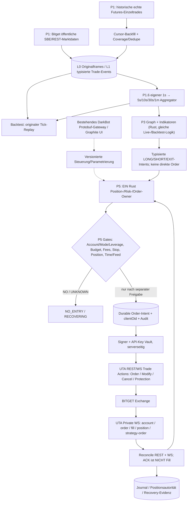

# DarkNode – PHASENPLAN P5 V1.0: Bitget UTA Private API, Futures-Steuerung und sicherer Order-Owner

**Stand:** 27.10.2026 · **Status:** Architektur-/Capability-Research, **P5 = NOT_RUN**, **GATE 1 = OPEN**, **SIGN/ARM/LIVE untersagt** ohne gesonderte Freigabe.
**Projektkonvention:** Im Gesamtplan [PHASENPLAN.md](PHASENPLAN.md) bezeichnet **P3 die Indikator-/Graph-Engine**; die private Bitget-Anbindung ist **P5**. Diese Datei konkretisiert ausschließlich P5, ohne die bestehenden P0–P10-IDs umzudeuten. P1 bleibt öffentliche Marktdaten/Rohtrade-Aufzeichnung und 1s-/MTF-Aggregation.

## 1. Verifizierter Dokumentationsstand vs. echter Nachweis

- **Öffentlich auf dem Mac verifiziert:** BTCUSDT USDT-Futures, SBE-V4, Demo-V5 und Classic-V2-Rohtrade-Historie, Instrument-Snapshot für **BTCUSDT allein**; keine bestätigte vollständige Symbol-/Coinliste.
- **Öffentlich dokumentiert, nicht im Nutzerkonto getestet:** UTA-V3 Private REST und WS; Hebel, Margin/Position Mode, Order-, Strategy-Order-, Fill-/Position-Verträge. Dokumentationsprüfung ist **kein Demo-/Kontonachweis**.
- **Getrennte API-Generationen bewusst:** `/api/v2/mix/market/fills-history` als bestätigte **öffentliche** historische Trade-Quelle; **private UTA** `/api/v3/account/*`, `/api/v3/trade/*`, `/api/v3/position/*`, WS `/v3/ws/private`. Nie ohne qualifizierten Account-Mode auf Classic-V2-Private-Order-Befehle zurückfallen.
- Erst **Account/Mode/Demo-Capability-Auslesung** entscheidet, was für den tatsächlichen Account erlaubt ist; kein default-isolated, default-one-way oder „maximal erlaubter Hebel“ aus öffentlichem Instruments-Response als Kontofreigabe.

## 2. Verbindliches Blockdiagramm

**P1 Public, P3 Graph, P5 Private Risk/Execution sind getrennte Module im EINEN existierenden Rust/DarkBot-Stack.** Strategy-/Backtestdaten enthalten weder Secrets noch private Orderbefehle. Externes Bitget-JSON nur Adapterrand; intern Protobuf-/Rust-Types/binäre Journale.

## 3. Endpunkt- und Kontrollflächeninventar (UTA V3)

Basis: `https://api.bitget.com`; UTA **private WS** `wss://ws.bitget.com/v3/ws/private`; **öffentlich** `wss://ws.bitget.com/v3/ws/public/sbe` und `.../public`. Kategorie UTA REST `USDT-FUTURES`, Symbol `BTCUSDT`. WS-Private-Kanäle `instType=UTA` und Topics `account`, `order`, `fill`, `position`, `strategy-order`.

| Domäne | Methode / API | Verbindliche Nutzung | Berechtigung / Status |
|---|---|---|---|
| Symboluniversum | `GET /api/v3/market/instruments?category=USDT-FUTURES` **ohne** `symbol` | alle gelisteten Futures-Instrumente; Filter `status`, Tick/Lot/Minimum/Max; versioniert | Public; **gesamte Liste NOT_RUN** |
| Account/Permissions | `GET /api/v3/account/info` | Kontokontext/Schreibrechte prüfen | UTA-management; NOT_RUN |
| Einstellungen | `GET /api/v3/account/settings` | `accountMode`, `accountLevel`, `holdMode`, `symbolConfigList`: Leverage und MarginMode pro Paar | UTA mgt read; NOT_RUN |
| Margin-/Leverage-Vorschau | `GET /api/v3/account/pre-set-leverage` | `estMaxOpen`, `requiredMargin` vor Änderung prüfen | UTA mgt read; NOT_RUN |
| **Hebel setzen** | **`POST /api/v3/account/set-leverage`** | `category=USDT-FUTURES`, `symbol`, `leverage`, kontextabhängig `marginMode`/`posSide` | **UTA mgt read/write**; NOT_RUN |
| Position-Mode | `POST /api/v3/account/set-hold-mode` | `one_way_mode` vs `hedge_mode`; Flat/Open-order-Prüfung vor Umstellung | **UTA mgt read/write**; NOT_RUN |
| Isolierte Positionsmargin | `POST /api/v3/account/set-margin` | `add`/`remove` nach PosSide, nur bei zulässiger Isolated-Position | **UTA mgt read/write**; NOT_RUN |
| Accountmodus | `POST /api/v3/account/adjust-account-mode` | nur getrenntes Administrations-Gate; **nicht** normale Bot-Orderroutine | **UTA mgt read/write**; NOT_RUN |
| Kontoguthaben | `GET /api/v3/account/assets` | available, equity, Risiko-/Funding-Margin und interne Reservationen | UTA mgmt read; NOT_RUN |
| Order platzieren | **`POST /api/v3/trade/place-order`** | `category`, `symbol`, `qty`, `side`, `orderType`, ggf. `posSide`, `clientOid`, `reduceOnly`, initiales TP/SL nur bei qualifizierter Semantik | **UTA trade read/write**; NOT_RUN |
| Order ändern/stornieren | `POST /api/v3/trade/modify-order`, `POST /api/v3/trade/cancel-order` | Korrelation nach `orderId`/`clientOid`; Cancel-ACK ist NICHT bestätigtes Storno | UTA trade read/write; NOT_RUN |
| Strategy-/Schutzorder | `POST /api/v3/trade/place-strategy-order`, `POST /api/v3/trade/modify-strategy-order` | dokumentierte `tpsl`, `trigger`, `oco`, `trailing_stop`; Bedingung/Stop/Kind/Position-Semantik je Typ gesondert in Demo abnehmen | UTA trade read/write; NOT_RUN |
| Strategy-Abfrage | `GET /api/v3/trade/unfilled-strategy-orders`, `GET /api/v3/trade/history-strategy-orders`, `GET /api/v3/trade/strategy-sub-orders` | Schutzorder-Existenz und Suborders nachweisen | UTA trade read; NOT_RUN |
| Order lesen | `GET /api/v3/trade/order-info`, `GET /api/v3/trade/unfilled-orders`, `GET /api/v3/trade/history-orders` | nach ACK-Verlust oder Neustart vor Retry; Status / Teilfills / Cancel | UTA trade read; NOT_RUN |
| Private Fills | `GET /api/v3/trade/fills` | eigene Kontoausführungen, **nicht** die öffentliche Markt-Tradehistorie | UTA trade read; NOT_RUN |
| Positionen | `GET /api/v3/position/current-position` | tatsächliche Exchange-Position ist Autorität, nicht Strategiegraph | UTA trade read; NOT_RUN |
| Private Streaming | WS `/v3/ws/private` | nach signiertem Login `account`/`order`/`fill`/`position`/`strategy-order` abonnieren; event-/reconnectgerechter State | Auth/Demo noch NOT_RUN |

**Open-Mode-Matrix zwingend:** in One-way `side=buy/sell` und Closing mit `reduceOnly=yes` (anwendbare Orderarten prüfen); in Hedge zusätzlich `posSide=long/short` und richtungskorrekten Open/Close. `qty` bei USDT-Futures in Base-Coin-Einheiten, Preis/Volumen als exakte Decimal/Fixed-Point-Werte aus Instrument-Version (nicht Float für Ordergröße). Öffentliche theoretische Leverage-Grenze ersetzt keine kontospezifische Pre-Set-/Risikofreigabe.

**MarginMode-Differenz:** In UTA V3 ist `marginMode` laut Migrationsguide kein klassischer Pflicht-Orderparameter für Futures; Mode wird durch Kontokonfiguration/Position bestimmt. Bitgets neuere Place-Order-Dokumentation kann den Parameter dennoch im generischen Body listen. **Vor Implementierung gegen aktuelle UTA-Account-Stufe und Demo real testen; keine automatische Annahme, dass ein Orderrequest den Margin-Modus umschaltet.** `/api/v2/mix/account/set-margin-mode` ist **Classic V2**, kein unqualifizierter UTA-Ersatz.

## 4. Authentisierung, Schlüssel und Transport

Bitget UTA REST Signatur: `ACCESS-SIGN = Base64(HMAC-SHA256(secret, timestamp + uppercase_method + path + (?query falls vorhanden) + exakte body_bytes))`; `ACCESS-KEY`, `ACCESS-TIMESTAMP`, `ACCESS-PASSPHRASE`, `Content-Type`. Timestamp/Requestbody müssen den wirklich versandten Bytes entsprechen; exakte Query-Reihenfolge und Canonical-Form im Adapter festlegen. WS-Private: `op=login`, mit Key/Passphrase/Timestamp und Signature über `timestamp + GET + /user/verify`; Login erst bestätigen, dann Subscriptions. Bitgets Dokumentation hat verschiedene historische Zeitbeispiele: nach aktuellem Quick-Start ms verwenden und Demo verifizieren.

**Permissions:** UTA Trade **read/write** erlaubt Orders. UTA Management **read/write** erlaubt Hebel/Modusänderungen. Management read reicht nicht zum Setzen. Account-Status-Lesephase zunächst ausschließlich getrennte **read-only Credentials**; für Demo-Mutationen eigene Demo-Schlüssel. Live-Key später ausdrücklich und getrennt freigeben. **Kein Withdrawal-/Transfer-/Broker-Key**, IP-Allowlist und Egress-Host-Allowlist, TLS-Zertifikatsprüfung, keine Secrets in Git/UI/Logs/Protobuf/Event-Messages. Least Privilege + Schlüsselrotation/Revocation. Kann man Management-Rechte nicht feingranular trennen, Hebel/Modus nur über separaten Admin-Kontrollpfad, niemals aus Graph-Node frei abrufbar.

**Demo-Bindung:** REST verwendet `https://api.bitget.com` mit **Demo-API-Key und Header `paptrading: 1`**. Private WS Demo **`wss://wspap.bitget.com/v3/ws/private`**, Public WS Demo `.../public`. Bitget Quickstart nennt eigene Demo-Credentials. Kein Demo-Fallback auf Live. Die im P1-Research beobachtete `.../public/sbe`-Demo-URL ist eine separat empirisch ermittelte Public-Datenstrecke, **kein Private-Orderendpunkt**.

**Rate-/Transportregeln:** Endpunktbezogene UID-Limits und geteilter REST/WS-Budgetstatus; bei 429 bounded backoff und `UNKNOWN` für möglicherweise eingesandte Order, nicht blind erneut platzieren. Text-`ping` alle 30 s und `pong`, separate Heartbeat-/Private-Stale-States. Signieren, Serialisieren, TLS-/JSON-Grenze ausdrücklich **außerhalb** des P1-SBE-/Event-Hot-Path.

## 5. Sicherheits- und Positionsautorität

1. Ein zentrales Rust **Account/Portfolio-/Position-/Order-Owner** je Bitget-Konto. Pro Bot nur ein fest ausgewähltes, verifiziertes Futures-Symbol und hartes Kapitalbudget; später mehrere Bots ausschließlich innerhalb desselben globalen Account-Risikolimits. Kein Node darf signierte Requests direkt auslösen.
2. Risk-Vorprüfung umfasst Instrumentstatus/Tick/Lot, verfügbare Equity, Budgetreserve, Funding/Fees/Slippage, Liquidationsabstand, live beobachteten Hebel und Margin-Modus, One-way/Hedge, aktuelle Position, laufende Orders, nachweisbaren Initial-SL und frischen Public-/Private-Feed. Bei Widerspruch `NO_ENTRY`.
3. `clientOid` und vollständige typisierte Requestdaten **vor dem Send** persistent journalisieren und fsyncen. ACK, Order-New, Partial-Fill, Filled, Cancelled, Stop-Armed und Exchange-Position als **verschiedene** Zustände führen; ACK ist keine Ausführung. Nach Timeout Query nach `clientOid`/`orderId` und Fills/Positions; kein Blind-Resend.
4. Initiale Schutzorder nachweislich an der Börse bestätigt, nicht nur im lokalen Code gesetzt. Nach einem Fill ohne qualifizierten Stop `PROTECTION_UNKNOWN` und sichere vordefinierte Exception-/Exit-Policy, keine weiteren Entries. Stop-/Trailing-Änderungen nach Kosten, Requotes, Mengen-/Partial-Fill-Änderungen und Exchange-Status erneut prüfen.
5. Key-Rechte nur in Infrastruktur; `ARM`/`LIVE` separate, auditierte, manuelle Autorisierungen, niemals automatisch durch positives Backtesting. Demo darf erst nach entsprechender Freigabe signierte Testorders ausführen; dieser Research-Auftrag sendet **keine** Order.
6. Bei REST/WS-Unstimmigkeiten, Neustart, verlorener Orderantwort, Teilfill, Fremdorder oder Subaccount-Änderung zuerst REST-Snapshot + WS private-Stream korrelieren, lokale Reservationen gegen Exchange-Positionsautorität reconciliieren. Fehlt Evidenz: `UNKNOWN` / `RECOVERING`.

## 6. Referenzvergleich Open Source (keine produktive Dependency-Freigabe)

| Projekt | Konkreter Recherche-Nutzen | Begrenzung für DarkNode |
|---|---|---|
| [CCXT – Bitget-Adapter](https://github.com/ccxt/ccxt/blob/master/python/ccxt/bitget.py) | `loadMarkets`, Futures/Precision, `setLeverage`, `setMarginMode`, `setPositionMode`, `createOrder`, `fetchPositions`; **Achtung**: in konkreter CCXT-Bitget-Implementierung ist `uta` für `setLeverage` ohne Params teils **false** (Classic-V2-Pfad) | Python+REST/JSON; API-Mode/Version explizit statt blind übernehmen; kein Rust-Hot-Path |
| [Hummingbot perpetual_trading](https://github.com/hummingbot/hummingbot/blob/master/hummingbot/connector/perpetual_trading.py) | Trennung von `position_mode`, leverage pro `trading_pair`, Positions-/Ordertracker | Prüfbedarf für aktuelle Bitget-UTA-V3-Connector-Pfade und Lizenz |
| [Freqtrade Futures](https://github.com/freqtrade/freqtrade/blob/develop/docs/leverage.md) | Futures-/Margin-Konfiguration und Kapitalkontrolle, Dry-run-Futures-Einschränkungen | Primär Candle-/Python-orientiert, nicht automatisch passend zum SBE-Raw-Trade-/L2-Ziel |
| [NautilusTrader](https://github.com/nautechsystems/nautilus_trader) | Events/Risk/Portfolio/Execution-State, getrennte Backtest-/Live-Komponenten | Bitget-UTA-Abdeckung **nicht bestätigt**; nicht als vorhandenen fertigen Bitget-Connector behaupten |

**Entscheid:** Bitget UTA V3 direkt im **bestehenden Rust-Adapter und Order-Owner** typisieren; Open Source als Referenz für Vertrags-/Recovery-Fälle nutzen, nicht zweite Trading-Architektur einbauen. Erlaubt sind isolierte, auditierte Bibliotheks-Bausteine nach Lizenz-/Versionstest. Bestehendes DarkBot Gateway/Graphite/Protobuf bleibt unverändert führend.

## 7. P5 Abnahme- und Fehlerprüfungen

| ID | Nachweis | Status |
|---|---|---|
| P5-A01 | Full USDT-Futures-Instruments ohne `symbol` → valide dynamische Auswahl; stillgelegtes Paar und Formatänderungen blockiert | NOT_RUN |
| P5-A02 | Account/UTAmode/read permissions/holdMode/marginMode/actualLeverage/risktiers aus dem echten **Demo-Account** mit dokumentierten Rückgabedaten erkannt | NOT_RUN |
| P5-A03 | 5× als Beispiel: `pre-set-leverage` lesen, autorisiertes `set-leverage` auf Demo, `settings` erneut lesen; Long-/Short-/isolated/cross-Semantik | NOT_RUN |
| P5-A04 | Mode-Wechsel nur bei Flat+keinen offenen Orders; ablehnender Exchange-Response darf keine Readiness vortäuschen | NOT_RUN |
| P5-A05 | One-way/Hedge buy/sell/posSide/reduceOnly und Positionsmengen, Instrument-Tick-/Lot-/Min-Notional-Tests gegen Bitget-Demo | NOT_RUN |
| P5-A06 | Market, Limit, IOC, FOK, Post-only, Cancel, Modify – Response vs tatsächliche WS-Order/Fill-Deltas getrennt | NOT_RUN |
| P5-A07 | Initial TP/SL, serverseitiges SL, Trigger, OCO, Trailing; Stop-Versagen, Partial-Fill, Cancel-replace und bestätigte Schutzexistenz | NOT_RUN |
| P5-A08 | Lost ACK, Doppelsignal, reconnect, Gateway-Close, REST/WS Konflikt, Reboot mit Position + ClientOid-Requery → **keine Doppelorder** | NOT_RUN |
| P5-A09 | Margin/Leverage-Änderungen, Order-Rate-Limits, UID/IP-Limits, Signatur-/Timestamp-/Clock-Fehler und 429; fail-closed | NOT_RUN |
| P5-A10 | Secrets/IP-Allowlist, keine Withdrawal-Rechte, kein Frontend-Key, getrenntes Demo/Live, SBE-Hot-Path ohne interne JSON-Verträge | NOT_RUN |
| P5-A11 | Echtes Risiko-/Kontobudget je Bot, globale UID-Exposures, Liquidations-/Funding-/Fee-Deltas, Kill-/Emergency-Policies | NOT_RUN |
| P5-A12 | Demo-Reconciliation bis bestätigtem FLAT ohne unbestätigten Schutz-/Restorderzustand | NOT_RUN |

**Gate:** Keine der dokumentierten privaten P5-Endpunkte wurde im Nutzer-Account abgefragt oder beschriebenen Mutationsfälle ausgeführt. Dokumentationsinventar **VERIFIED_DOC**, funktionale Konto-/Order-Nachweise **NOT_RUN**. P5 bleibt NOT_RUN; Gate 1 bleibt OPEN. Kein SIGN/ARM/LIVE.

## 8. Offizielle Primärquellen (27.10.2026)

- [Bitget UTA Quick Start, Schlüssel/SIGN/Private WS/Demo/Rate-Limits](https://www.bitget.com/docs/uta/quick-start)
- [Instruments: kompletter USDT-Futures-Katalog ohne Symbolfilter](https://www.bitget.com/api-doc/uta/public/Instruments)
- [Account Settings: Settings/Pre-Set/Set-Leverage/Hold-Mode/Set-Margin](https://www.bitget.com/docs/catalog/account/account-settings)
- [Order Management: Place/Modify/Cancel/Order-Info/History](https://www.bitget.com/docs/catalog/trading/order-management)
- [Bitget Best Practices: Positionsmodus, Accountmode, Leverage, Reconciliation](https://www.bitget.com/docs/uta/best-practices-guide)
- [April/Juni/August 2026 V3 Strategy-Order-Erweiterungen](https://www.bitget.com/docs/uta/changelog/2026-08)
- [Bitget UTA Migrationsguide: Classic V2 vs UTA V3](https://www.bitget.com/docs/classic/uta-api-upgrade-guide)
- [Demo REST](https://www.bitget.com/docs/uta/demo-trading/rest-api) und [Demo WS](https://www.bitget.com/docs/uta/demo-trading/websocket)
