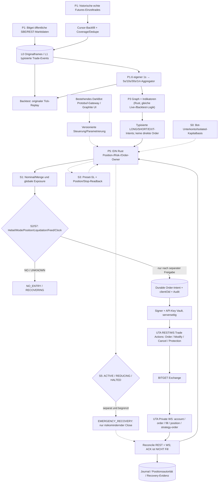

# DarkNode – PHASENPLAN P5 V1.2: Bitget UTA Private API, Futures-Steuerung und sicherer Order-Owner

**Stand:** 27.10.2026 · **Revision V1.2:** S0–S7 / P5-A01–A28, Größenregel, Exchange-Drift, Strategy-ID, Kostengates · **Status:** Architektur-/Capability-Research, **P5 = NOT_RUN**, **GATE 1 = OPEN**, **SIGN/ARM/LIVE untersagt** ohne gesonderte Freigabe.
**Projektkonvention:** Im Gesamtplan [PHASENPLAN.md](PHASENPLAN.md) bezeichnet **P3 die Indikator-/Graph-Engine**; die private Bitget-Anbindung ist **P5**. Diese Datei konkretisiert ausschließlich P5, ohne die bestehenden P0–P10-IDs umzudeuten. P1 bleibt öffentliche Marktdaten/Rohtrade-Aufzeichnung und 1s-/MTF-Aggregation.

## 1. Verifizierter Dokumentationsstand vs. echter Nachweis

- **Öffentlich auf dem Mac verifiziert:** BTCUSDT USDT-Futures, SBE-V4, Demo-V5 und Classic-V2-Rohtrade-Historie, Instrument-Snapshot für **BTCUSDT allein**; keine bestätigte vollständige Symbol-/Coinliste.
- **Öffentlich dokumentiert, nicht im Nutzerkonto getestet:** UTA-V3 Private REST und WS; Hebel, Margin/Position Mode, Order-, Strategy-Order-, Fill-/Position-Verträge. Dokumentationsprüfung ist **kein Demo-/Kontonachweis**.
- **Getrennte API-Generationen bewusst:** `/api/v2/mix/market/fills-history` als bestätigte **öffentliche** historische Trade-Quelle; **private UTA** `/api/v3/account/*`, `/api/v3/trade/*`, `/api/v3/position/*`, WS `/v3/ws/private`. Nie ohne qualifizierten Account-Mode auf Classic-V2-Private-Order-Befehle zurückfallen.
- Erst **Account/Mode/Demo-Capability-Auslesung** entscheidet, was für den tatsächlichen Account erlaubt ist; kein default-isolated, default-one-way oder „maximal erlaubter Hebel“ aus öffentlichem Instruments-Response als Kontofreigabe.

## 2. Verbindliches Blockdiagramm

**P1 Public, P3 Graph, P5 Private Risk/Execution sind getrennte Module im EINEN existierenden Rust/DarkBot-Stack.** Strategy-/Backtestdaten enthalten weder Secrets noch private Orderbefehle. Externes Bitget-JSON nur Adapterrand; intern Protobuf-/Rust-Types/binäre Journale.

## 3. Endpunkt- und Kontrollflächeninventar (UTA V3)

Basis: `https://api.bitget.com`; UTA **private WS** `wss://ws.bitget.com/v3/ws/private`; **öffentlich** `wss://ws.bitget.com/v3/ws/public/sbe` und `.../public`. Kategorie UTA REST `USDT-FUTURES`, Symbol `BTCUSDT`. WS-Private-Kanäle `instType=UTA` und Topics `account`, `order`, `fill`, `position`, `strategy-order`.

| Domäne | Methode / API | Verbindliche Nutzung | Berechtigung / Status |
|---|---|---|---|
| Symboluniversum | `GET /api/v3/market/instruments?category=USDT-FUTURES` **ohne** `symbol` | alle gelisteten Futures-Instrumente; Filter `status`, Tick/Lot/Minimum/Max; versioniert | Public; **gesamte Liste NOT_RUN** |
| Account/Permissions | `GET /api/v3/account/info` | Kontokontext/Schreibrechte prüfen | UTA-management; NOT_RUN |
| Einstellungen | `GET /api/v3/account/settings` | `accountMode`, `accountLevel`, `holdMode`, `symbolConfigList`: Leverage und MarginMode pro Paar | UTA mgt read; NOT_RUN |
| Margin-/Leverage-Vorschau | `GET /api/v3/account/pre-set-leverage` | `estMaxOpen`, `requiredMargin` vor Änderung prüfen | UTA mgt read; NOT_RUN |
| **Hebel setzen** | **`POST /api/v3/account/set-leverage`** | `category=USDT-FUTURES`, `symbol`, `leverage`, kontextabhängig `marginMode`/`posSide` | **UTA mgt read/write**; NOT_RUN |
| Position-Mode | `POST /api/v3/account/set-hold-mode` | `one_way_mode` vs `hedge_mode`; Flat/Open-order-Prüfung vor Umstellung | **UTA mgt read/write**; NOT_RUN |
| Isolierte Positionsmargin | `POST /api/v3/account/set-margin` | `add`/`remove` nach PosSide, nur bei zulässiger Isolated-Position | **UTA mgt read/write**; NOT_RUN |
| Accountmodus | `POST /api/v3/account/adjust-account-mode` | nur getrenntes Administrations-Gate; **nicht** normale Bot-Orderroutine | **UTA mgt read/write**; NOT_RUN |
| Kontoguthaben | `GET /api/v3/account/assets` | available, equity, Risiko-/Funding-Margin und interne Reservationen | UTA mgmt read; NOT_RUN |
| Order platzieren | **`POST /api/v3/trade/place-order`** | `category`, `symbol`, `qty`, `side`, `orderType`, ggf. `posSide`, `clientOid`, `reduceOnly`, initiales TP/SL nur bei qualifizierter Semantik | **UTA trade read/write**; NOT_RUN |
| Order ändern/stornieren | `POST /api/v3/trade/modify-order`, `POST /api/v3/trade/cancel-order` | Korrelation nach `orderId`/`clientOid`; Cancel-ACK ist NICHT bestätigtes Storno | UTA trade read/write; NOT_RUN |
| Strategy-/Schutzorder | `POST /api/v3/trade/place-strategy-order`, `POST /api/v3/trade/modify-strategy-order` | dokumentierte `tpsl`, `trigger`, `oco`, `trailing_stop`; Bedingung/Stop/Kind/Position-Semantik je Typ gesondert in Demo abnehmen | UTA trade read/write; NOT_RUN |
| Strategy-Abfrage | `GET /api/v3/trade/unfilled-strategy-orders`, `GET /api/v3/trade/history-strategy-orders`, `GET /api/v3/trade/strategy-sub-orders` | Schutzorder-Existenz und Suborders nachweisen | UTA trade read; NOT_RUN |
| Order lesen | `GET /api/v3/trade/order-info`, `GET /api/v3/trade/unfilled-orders`, `GET /api/v3/trade/history-orders` | nach ACK-Verlust oder Neustart vor Retry; Status / Teilfills / Cancel | UTA trade read; NOT_RUN |
| Private Fills | `GET /api/v3/trade/fills` | eigene Kontoausführungen, **nicht** die öffentliche Markt-Tradehistorie | UTA trade read; NOT_RUN |
| Positionen | `GET /api/v3/position/current-position` | tatsächliche Exchange-Position ist Autorität, nicht Strategiegraph | UTA trade read; NOT_RUN |
| Private Streaming | WS `/v3/ws/private` | nach signiertem Login `account`/`order`/`fill`/`position`/`strategy-order` abonnieren; event-/reconnectgerechter State | Auth/Demo noch NOT_RUN |

**Open-Mode-Matrix zwingend:** in One-way `side=buy/sell` und Closing mit `reduceOnly=yes` (anwendbare Orderarten prüfen); in Hedge zusätzlich `posSide=long/short` und richtungskorrekten Open/Close. `qty` bei USDT-Futures in Base-Coin-Einheiten, Preis/Volumen als exakte Decimal/Fixed-Point-Werte aus Instrument-Version (nicht Float für Ordergröße). Öffentliche theoretische Leverage-Grenze ersetzt keine kontospezifische Pre-Set-/Risikofreigabe.

**MarginMode-Differenz:** In UTA V3 ist `marginMode` laut Migrationsguide kein klassischer Pflicht-Orderparameter für Futures; Mode wird durch Kontokonfiguration/Position bestimmt. Bitgets neuere Place-Order-Dokumentation kann den Parameter dennoch im generischen Body listen. **Vor Implementierung gegen aktuelle UTA-Account-Stufe und Demo real testen; keine automatische Annahme, dass ein Orderrequest den Margin-Modus umschaltet.** `/api/v2/mix/account/set-margin-mode` ist **Classic V2**, kein unqualifizierter UTA-Ersatz.

## 4. Authentisierung, Schlüssel und Transport

Bitget UTA REST Signatur: `ACCESS-SIGN = Base64(HMAC-SHA256(secret, timestamp + uppercase_method + path + (?query falls vorhanden) + exakte body_bytes))`; `ACCESS-KEY`, `ACCESS-TIMESTAMP`, `ACCESS-PASSPHRASE`, `Content-Type`. Timestamp/Requestbody müssen den wirklich versandten Bytes entsprechen; exakte Query-Reihenfolge und Canonical-Form im Adapter festlegen. WS-Private: `op=login`, mit Key/Passphrase/Timestamp und Signature über `timestamp + GET + /user/verify`; Login erst bestätigen, dann Subscriptions. Bitgets Dokumentation hat verschiedene historische Zeitbeispiele: nach aktuellem Quick-Start ms verwenden und Demo verifizieren.

**Permissions:** UTA Trade **read/write** erlaubt Orders. UTA Management **read/write** erlaubt Hebel/Modusänderungen. Management read reicht nicht zum Setzen. Account-Status-Lesephase zunächst ausschließlich getrennte **read-only Credentials**; für Demo-Mutationen eigene Demo-Schlüssel. Live-Key später ausdrücklich und getrennt freigeben. **Kein Withdrawal-/Transfer-/Broker-Key**, IP-Allowlist und Egress-Host-Allowlist, TLS-Zertifikatsprüfung, keine Secrets in Git/UI/Logs/Protobuf/Event-Messages. Least Privilege + Schlüsselrotation/Revocation. Kann man Management-Rechte nicht feingranular trennen, Hebel/Modus nur über separaten Admin-Kontrollpfad, niemals aus Graph-Node frei abrufbar.

**Demo-Bindung:** REST verwendet `https://api.bitget.com` mit **Demo-API-Key und Header `paptrading: 1`**. Private WS Demo **`wss://wspap.bitget.com/v3/ws/private`**, Public WS Demo `.../public`. Bitget Quickstart nennt eigene Demo-Credentials. Kein Demo-Fallback auf Live. Die im P1-Research beobachtete `.../public/sbe`-Demo-URL ist eine separat empirisch ermittelte Public-Datenstrecke, **kein Private-Orderendpunkt**.

**Rate-/Transportregeln:** Endpunktbezogene UID-Limits und geteilter REST/WS-Budgetstatus; bei 429 bounded backoff und `UNKNOWN` für möglicherweise eingesandte Order, nicht blind erneut platzieren. Text-`ping` alle 30 s und `pong`, separate Heartbeat-/Private-Stale-States. Signieren, Serialisieren, TLS-/JSON-Grenze ausdrücklich **außerhalb** des P1-SBE-/Event-Hot-Path.

## 5. Sicherheits- und Positionsautorität

1. Ein zentrales Rust **Account/Portfolio-/Position-/Order-Owner** je Bitget-Konto. Pro Bot nur ein fest ausgewähltes, verifiziertes Futures-Symbol und hartes Kapitalbudget; später mehrere Bots ausschließlich innerhalb desselben globalen Account-Risikolimits. Kein Node darf signierte Requests direkt auslösen.
2. Risk-Vorprüfung umfasst Instrumentstatus/Tick/Lot, verfügbare Equity, Budgetreserve, Funding/Fees/Slippage, Liquidationsabstand, live beobachteten Hebel und Margin-Modus, One-way/Hedge, aktuelle Position, laufende Orders, nachweisbaren Initial-SL und frischen Public-/Private-Feed. Bei Widerspruch `NO_ENTRY`.
3. `clientOid` und vollständige typisierte Requestdaten **vor dem Send** persistent journalisieren und fsyncen. ACK, Order-New, Partial-Fill, Filled, Cancelled, Stop-Armed und Exchange-Position als **verschiedene** Zustände führen; ACK ist keine Ausführung. Nach Timeout Query nach `clientOid`/`orderId` und Fills/Positions; kein Blind-Resend.
4. Initiale Schutzorder nachweislich an der Börse bestätigt, nicht nur im lokalen Code gesetzt. Nach einem Fill ohne qualifizierten Stop `PROTECTION_UNKNOWN` und sichere vordefinierte Exception-/Exit-Policy, keine weiteren Entries. Stop-/Trailing-Änderungen nach Kosten, Requotes, Mengen-/Partial-Fill-Änderungen und Exchange-Status erneut prüfen.
5. Key-Rechte nur in Infrastruktur; `ARM`/`LIVE` separate, auditierte, manuelle Autorisierungen, niemals automatisch durch positives Backtesting. Demo darf erst nach entsprechender Freigabe signierte Testorders ausführen; dieser Research-Auftrag sendet **keine** Order.
6. Bei REST/WS-Unstimmigkeiten, Neustart, verlorener Orderantwort, Teilfill, Fremdorder oder Subaccount-Änderung zuerst REST-Snapshot + WS private-Stream korrelieren, lokale Reservationen gegen Exchange-Positionsautorität reconciliieren. Fehlt Evidenz: `UNKNOWN` / `RECOVERING`.

## 5a. VERBINDLICH: Unabhängige Schutzschichten S0–S7 (P5 V1.1)

**Abnahmestatus aller Schichten: NOT_RUN.** Jede Schicht muss unabhängig von erfolgreichem Backtest/Frontend/Exchange-ACK wirken. Keine Signatur, ARM-/LIVE-Freigabe oder Demo-Order durch diese Planung. Referenzverhalten aus Open Source begründet Prüfungen, ist kein Beweis für den Bitget-Account.

### S0 – Kapitalbasis isolieren, aber keinen garantierten Verlustdeckel behaupten

- Bevorzugt ein **reguläres, API-fähiges Bitget-Unterkonto** ausschließlich für DarkNode mit begrenztem Bestand; keine automatischen Transfers oder weiteren Trading-Owner. Bitgets API-Key-Dokumentation bestätigt eigenständige Unterkonto-Schlüssel, und die Futures-Bedingungen beschreiben voneinander getrennte Margin-Anforderungen der Unterkonten. **Nicht** mit Bitgets Spezialprodukt „bot trading sub-account“ gleichsetzen, für das eine Supportseite API-Trading ausschließt. Konto-Typ und tatsächliche Befugnisse im Demo verifizieren.
- **Isolated Margin** nur wenn tatsächlich unterstützt/ausgelesen und explizit konfiguriert; Cross ohne separate Freigabe sperren. Keine Aussage „schlimmster Fall ist garantiert die hinterlegte Margin“: Gebühren, Slippage, Liquidationsmechanismen, Nachschusssituationen und kontobezogene Sonderregeln separat prüfen.
- Key nur mit erforderlichen **Lese-/Trade-Rechten**, IP-Allowlist und **keinen Auszahlungs-, Transfer- oder Key-Admin-Rechten**, soweit Bitget die Berechtigungen granular anbietet; Management-Schreibrechte für Hebel/Mode nach Möglichkeit separater administrativer Pfad. **Kein Withdrawal-Recht verhindert nicht Verluste durch missbräuchliche Trades.**
- Kapital- und Exposure-Limits pro Bot **und** konto-/UID-global, unabhängig von der Strategie, auch wenn später mehrere Bots denselben Kontostand teilen.

### S1 – Nominal-/Mengen-Risiko VOR jeder Order

- Harte Obergrenzen für **Nominalwert (Positions-Notional)**, Base-Menge, offene Gesamt-Exposure einschließlich noch nicht bestätigter und bereits übermittelter Orders, Zahl der Positionen, Orderrate, Tages-/Gesamtverlust. **Nicht** ausschließlich Margin als Risikomaß verwenden. Hebel beeinflusst Marginanforderung, darf die autorisierte Position niemals vergrößern.
- Risk-Preflight aus verifizierten Instrumentdaten: Futures-Symbol/Status, Preis- und Mengenstep, Min/Max, Kontokapital/Reservations, Fees, Funding, Spread/Slippage, Public/Private-Feed- und Uhrqualität, Margin-/Hold-Mode, Stopverfügbarkeit. Preis × Menge mit Fixed-Point/Decimal und korrekter Futures-Einheit; keine Float-Rundungs-/Overflow-Bypässe.
- Kein Node-Graph, GUI-Command, API-Reconnect oder Testmodus kann ein höheres Limit oder einen Risk-Bypass setzen. Jede Limitänderung versioniert, nachvollziehbar, separat autorisiert.

### S2 – Falscher Hebel / Liquidationsprüfung

1. Modus/Leverage/Position/Orders lesen. **Set-Leverage/Mode nur bei nachweislich FLAT und ohne offene oder UNKNOWN Orders**, mit gesonderter Zustimmung, nicht bei laufender Position.
2. Reihenfolge: **`GET /api/v3/account/pre-set-leverage` → `POST /api/v3/account/set-leverage` → `GET /api/v3/account/settings`** (danach Ist-Werte ggf. zusätzlich in `/api/v3/position/current-position`). Hebel, `marginMode`, `holdMode`, `posSide`, `symbol` und tatsächlich aktiver Account müssen exakt zum Soll passen; sonst neue Entries `HALTED`.
3. Nach jedem echten Fill/Partial-Fill und bei Margin-/Markpreisdrift: Bitget-Position mit `liquidationPrice`, `markPrice`, `mmr`, `leverage` und `marginMode` lesen. `liquidationPrice` ist laut Bitget **geschätzt**, 0/negativ hat eigene Bedeutung; kein garantierter Exit-Preis. Long-SL mit qualifiziertem Puffer **oberhalb**, Short-SL **unterhalb** der Liquidationsregion (inkl. Mark-/Last-Trigger, Kosten und Liquidations-/Slippage-Unsicherheit).
4. Stop zu nah an Liquidation / Preis unbekannt / Hebel falsch → `NO_ENTRY`; kontrollierte risikomindernde Verkleinerung oder Schließung je freigegebener Notfallpolicy. Niemals ungeprüft Margin nachschießen.

### S3 – Stop als serverseitig *bestätigter* Zustand

- Bitget unterstützt für Futures **Preset-`stoploss`** bei `POST /api/v3/trade/place-order` mit `slTriggerBy`, `slOrderType`. Ziel: initialen Schutz mit Entry anfordern. **Keine Behauptung**, der Stop sei bereits bei jedem Fill garantiert wirksam oder skaliere automatisch bei Partial-Fill. Dies ist pro UTA-Mode/Entry-Typ ein verpflichtender Demo-Nachweis.
- Nach **jedem Fill/Partial-Fill**: tatsächlich an der Börse vorhandenen Schutz aus privaten WS-/REST-Order-/Strategy-Order-Daten auslesen, verifizieren: Side, Position, Restmenge, Triggerbasis (Mark/Market), Triggerpreis, Markt-/Limit-Ausführung, Status. `STOP_REQUESTED` ≠ `STOP_CONFIRMED`. Deadline wird anhand gemessener Testdaten festgelegt.
- Fehlender/gelöschter/unpassender Stop → `PROTECTION_UNKNOWN`, neue Entries sperren, eindeutig korrelierten Ersatz-Stop versuchen. Scheitert die Schutzherstellung: **kontrollierter Emergency-Close** nur über bestätigte Restposition und gültige Close-/reduce-only-Semantik (One-way versus Hedge unterscheiden). Scheitert dieser oder bleibt Sendestatus unbekannt → `EMERGENCY_UNKNOWN/HALTED` + persistenter Alarm; kein wiederholtes Market-Senden ohne Exchange-Reconciliation.
- Nach Reconnect, Neustart, Fremdänderung und periodisch Stop-Existenz/mengenmäßig vollständigen Schutz erneut kontrollieren. Emergency-Marktorder ist keine Fill-/Verlustgarantie; Stop-Limit kann bei Gap nicht ausführen.

### S4 – Signale, Cancel/Timeout, späte Fills, keine Doppelorder

- Vor Send persistenter/fsycnter `clientOid`-Intent und vollständige Requestidentität. Getrennte States: `INTENT_COMMITTED/SENT/ACK/NEW/PARTIAL/FILLED/CANCEL_PENDING/CANCELED/REJECTED/UNKNOWN`. Ein lokales `FAILED` oder Timeout beweist **nicht**, dass Bitget nichts ausgeführt hat.
- Timeout, Storno-Fehler, verlorenes ACK, Neustart → `UNKNOWN`; zuerst private Order-/Fill-/Positions-Reconciliation sowie `clientOid`-/`orderId`-Lookup, **niemals blind eine neue Order/Close-Order** senden.
- Signal verschwindet nach Market-Send: laufende Order/Fills samt Stop weiter behandeln, nicht „nicht passiert“ annehmen. Bei offener Limit-Entry Storno anfordern und Rest-Fills bis zum nachweislichen Endstatus schützen.
- **Hummingbot-Regressionsfall:** PositionExecutor/Hyperliquid Issue #7295 beschreibt `FAILED close → late FILL → duplicate close`. Identität einer fehlgeschlagenen Close-Order bis abschließend geklärtem Exchange-Zustand erhalten, späte Fills unabhängig vom bisherigen lokalen Fehlerstatus verbuchen; kein zweiter Close bei noch unbekanntem ersten. **Referenzbug, nicht bei Bitget schon gemessen.**

### S5 – Getrennte Risk-States und autorisierte Notfallaktion

| Zustand | Neue/erhöhende Orders | Storno/Readback | Risk-reduzierende Orders |
|---|---|---|---|
| `ACTIVE` | Nur nach vollem Risk-Gate | JA | JA |
| `REDUCING` | **NEIN** | JA | JA, nur für bestätigte vorhandene Position/Menge |
| `HALTED` | **NEIN** | JA | **Nicht über normalen Orderpfad** |
| `EMERGENCY_RECOVERY` | **NEIN** | JA | Enger, journalisierter, deduplizierter Not-Exit nach bestätigter Menge |

- NautilusTrader definiert `HALTED` als **Cancels/Queries-only**. Deshalb sind **„Handel stoppen“** und **„Position kontrolliert schließen“** getrennte, explizit auditierte Operationen. Emergency ist kein allgemeiner Risk-Bypass: kein Entry/Flip, maximal bestätigte Restposition, richtige One-way/Hedge-Semantik, Dedup/Requery vor Retry.
- Stale Feed, Uhrdrift, Tagesverlust → mindestens `NO_ENTRY`; `REDUCING` nur wenn sichere Positionsautorität vorhanden; bei Unklarheit `HALTED/RECOVERING`. Rückkehr `ACTIVE` nur nach frischem Konto-/Position-/Stop-Readback, keine Freigabe allein durch Ping.
- Not-Aus/Alarm im bestehenden DarkBot Frontend sowie **autonome** Watchdogs/outbox/externer Heartbeat gemäß P1.9; Browserausfall beeinträchtigt nicht Stopprüfung oder Recovery.

### S6 – Börsen-Totmannschalter standardmäßig OFF

- Bitget dokumentiert **`POST /api/v3/trade/countdown-cancel-all`**, `countdown=5..60` Sekunden (`0` deaktiviert), 1 Request/s/UID; **separate Freischaltung über Bitget Business Development nötig**. Gilt für UTA, nicht Classic.
- Bitget schreibt **alle offenen Orders stornieren**. **Ungeklärt**, ob die konkret verwendeten Preset-TP/SL-/Strategy-Schutzorders mitbetroffen sind. Deshalb `DEFAULT=OFF`. Erst nach autorisiertem Demo-Test mit offenen Entries, TP/SL, Teilfills und ausbleibendem Heartbeat darf über Aktivierung entschieden werden. **Löscht es Schutzorders oder ist Abdeckung unklar, muss es OFF bleiben.**

### S7 – Start-/Drift-Gate

- Zu Boot, Reconnect und Konfigurationsänderungen prüfen: Unterkonto/UID/Keys/Allowlist, echte Exchange-/Account- und Hold-/Margin-Modi, Futures-Symbol/Precision, Ist/Soll-Hebel, Eigen-/Fremdorders und Fills, reale Position inkl. Liquidation, Schutzorders, Equity/Reservations und Public-/Private-Feed/Clock. Nicht passende oder fehlende Werte → **kein Entry**, aber bestehende Exposure weiterhin aktiv überwachen.
- Änderungen in der Bitget-App und im Account trotz laufendem Bot erkannt/geloggt; keine auto-ARM-/auto-LIVE-Aktivierung, keine Scheinfreigabe aus lokalem State. Einzige autoritative Position bleibt Bitget, journalbasierter Restart-Reconcile verpflichtend.

**Vertragliche Grenzen:** Unterkonto/Isolated mindern Kontorisiken, garantieren nicht einen exakten maximalen Endverlust; Key ohne Withdrawal verhindert keine verlustträchtigen Tradeaktionen; Liquidations-/Stop-Preise sowie Market-Exits garantieren keine Fills. Kein Demo-PASS ohne echten Bitget-Nachweis am qualifizierten Account/Mode.

**Primärquellen und Referenzen:** [Bitget Futures-Konto-/Margin-Guide](https://www.bitget.com/docs/uta/best-practices-guide), [Bitget UTA Rest/Subaccount-Key](https://www.bitget.com/docs/uta/rest-api), [Bitget Futuresbedingungen/Unterkonto-Margin](https://www.bitget.com/support/articles/7700532076057), [Bitget Account/Set-Leverage](https://www.bitget.com/docs/catalog/account/account-settings), [Bitget Position/liquidationPrice](https://www.bitget.com/legacy-docs/uta/trade/Get-Position), [Bitget Place-Order/Preset-SL/countdown-cancel-all](https://www.bitget.com/docs/catalog/trading/order-management), [NautilusTrader Trading States](https://nautilustrader.io/docs/latest/concepts/execution/), [Nautilus Risk limits](https://nautilustrader.io/docs/rust-api-latest/src/nautilus_live/node/config.rs.html), [Freqtrade Stoploss und emergency_exit](https://docs.freqtrade.io/en/latest/stoploss/), [Hummingbot Issue #7295](https://github.com/hummingbot/hummingbot/issues/7295).

**Verbindliche Code-Audit- und Gesamtprüfungsreferenz:** [P5_OPEN_SOURCE_CODE_AUDIT_AND_TESTPLAN_V1.md](P5_OPEN_SOURCE_CODE_AUDIT_AND_TESTPLAN_V1.md) mit fixierten Upstream-SHAs, konkreten Source-/Testdateien, CCXT-V2-vs-UTA-Routing, Hummingbot-/Freqtrade-Regressionen und einheitlichem Testprogramm `DN-P5-ALL-001` in A–F-Lanes. **Gesamttest noch NOT_RUN; keine PASS-Vortäuschung.**

## 5b. Präzisierungen V1.2 – P5-Sicherheit, identische A01–A28 (27.10.2026)

**Status:** normative Erweiterung des bestehenden Tests `DN-P5-ALL-001`; keine neue Engine, keine zusätzliche Phase, keine Orderausführung. Die Schichten **S0–S7 sind acht Schichten**. Sämtliche folgenden Implementierungs- und Demo-Nachweise bleiben `NOT_RUN`.

### Positionsgröße ist eine überprüfbare Risikorechnung (S1 / A14)

Für lineare USDT-Futures wird die Ordermenge aus einem pro Trade freigegebenen **Netto-Verlustbudget** und den tatsächlichen Kontrakt-/Einheitendaten berechnet, **bevor** Lot-Schritte abgerundet werden. Konservativer Prüfwert je Base-Einheit: `d = abs(entry_reference - stop_reference) + entry_fee_per_base + exit_fee_per_base + entry_slippage_reserve_per_base + exit_gap_slippage_reserve_per_base + funding_reserve_per_base` (alle in USDT/Base; niemals Prozent mit USDT/BTC addieren). Dann `q_risk = floor_to_lot(risk_budget_USDT / d)`; die endgültig genehmigte Menge ist das **Minimum** aus `q_risk`, Notional-Limit, Mengen-/Exposure-Limit, Available-/Reservation-Limit und Exchange-Maximum. Ist `d`, Kontowährung, Stop, Tick/Lot oder Kostenreserve nicht verlässlich bestimmt, gilt `NO_ENTRY`. Der Risikoansatz gilt getrennt von der harten S1-Nominalwertgrenze, auch bei höherem Hebel und gleichzeitig unbekannten In-flight-Orders. Die Reserve modelliert Szenarien, **keinen garantierten Maximalverlust** bei Gaps/Liquidation. Teste Rundung, Decimal-Overflow, minOrderAmount, stark wechselnden Preis, Teilfills, Kapital- und UID-Grenzen.

### Strategy-Order-Identität und Schutzstatus (S3/S4 / A17–A22/A27)

Bitget UTA V3 dokumentiert `clientOid` bei `POST /api/v3/trade/place-strategy-order` **nur für `type=tpsl`**. Die erwähnte sechs­stündige Idempotenzgültigkeit ist laut Dokumentation **nicht vollständig garantiert**; für andere Strategietypen keine Gleichsetzung mit einem verifizierten `clientOid`-Schutz. Auch bei gewöhnlichen Orders prüft Bitget `clientOid`-Eindeutigkeit nur gegen **offene** Orders. Daher: persistente **eigene** Request-Identität, Exchange-`orderId`, Typ, Konto, Symbol, Side, Triggerbasis, Menge, Zeit, Parent-/Suborder-Relation und Readback; unbekannte Antwort ⇒ `UNKNOWN`, REST/WS-Abgleich **vor** Ersatz, Modify, Cancel oder erneutem Exit. Für V1 ist `tpsl` als prüfbarer Stop-Kandidat vorzuziehen; `full`/ `partial`, `qty`, Partial-Fill und `modify-strategy-order` müssen gegen echte Demo-Positionen belegt werden. Ein modifizierter Stop gilt erst nach neuer Exchange-Bestätigung. Andere Strategietypen sind weder still erlaubt noch bereits widerlegt.

### Exchange-autonome Positionsänderung (S3/S4/S7 / A08/A20/A26/A27)

Bitget nennt `execType=reduce/liquidation` sowie ADL-/Liquidations- und Forced-Reduction-Ereignisse in den offiziellen Enumerationen. Die Position kann deshalb ohne eigenen offenen Bot-Fill von der erwarteten Menge abweichen. **Positions-Snapshot und eigene Orderhistorie nicht gleichsetzen.** Position, Fill-/Orderjournal und Schutzmenge ereignisgetrieben **und** nach jedem Reconnect/Restart/periodisch vergleichen. Ungeklärte Reduktion, Liquidation, ADL, externe manuelle Aktion oder Fremdorder ⇒ `NO_ENTRY/RECOVERING`, Stopmenge erneut überprüfen, verwaiste Schutzorders behandeln und erst nach eindeutigem Readback in `ACTIVE` zurückkehren. Fault-Replay: Positionsänderung ohne eigenen Fill, danach verzögerte Events, Neustart und Stopmengenabweichung.

### Tagesverlust: Exchange-Equity und PnL nachvollziehbar abgleichen (S1/S7 / A11/A14/A26)

Die reine Differenz `equity_jetzt - equity_UTC00` ist **kein** verlässlicher Trading-Tages-PnL: Transfers/Einlagen/Entnahmen, Asset-Konvertierungen und externe Kontobewegungen können sie verändern. Speichere qualifizierte Exchange-Equity-Snapshots mit UTC-Grenze und Account-/Währungsversion; berechne eine **um externe Cashflows korrigierte Equity-Änderung** einschließlich ungeklärter Balance-Ereignisse und halte **realisierten Netto-PnL, Gebühren, Funding und unrealisierten marktbewerteten PnL** getrennt prüfbar. Tages-/Gesamtrisiko muss laufende offene Verluste einbeziehen; fehlende 00:00-Basis, Staleness oder widersprüchliche Accountdaten sperren neue Entries. Exakte Tagesreset-, FX- und High-Water-Regel vor Aktivierung versionieren, nicht aus einem internen Win/Loss-Zähler ableiten.

### Nettonutzen, Kosten und Risiko bleiben zwei unabhängige Gates (P4/P8/P9; S1/S7)

Die **technische P5-Implementierung** darf gemäß Gesamtphasenplan parallel zu P3/P4 vorbereitet werden; ein positives Backtestergebnis ist **keine Bedingung zum Implementieren** des sicheren Order-Owners. Für **Strategiequalifikation und späteres Echtgeld-LIVE** ist dagegen ein vorab festgelegter, reproduzierbarer Out-of-Sample-/Walk-forward-Test mit **kontospezifischen** Maker-/Taker-Gebühren, Spread, Slippage, Funding, Fill-/Non-Fill- und Adverse-Selection-Annahmen Pflicht. Öffentliche Gebühren sind nur ein Snapshot, nicht der individuell geltende Tarif. Market-/Maker-/Post-only-Ausführungen getrennt modellieren und nach realer Demo-/Pilot-Evidenz kalibrieren; Demo-Liquidität ist kein Echtgeld-Fill-Beweis. Unverifizierte positive Erwartung ⇒ kein ökonomisches LIVE-Gate; keine erfundene Mindest-Rendite oder statistische Signifikanz. Das **nicht überbrückbare zentrale** Kosten-/Risk-Gate prüft jeden Order-Intent; ein visueller Kosten-Node kann es **nicht** ersetzen. Funding-Termin und `mark`-/`market`-Stop-Trigger werden mit qualifizierter Daten- und Kostenbasis als versionierte Parameter verglichen; eine generelle Funding-Minuten-Sperre wird ohne Strategieprüfung nicht hartcodiert.

### V1-Modusumfang nicht still verändern (DN-D08, A02–A07/A15–A20)

**One-way + Isolated ist ein sinnvoller enger V1-Prüfkandidat, aber laut `GATE_1.md` DN-D08 noch nicht als geprüfter Bitget-Kontomodus freigegeben.** Die endgültige Auswahl erfolgt nach read-only Account-Capability und Demo. Nicht aktivierte Hedge-/Cross-/IOC-/FOK-/OCO-/Trailing-Varianten müssen mindestens **sicher abgelehnt** werden; volle positive Testmatrix nur für aktivierte Capabilities. Initialer Market-Entry mit Preset-SL und Reduce-only-Market-Exit ist ein Kandidat, **keine vorab bewiesene Teilfill-/Stop-Garantie**. Eine Stop-Monotonie und Exchange-Modify-Readback sind auch bei lokalem Break-even/Trailing notwendig; Post-only nicht grundsätzlich aus V1 ausschließen, bevor P4 Kosten/Fills bewertet. Es gibt keine zweite Order-Engine.

### Zusätzliche Assertions innerhalb der bestehenden 28 Tests

| Bestehende IDs | Zusätzlicher zwingender Negativ-/Realnachweis |
|---|---|
| A11/A14 | Quantitätsformel, Gebühren-/Gap-/Funding-Reserve, Lot-Floor, Min-Notional, Notional-Cap und um externe Cashflows korrigierter Tagesverlust |
| A17–A20 | `tpsl`-`clientOid`-Grenze, `full/partial`, `qty`, Replace/Modify-ACK≠Stop bestätigt, Restmenge nach Fill |
| A08/A21/A22/A27 | Nach >6h, verlorener Orderantwort, Reboot, Late Fill und identischer alter `clientOid` nie blind erneut senden |
| A20/A26/A27 | Exchange-autonome Reduktion/ADL/Liquidation/Fremdaktion ohne eigenen Fill, Stop-Readback, keine Phantomposition |
| A02–A07/A15 | Exakt freigegebener One-way-/Isolated-Mode; alle deaktivierten Modi/Ordertypen ausdrücklich ablehnen |
| A28 | Stop-Trigger `mark` vs `market`, Preisgap, Kosten- und Funding-Schock; keine modellierte Fill-Garantie |

**Primärquellen (Dokumentation, keine Demo-Evidenz):** [Bitget Strategy Trading / `clientOid` und `tpsl`](https://www.bitget.com/docs/catalog/trading/strategy-trading), [Bitget Best Practices / Open-Order-ID-Uniqueness](https://www.bitget.com/docs/uta/best-practices-guide), [Bitget UTA Enumerations / Forced-Reduction und ADL](https://www.bitget.com/docs/uta/enum), [Bitget Account Channel / Equity](https://www.bitget.com/docs/uta/websocket/private/Account-Channel), [Bitget Account Settings / Mode und Leverage](https://www.bitget.com/docs/catalog/account/account-settings).

## 6. Referenzvergleich Open Source (keine produktive Dependency-Freigabe)

| Projekt | Konkreter Recherche-Nutzen | Begrenzung für DarkNode |
|---|---|---|
| [CCXT – Bitget-Adapter](https://github.com/ccxt/ccxt/blob/master/python/ccxt/bitget.py) | `loadMarkets`, Futures/Precision, `setLeverage`, `setMarginMode`, `setPositionMode`, `createOrder`, `fetchPositions`; **Achtung**: in konkreter CCXT-Bitget-Implementierung ist `uta` für `setLeverage` ohne Params teils **false** (Classic-V2-Pfad) | Python+REST/JSON; API-Mode/Version explizit statt blind übernehmen; kein Rust-Hot-Path |
| [Hummingbot perpetual_trading](https://github.com/hummingbot/hummingbot/blob/master/hummingbot/connector/perpetual_trading.py) | Trennung von `position_mode`, leverage pro `trading_pair`, Positions-/Ordertracker | Prüfbedarf für aktuelle Bitget-UTA-V3-Connector-Pfade und Lizenz |
| [Freqtrade Futures](https://github.com/freqtrade/freqtrade/blob/develop/docs/leverage.md) | Futures-/Margin-Konfiguration und Kapitalkontrolle, Dry-run-Futures-Einschränkungen | Primär Candle-/Python-orientiert, nicht automatisch passend zum SBE-Raw-Trade-/L2-Ziel |
| [NautilusTrader](https://github.com/nautechsystems/nautilus_trader) | Events/Risk/Portfolio/Execution-State, getrennte Backtest-/Live-Komponenten | Bitget-UTA-Abdeckung **nicht bestätigt**; nicht als vorhandenen fertigen Bitget-Connector behaupten |

**Entscheid:** Bitget UTA V3 direkt im **bestehenden Rust-Adapter und Order-Owner** typisieren; Open Source als Referenz für Vertrags-/Recovery-Fälle nutzen, nicht zweite Trading-Architektur einbauen. Erlaubt sind isolierte, auditierte Bibliotheks-Bausteine nach Lizenz-/Versionstest. Bestehendes DarkBot Gateway/Graphite/Protobuf bleibt unverändert führend.

## 7. P5 Abnahme- und Fehlerprüfungen

| ID | Nachweis | Status |
|---|---|---|
| P5-A01 | Full USDT-Futures-Instruments ohne `symbol` → valide dynamische Auswahl; stillgelegtes Paar und Formatänderungen blockiert | NOT_RUN |
| P5-A02 | Account/UTAmode/read permissions/holdMode/marginMode/actualLeverage/risktiers aus dem echten **Demo-Account** mit dokumentierten Rückgabedaten erkannt | NOT_RUN |
| P5-A03 | 5× als Beispiel: `pre-set-leverage` lesen, autorisiertes `set-leverage` auf Demo, `settings` erneut lesen; Long-/Short-/isolated/cross-Semantik | NOT_RUN |
| P5-A04 | Mode-Wechsel nur bei Flat+keinen offenen Orders; ablehnender Exchange-Response darf keine Readiness vortäuschen | NOT_RUN |
| P5-A05 | One-way/Hedge buy/sell/posSide/reduceOnly und Positionsmengen, Instrument-Tick-/Lot-/Min-Notional-Tests gegen Bitget-Demo | NOT_RUN |
| P5-A06 | Market, Limit, IOC, FOK, Post-only, Cancel, Modify – Response vs tatsächliche WS-Order/Fill-Deltas getrennt | NOT_RUN |
| P5-A07 | Initial TP/SL, serverseitiges SL, Trigger, OCO, Trailing; Stop-Versagen, Partial-Fill, Cancel-replace und bestätigte Schutzexistenz | NOT_RUN |
| P5-A08 | Lost ACK, Doppelsignal, reconnect, Gateway-Close, REST/WS Konflikt, Reboot mit Position + ClientOid-Requery → **keine Doppelorder** | NOT_RUN |
| P5-A09 | Margin/Leverage-Änderungen, Order-Rate-Limits, UID/IP-Limits, Signatur-/Timestamp-/Clock-Fehler und 429; fail-closed | NOT_RUN |
| P5-A10 | Secrets/IP-Allowlist, keine Withdrawal-Rechte, kein Frontend-Key, getrenntes Demo/Live, SBE-Hot-Path ohne interne JSON-Verträge | NOT_RUN |
| P5-A11 | Echtes Risiko-/Kontobudget je Bot, globale UID-Exposures, Liquidations-/Funding-/Fee-Deltas, Kill-/Emergency-Policies | NOT_RUN |
| P5-A12 | Demo-Reconciliation bis bestätigtem FLAT ohne unbestätigten Schutz-/Restorderzustand | NOT_RUN |
| P5-A13 | API-fähiges echtes Bot-Unterkonto, getrennte Mittel, keine automatischen Transfers, Rechte/IP/Keys/Isolated dokumentiert; Verlustgrenzen ohne falsche Margin-Garantie | NOT_RUN |
| P5-A14 | Nominal-/Mengen-/Bot-/UID-Limits vor jeder Order inklusive offener/UNKNOWN/Partial Exposure und Hebelabweichung – nie nur Margin; Graph/Gateway kann Risk nicht umgehen | NOT_RUN |
| P5-A15 | FLAT ohne offene Orders: pre-set-leverage → set-leverage → settings/Position readback; falscher Hebel/Mode/PosSide blockiert Entry und meldet HALTED | NOT_RUN |
| P5-A16 | Nach jedem Fill Bitget-Liquidationspreis/Markpreis/MMR/Leverage prüfen, konservativen Long-/Short-Stop-Puffer validieren; zu wenig Puffer → sichere Verkleinerung/Not-Exit statt stiller READY | NOT_RUN |
| P5-A17 | Preset-SL am Entry in realer Demo für One-way/Hedge/isolated/cross/Market/Limit; Server-Schutzstatus und Trigger nach realem Fill nachgewiesen, nicht nur ACK | NOT_RUN |
| P5-A18 | Teilfill: Stopmenge exakt gegen bestätigte Position verifiziert; Zeit bis wirksamen Schutz und mögliches ungeschütztes Intervall real gemessen, keine Sofortwirkung behauptet | NOT_RUN |
| P5-A19 | Stop fehlt/wird abgelehnt/manuell gelöscht: UNKNOWN → qualifizierter Ersatzstop → wenn nötig kontrollierter Emergency-Close → FLAT/Reconcile oder UNKNOWN+Alarm, keine ungeprüften Wiederholungen | NOT_RUN |
| P5-A20 | Periodischer und Reconnect-/Restart-Stop-Audit mit REST+Private WS erkennt falsche Menge/Trigger, externe Löschung/Neuanlage und Positionsänderung | NOT_RUN |
| P5-A21 | Hummingbot-Race-Regression: FAILED Close/Timeout → Late Fill → kein zweiter Close; persistierte clientOid und echter Exchange-Status vor Retry | NOT_RUN |
| P5-A22 | Signalende nach Market-Send bzw. Cancel-Pending bei Limit mit Late Partial Fill: ACK/Fills/Stop bleiben verfolgt; Cancelfehler bleibt UNKNOWN | NOT_RUN |
| P5-A23 | ACTIVE/REDUCING/HALTED plus enger EMERGENCY_RECOVERY-Pfad: HALTED normale Orderdeny; Emergency reduziert nur belegte Restmenge, kein Entry/Flip/Bypass | NOT_RUN |
| P5-A24 | GUI-HALT vs Emergency-Close getrennt; Browser/Gateway down beeinträchtigt autonomen Stop-Audit/Alarm nicht; ACTIVE nur nach vollem Readback | NOT_RUN |
| P5-A25 | Bitget countdown-cancel-all erst bei genehmigtem Zugang und wenn Demo-Test bei Host-/Heartbeat-Ausfall Schutz-TP/SL/Strategy unangetastet belegt; sonst DEFAULT OFF | NOT_RUN |
| P5-A26 | Kaltstart und Account-/App-Drift: Key/Account/Mode/Hebel/Symbol/Orders/Fills/Position/Stops/Clock/WS validiert, jede Abweichung blockiert Entry | NOT_RUN |
| P5-A27 | Crash-/Netzsplit an Persistenz-/Send-/ACK-/Fill-Grenzen inkl. externer Orders und Positionsänderung: kein Phantom-FLAT, kein doppelter Fill/Close | NOT_RUN |
| P5-A28 | Stop-Limit bei Preisgap, Mark/Market-Trigger, Funding, Liquidation, Gebühren/Slippage – fail-closed und keine behauptete Fill-Garantie | NOT_RUN |

**Gate:** Keine der dokumentierten privaten P5-Endpunkte wurde im Nutzer-Account abgefragt oder beschriebenen Mutationsfälle ausgeführt. Dokumentationsinventar **VERIFIED_DOC**, funktionale Konto-/Order-Nachweise **NOT_RUN**. P5 bleibt NOT_RUN; Gate 1 bleibt OPEN. Kein SIGN/ARM/LIVE.

## 8. Offizielle Primärquellen (27.10.2026)

- [Bitget UTA Quick Start, Schlüssel/SIGN/Private WS/Demo/Rate-Limits](https://www.bitget.com/docs/uta/quick-start)
- [Instruments: kompletter USDT-Futures-Katalog ohne Symbolfilter](https://www.bitget.com/api-doc/uta/public/Instruments)
- [Account Settings: Settings/Pre-Set/Set-Leverage/Hold-Mode/Set-Margin](https://www.bitget.com/docs/catalog/account/account-settings)
- [Order Management: Place/Modify/Cancel/Order-Info/History](https://www.bitget.com/docs/catalog/trading/order-management)
- [Bitget Best Practices: Positionsmodus, Accountmode, Leverage, Reconciliation](https://www.bitget.com/docs/uta/best-practices-guide)
- [April/Juni/August 2026 V3 Strategy-Order-Erweiterungen](https://www.bitget.com/docs/uta/changelog/2026-08)
- [Bitget UTA Migrationsguide: Classic V2 vs UTA V3](https://www.bitget.com/docs/classic/uta-api-upgrade-guide)
- [Demo REST](https://www.bitget.com/docs/uta/demo-trading/rest-api) und [Demo WS](https://www.bitget.com/docs/uta/demo-trading/websocket)
