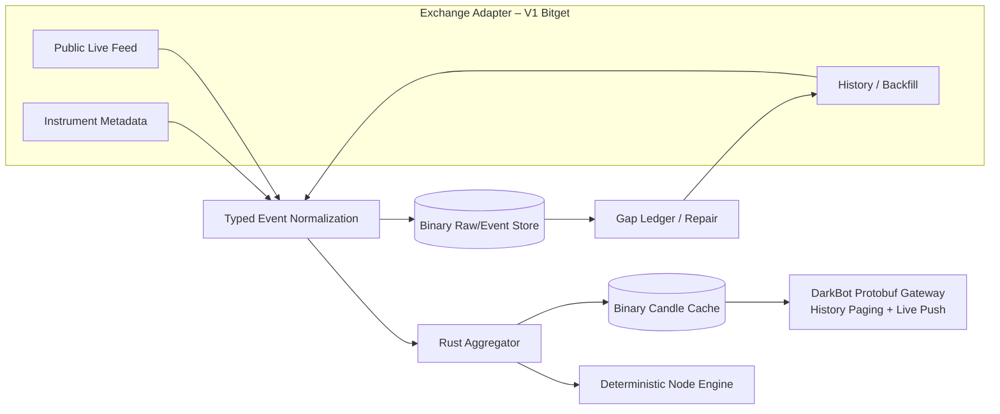
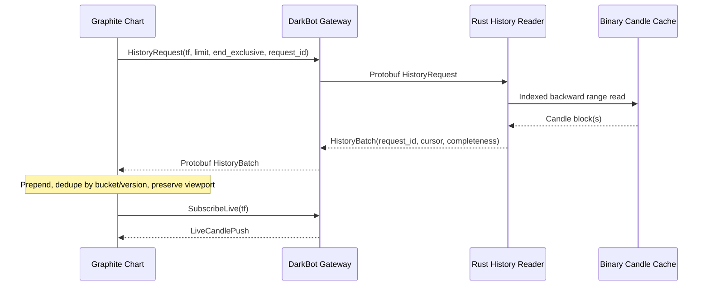

# DarkNode – Übernommene Ideen aus ws_ai

**Dokument:** `darknode/docs/WS_AI_IDEEN.md`  
**Stand:** 26.10.2026  
**Status:** **GATE 1 / IDEEN- UND ARCHITEKTURREFERENZ – KEINE IMPLEMENTIERUNGSFREIGABE**  
**Geprüfte Altcode-Basis:** [`sawyerma/ws_ai` @ `1f27ed319b70eb94ba6990799f120743819f1534`](https://github.com/sawyerma/ws_ai/tree/1f27ed319b70eb94ba6990799f120743819f1534)

Dieses Dokument bewahrt **die Ideen** des alten `ws_ai`-Systems. Bekannte Fehler werden nicht als neue Architektur übernommen. Die hier formulierten DarkNode-Technologien sind, soweit nicht anders markiert, **Zielbild oder Kandidaten**. Ein endgültiger Phasenplan folgt erst aus verifizierten API-Verträgen und Benchmarks.

## 1. Ursprüngliche Vision und DarkNode-Ziel

`ws_ai` sollte sieben bis acht Börsen parallel beobachten, Trades, Orderbücher und Volatilität eigenständig erfassen, historisieren und bis zu L3-Datentiefe auswertbar machen. Die bewahrenswerte Kernkette lautet:

**Live empfangen → instrumentbezogen normalisieren → selbst aggregieren → Rohdaten speichern → Historie beschaffen → Lücken erkennen/reparieren → ältere Daten paketweise über bestehende Verbindung ausliefern.**

DarkNode beginnt mit **Bitget Futures, einem Instrument und einem 24/7-Rust-Owner**, besitzt aber von Anfang an stabile interne Instrument-/Exchange-Identitäten. Weitere Börsen sollen später über Adapter integrierbar sein, **ohne** Market-Data-, Node- oder Replay-Kern neu zu schreiben. Exchange-spezifische Fähigkeiten und Unterschiede bleiben ausdrücklich sichtbar.



## 2. Ideen-Katalog: Bewahren statt kopieren

| ID | Idee aus `ws_ai` | DarkNode-Zielbild | Zeitpunkt / Status |
|---|---|---|---|
| 01 | Börsenspezifische Parser, Subscribe-Nachrichten und Exchange-Factory | Rust-Adaptervertrag für öffentliche Daten, historischen Import, Metadaten und separat für private Execution. Danach typisierte börsenneutrale Events. | V1 Bitget; weitere Börsen später; Vertrag offen |
| 02 | Einheitliches Symbol-Mapping für Spot und verschiedene Futures | Stabile Instrument-ID plus natives Symbol, Produkttyp, Tick- und Lot-Schritte, Kontrakt-/Tierdaten; versionierte Instrument-Snapshots. | V1 |
| 03 | Lanes pro Exchange/Symbol/Markt mit eigenem Reconnect/Health | Instrumentbezogene Subscription-/Datenzustände, **ein kontrollierter Market-Data-Owner** statt Browser-gebundener Collector. | V1 |
| 04 | Einzeltrades statt fertiger Candles als Primärquelle | Rohereignisse vollständig und unveränderlich aufzeichnen; Trades sind Candle-Grundlage, Book-/BBO-/Mark-Ereignisse besitzen eigene Rohquellen. | V1 |
| 05 | OHLC aus 1s-Candles für höhere Intervalle | Ein deterministischer Rust-Aggregator, rekonstruierbare 1s-Basis und optionale binäre Timeframe-Caches. | V1; Leerlaufsemantik testen |
| 06 | Mehrere Live-Auflösungen aus einem Trade-Feed | Benötigte 5s/10s/30s/1m/5m/... inkrementell im Engine-Kern, ohne zusätzlichen Exchange-Feed pro Timeframe. | V1 |
| 07 | Quellenkennung, Version und Live/Backfill-Merge | Event-Provenienz je Quelle plus **prüfbare Konfliktregeln**. Live nicht pauschal als inhaltlich korrekt gegenüber einem später vollständigeren Archiv betrachten. | V1; Policy offen |
| 08 | Gap-first-Backfill, dann zeitlich rückwärts, Stillstandsschutz, Reboot-Fortsetzung | Persistentes Gap-/Coverage-Ledger, idempotente Importer, Cursor passend zum **konkret geprüften Endpunkt**, wiederaufnehmbar. | V1; API-Capability offen |
| 09 | Adaptiver API-Limiter und Druckregelung | Rate-Limits pro Endpunkt, konservativer Backoff, Drucksignale aus Writer-/Import-Queues. | V1 |
| 10 | Zweistufiger Gap-Scan grob/fein | Disconnect-/Sequence-Gaps als primärer Hinweis; periodische Coverage-Prüfung als unabhängige Gegenkontrolle. Ein tradefreies Zeitfenster ist nicht automatisch Datenverlust. | V1 |
| 11 | Backfill → betroffene Candles neu berechnen | Betroffene Zeitbereiche neu ableiten, Cache-/Dataset-Version atomar umstellen; alte Live-Entscheidungen unverändert nachvollziehbar halten. | V1 |
| 12 | **History über dieselbe WS-Verbindung** mit Greeting/Limits, Paging, Subscribe, Unsubscribe, Ping/Pong | Dasselbe **Bedienprotokoll**, jetzt binäre Protobuf-Requests/-Batches über das vorhandene DarkBot-Gateway. Exklusiver Endcursor, Request-ID, per-Chart-Zustand, Prefetch und Live-Push. | V1, bewährte Grundidee |
| 13 | Decimal/String-Präzision für Marktwerte | Typisierte Ganzzahlen auf Tick-/Lot-Basis **wo exakt darstellbar**, plus versionierter Instrument-Scale-Vertrag; keine stillen Rundungen. | V1, Grenzfälle prüfen |
| 14 | Konfigurierbare Fenster, Limits und Strategien | Versionierte Protobuf-Konfiguration mit validierten Grenzen; kein willkürliches Hardcoding. | V1 |
| 15 | Gesundheits-/Metriksystem für Lanes und Komponenten | Echte Zustände `LIVE`, `STALE`, `GAP`, `RECOVERING`, plus Queue-, Schreib- und Backfill-Metriken; keine simulierten Produktivwerte. | V1 |
| 16 | Orderbuchdaten pro Börse aufzeichnen | Bitget SBE `books1` und `books50` als V1-Kandidaten. Book-Rekonstruktion, Snapshot-/Delta-Version und Sequence-Regeln zwingend. | V1 teilweise |
| 17 | Börsenübergreifende BBO-/Spread-/Mid-Sicht | Instrument-/Quote-Normalisierung vorbereitet; später Cross-Exchange-Quotierung mit eigener Clock-/Funding-/Kontrakt-Semantik. | Später |
| 18 | Volatilität, Regime, Whale-/Trade-Intensity- und Korrelationsanalyse | Später als separate standardisierte Indicator-/Condition-/Risk-Nodes, nicht als zweite Engine. | Später |

## 3. Was im alten `ws_ai`-Code wirklich existierte

Die folgenden Teile wurden **im Repository geprüft** und sind die konkrete Herkunft des Paging- und Feed-Konzepts:

| Datei (fixierter Commit) | Nachgewiesene Funktion |
|---|---|
| [`frontend/src/services/ws/WebSocketPool.ts`](https://github.com/sawyerma/ws_ai/blob/1f27ed319b70eb94ba6990799f120743819f1534/frontend/src/services/ws/WebSocketPool.ts) | Pool je `exchange:symbol:market`; Listener/Referenzzählung, Verbindungs-Generationen, Reconnect/Backoff |
| [`frontend/src/services/ws/useWsLane.ts`](https://github.com/sawyerma/ws_ai/blob/1f27ed319b70eb94ba6990799f120743819f1534/frontend/src/services/ws/useWsLane.ts) | `historical:<interval>:<limit>[:<end_ms>]`, 250-ms-Anfrage-Throttle, In-Flight, oldest-Cursor, History-/Live-Merge nach Zeit |
| [`frontend/src/shared/components/CandleChart/useCandleChart.ts`](https://github.com/sawyerma/ws_ai/blob/1f27ed319b70eb94ba6990799f120743819f1534/frontend/src/shared/components/CandleChart/useCandleChart.ts) | Erkennt Nähe zum linken Chartrand und sendet `wsai:need_history` |
| [`backend/websocket/ws_router.py`](https://github.com/sawyerma/ws_ai/blob/1f27ed319b70eb94ba6990799f120743819f1534/backend/websocket/ws_router.py) | Beantwortet History-Requests, Subscribe/Unsubscribe, Live-Push auf bestehendem **Frontend-Backend-WebSocket** |
| [`backend/services/usecases/unified_ohlc.py`](https://github.com/sawyerma/ws_ai/blob/1f27ed319b70eb94ba6990799f120743819f1534/backend/services/usecases/unified_ohlc.py) | Liest ältere OHLC-Buckets aus ClickHouse; `end` exklusiv, 1s → höhere Zeitauflösung |
| [`backend/websocket/ws_manager.py`](https://github.com/sawyerma/ws_ai/blob/1f27ed319b70eb94ba6990799f120743819f1534/backend/websocket/ws_manager.py) | Börsen-WebSocket, Subscription, Reconnect, Forwarding und weiterer Live-Candle-Pfad |

**Präzisierung:** Historische Pakete kamen damals **vom eigenen Backend über WS zum Chart**, nicht rückwärts direkt von einem Bitget-WebSocket. Das Backend las aus der lokalen Datenhaltung. Diese Architekturidee bleibt erhalten; der neue Rust-History-Reader bedient stattdessen einen binären Index/Cache.



**Für V1 neu zu ergänzen:** Chart-ID bzw. Request-Kontext statt globalem History-Event ohne Instrument, getrennte Paging-Cursor, Cancel/Timeout, keine Duplikate oder Sprünge beim Prepend, korrektes Recycling des sichtbaren Fensters, Resume/Resubscribe. Keine zusätzlichen Bitget-Public-Verbindungen nur wegen neuer Browser-/Chart-Komponenten.

## 4. Rust statt Python – sinnvoll, aber präzise begründet

**Ziel:** Market Data, Importer, Journal, Aggregator, Indicator-/Graph-Kern, Replay, Position/Risk/Execution in Rust. React/TypeScript und das bestehende Graphite-Frontend bleiben bestehen. Gateway-Transport und interne Konfiguration bleiben binär/Protobuf.

Rust liefert statische Typprüfung, Ownership- und Speichersicherheitsgarantien ohne GC-Pausen. Es verhindert **nicht automatisch** Protokollmissverständnisse, verlorene WS-Nachrichten, logische Fehler wie ein zu frühes `return`, Datenlücken, ungeschützte Positionen oder fehlerhafte Order-Reconciliation. `Option` und `Result` helfen nur, wenn die Feldverträge fehlende oder fehlerhafte Werte entsprechend modellieren. Laufzeitstabilität und 24/7-Sicherheit sind **Testresultate**, keine Compiler-Eigenschaft.

### Vorgeschlagener Workspace (Entwurf, keine beschlossene Anzahl von Crates)

```text
darknode/native/
  crates/
    dn-types       Events, Instrumente, Zeitsystem, Status
    dn-bitget      SBE, Market/Public WS, Private WS, REST, Auth
    dn-store       Raw Journal, Event-Dateien, Index, Candle-Cache, Manifest
    dn-agg         OHLCV, Timeframes, Late-Trade-Vertrag
    dn-backfill    Bulk-Import, Coverage, Gap-Reparatur
    dn-graph       Node-Spezifikationen, Compiler, Port-/Bool3-Typen
    dn-engine      deterministischer Scheduler, Indikatoren, Signale
    dn-exec        Position-/Risk-/Order-Owner, Journal, Recovery
    dn-backtest    Event-Replay, Execution-Simulation, Metriken
    dn-gateway     Adapter zum bestehenden DarkBot-Protobuf-Gateway
  bins/
    darknode       24/7-Dienst
    dn-cli         Datenimport und Prüfwerkzeuge
```

Die Grenzen zwischen Crates werden anhand des bestehenden DarkBot-Builds und der zyklischen Abhängigkeiten geprüft. **Keine zweite Gateway-Architektur.** Für den Build möglicherweise nicht benötigte Crates dürfen zusammengelegt werden.

### Bibliothekskandidaten (Spikes vor Auswahl)

| Zweck | Kandidaten |
|---|---|
| Async/Networking | `tokio`, `tokio-tungstenite` gegen `fastwebsockets`, `rustls`, `reqwest`/`hyper` |
| Interne Queues | `rtrb` (SPSC) oder `crossbeam` je Producer-/Consumer-Muster |
| Serialization | `prost` (Protobuf); eigenes **versioniertes** Binary-Journal-Layout; kein JSON intern |
| JSON nur an der Exchange-Grenze | `sonic-rs` oder gleichwertige typisierte Bitget-Adapter-Dekodierung |
| Compression / IO | `zstd`; `memmap2` und `bytemuck` nur nach Layout-/Crash-Tests |
| Hashing / Signatur | `blake3`; `hmac`/`sha2` für Bitget-Auth |
| Logs | `tracing` mit Textausgabe und binärer Evidence, kein JSON-Logging |
| SBE | Schema-versionierter Decoder aus dem veröffentlichten Bitget-XML-Vertrag |

## 5. No-JSON-Grenze

**Intern No JSON**: Engine, Hot-Path, Node-Konfiguration, Manifeste, Speicher- und Gateway-Payloads nutzen Rust-Structs, versionierte Binärrecords bzw. Protobuf. **Ausnahme ausschließlich an externen Formatgrenzen**: Bitget-SBE-Handshake und Bitget-REST/private WS benutzen von Bitget vorgegebene JSON-Nachrichten; sie werden sofort in typisierte Rust-Werte dekodiert. Ein Raw-Journal darf original empfangene JSON-Frames **bytegetreu** als opaque bytes enthalten, ohne JSON als internes Dokumentformat einzuführen.

Ein gewöhnlich serialisiertes Protobuf ist nicht automatisch kanonisch für einen über Sprachen und Versionen stabilen Graph-Hash; dafür wird eine explizite kanonische Byte-/Hash-Vorschrift definiert.

## 6. Datentiefe und weitere Börsen

Die Bitget-Public-Tiefenkanäle liefern **L2 (aggregierte Preisstufen)**, keine bestätigten individuellen L3-Order-Events. L3 bleibt eine **optionale Event-Variante** für Börsen, die Market-by-Order tatsächlich anbieten. Ein einzelnes immer vorhandenes Order-ID-Feld in **jedem** Trade-Record ist dafür nicht erforderlich; ein versioniertes Event-Envelope/Variantenschema ist als Kandidat sauberer. Echte Exchange-Trade-IDs sind typisiert und verlustfrei zu speichern, ohne ihre Größe oder numerische Darstellbarkeit ungeprüft auf `u64` festzulegen.

Börse 2–8 soll einen weiteren Adapter verwenden können, muss aber die gleiche Instrument-, Zeit-, Event- und Qualitätssemantik erfüllen. Order-Handling, Positionsmodi und Produkttypen können zusätzliche explizite Capability-Gates erfordern.

## 7. Beziehung zu professionellen Architekturen

Das **Strukturprinzip** entspricht verbreiteten Mustern: Feedhandler → normalisierte Events → dauerhafte Aufzeichnung → In-Memory-/Realtime-Verarbeitung → historische Abfrage/Replay. Das ist u. a. aus der kdb+tick-Tickerplant-/RDB-/HDB-Architektur bekannt. **DarkNode implementiert kdb+ nicht und beansprucht keine identische Architektur oder Latenz.**

| DarkNode-Idee | Analoger Architekturgedanke |
|---|---|
| Exchange-Adapter | Feedhandler / Exchange Connector |
| Typisierte Normalisierung | Gemeinsames Marktdatenmodell |
| Append-only Raw-Journal | Wiederanlauf durch Replay eines unveränderten Eingangslogs |
| RAM-Caches / Live-Core | Echtzeit-Datenverarbeitung ohne wiederholte Datenbankabfragen |
| Versionierter binärer Event-Store | Schneller Zeitbereichszugriff auf historische Ereignisse |
| Backtest und Live-Kern | Eine Strategieauswertung mit verschiedenen Event-Quellen |
| Rückwärts-Paging über Gateway | Bedarfsorientierter Chart-Historienabruf; bei `ws_ai` konkret belegt |

## 8. Datenbeschaffung: offene API-Entscheidungen

**Wichtige begriffliche Trennung:** `GET /api/v3/market/fills` ist ein Endpunkt für **öffentliche Markt-Trades**. `GET /api/v3/trade/fills` betrifft **eigene Account-Ausführungen** und deren historische Begrenzung. Ein öffentlicher Archiv- oder Gap-Importer darf nicht versehentlich die privaten Konto-Fills verwenden.

Bitget dokumentiert zusätzlich ein **Market Data Download Center** für ältere öffentliche Futures-Trades, Candles und Depth-Snapshots. Vor einer Kaufarchiv- oder Backfill-Entscheidung ist zu messen: tatsächlicher Startzeitpunkt, Granularität, Vollständigkeit, Trade-IDs, Verzögerung, Download-Performance und Überlappung zur eigenen Live-Aufzeichnung. REST kann nur die vom **konkret gewählten öffentlichen Endpunkt** unterstützten Zeitbereiche reparieren; ansonsten bleibt ein markierter Gap bestehen.

Offizielle Referenzen:
- [Public Market Fills, v3](https://www.bitget.com/docs/catalog/market/market-data)
- [Private Fill History, v3](https://www.bitget.com/legacy-docs/uta/trade/Get-Order-Fills)
- [Market Data Download Center](https://www.bitget.com/legacy-docs/uta/data-download-center)
- [Bitget Changelog 2026: SBE und `books50` Snapshot→Delta](https://www.bitget.com/legacy-docs/uta/changelog)

## 9. Offene technische Spikes, bevor Gate 1 abgeschlossen werden darf

| Gate | Prüfung | Nachweis |
|---|---|---|
| R1 | Private Orders / Account / Demo / Stops / Teilfills / Idempotenz | echte Bitget-Demo-Captures + Recovery-Matrix |
| R2 | SBE Schema/Trade-Batches, Depth50 Snapshot/Delta, Feed-Latenz und Datenvolumen | reproduzierbare Frames + Parser- und Book-Tests |
| R2b | Bitget Download-Center und öffentliche REST-Daten nach Tiefe/Zeitraum/IDs | überlappende Stichprobe gegen eigenen Live-Capture |
| R2c | (A) Journal+Zeitindex, (B) Journal+Candle-Cache, (C) ClickHouse-Referenz | Chart-Paging, Replay, Disk, Crash-Verhalten messen |
| R3 | Zeit-/Latenzsemantik und Live-Replay-Parität | gleiche Input-Folge → gleiche Engine-Traces |
| R4 | Leere Intervalle, verspätete Trades, Mehrzeitrahmen, Closed Bars | Golden-Vectors + deterministische Rebuilds |
| R6 | Rust WS-, SBE-, Queue-/Writer-Bibliotheken unter Last | p50/p95/p99, Overload, Reconnect, Memory |

**Technologische Favoriten (SBE/Rust/Binary-Cache) sind noch keine PASS-Entscheidungen.** Ein voller SPSC-Ring kann trotz `lock-free` nicht verlustfrei garantieren, dass weitere Ereignisse angenommen werden. Persistenz-ACKs, Crash-Recovery, Gap-Handling und Order-Schutz müssen ausdrücklich nachgewiesen werden.

## 10. Konsequenz für die spätere Phasenplanung

**Teil 1 – Market Data:** Public-WS-Owner, Instrumente, SBE/JSON-Adaptergrenze, Journal, Import, Gap-/Cache-/History-Paging, Aggregation.

**Teil 2 – Strategy:** deterministischer Rust-Kern, Indikatoren, Graph-/Node-Vertrag, gleiche Replay-Auswertung, Graphite-Bedienung.

**Teil 3 – Execution:** Private-WS-/REST-Adapter, Risk/Position/Order-Owner, Wallet/Budget, persistentes Intent-Journal, Stop-/Fill-Reconciliation und 24/7-Betrieb.

Das Dokument ist eine **Ideensammlung mit nachvollziehbarer Herkunft**, kein Ersatz für den bestehenden `PHASENPLAN.md`, keine Bitget-LIVE-Freigabe und kein Auftrag, alte Python-Module zu kopieren. Eine Git-Übernahme ist erst nach ausdrücklicher Zustimmung vorgesehen.
