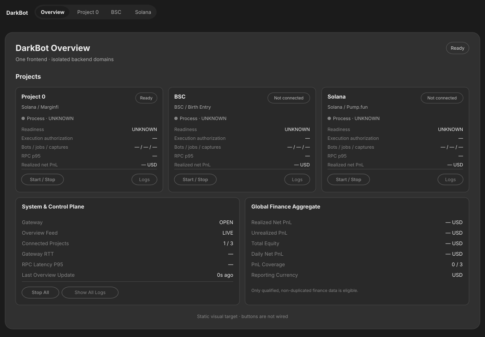

# DarkBot Frontend – Master-Phasenplan V1.3

**Status:** Verbindlicher SOLL-Architektur- und Implementierungsplan, Stand 2026-10-19 (F7-OVR specification appended; historical IST sections remain evidence snapshots). IST-Stand nur in den datierten Abschnitten, zuletzt §8 „Infrastruktur-Abschluss 2026-10-24“. Fachliche Projektpläne bleiben unabhängig maßgebend. Dieser Master ersetzt die alten, sich überlappenden Frontend-Gesamtpläne.

## 0. Eine Dokumentationsautorität

- **Dieses Dokument**: einzig aktiver Frontend-Phasenplan, Zuständigkeiten, React-Zielstruktur, F0–F8 und Abnahme.
- [GATEWAY_WIRE_PROTOCOL_V1_3.md](GATEWAY_WIRE_PROTOCOL_V1_3.md): einzig aktiver Wire-Vertrag (Gateway↔Browser **und** Gateway↔Engine).
- [GOVERNANCE_UND_SICHERHEIT.md](GOVERNANCE_UND_SICHERHEIT.md): fachliche Autorisierung, Freigaben und Trust-Grenzen.
- [SOURCE_VARIABLE_MATRIX.md](SOURCE_VARIABLE_MATRIX.md): Source-basierte Project_0-/BSC-Feldinventur, **F0-VAR muss vor Adapterimplementierung abgeschlossen sein**.
- [V0_GRAPHITE_FLEET.md](V0_GRAPHITE_FLEET.md): akzeptiertes V7→V0-Design, fünf Reiter, eingefrorene Wallets.
- Weiterhin aktive Spezialanhänge: [GRAPHITE_V5_UI_FINANCE_CONTRACT.md](GRAPHITE_V5_UI_FINANCE_CONTRACT.md) (Finanz-/UX-Details, nicht neueres Design), [STARTUP_BACKTEST_OPTIMIZATION.md](STARTUP_BACKTEST_OPTIMIZATION.md), [WALLETS_TREASURY.md](WALLETS_TREASURY.md), [PROJECT_0_CODE_MAP.md](PROJECT_0_CODE_MAP.md) (historischer Quellkatalog, nach HEAD zu prüfen).
- **[delete/](delete/README.md)**: unveränderte alte Gesamt-/Wire-/Control-/Fleettexte sowie alter Master sind **archiviert und nicht mehr normativ**. Nicht erneut danach implementieren.

Projekt-Fachautorität: [Project_0 PHASENPLAN](../../project_0/docs/PHASENPLAN.md), [STATUS](../../project_0/docs/STATUS.md), [Ledger](../../project_0/docs/MEASUREMENT_LEDGER.md); [BSC Roadmap](../../bsc/docs/BSC_DUAL_VENUE_ROADMAP.md), [Gate-0](../../bsc/docs/GATE0_TESTPLAN_SHORT.md), [BSC Masterplan](../../bsc/docs/BSC_PRODUCTION_BUILD_MASTER_PLAN.md), [BSC Status](../../bsc/docs/STATUS.md). Keine LIVE-Gates werden durch UI-Dokumente ersetzt.

### Bindende Project_0-/BSC-Architekturgrenze und Speicher-/Wire-Trennung (2026-10-24)

[frontend/README.md](../README.md) ist die gemeinsame README für **ein Dashboard, einen Gateway und denselben Protobuf-/STATE-/Command-Wire** bei zwei getrennten nativen Backend-Owners. BSC speichert intern `DBREC001` (typisierte Felder + SHA-256) und `DBJNL001` (CRC32/SHA-256), Project_0 intern `P0J`/`P0JRNL01` (CRC32/verkettetes SHA-256/Bincode für Schema-2+-Payloads). Zum Browser gelangen **nur native, sanitierte öffentliche Projektionen via Protobuf → Gateway → Protobuf/WebSocket → Projekt-Adapter/Store**, niemals Rohjournale. Bestehende fünf Reiter und Topic-/Proto-IDs bleiben unverändert. [protocol/README.md](../../protocol/README.md) grenzt Storage und Transport ab.

**Gemeinsame F3/F6/F7-RESTAUFGABEN, nicht als FINAL behaupten:** Engine→Gateway-`FRAME_TOO_LARGE` mit einheitlichem Topic-Fehler und noch offenem Envelope-bewussten Engine-Frame-Limit; nachfolgende Topic-Recovery; Gateway-Idempotenz-Ledger bei `MAX_RECORDS=1024` mit noch festzulegender sicherer Retention; Stop-All-Teilausfall `NOT_RUN` bis isolierter Negativtest; `npm run budget` nach `iltorb`-Fehler nicht PASS; Visual-Pixeldiff ohne Baselines `NOT_RUN`. Gateway-RTT bleibt `—`; bei späterer Implementierung bestehender Gateway↔Browser-Heartbeat/Pong statt neuem Heartbeat oder P0-Reporter-Änderung. P0-Capture-Polling→Push ist P0-Owner-Aufgabe; `F4 EVENT`, native Receipts und fehlende Fachquellen bleiben phasengebunden. Dies ist **keine neue Phase, kein Architekturumbau und keine LIVE-Freigabe**. Nur konkret betroffene Regressionen prüfen.

**Stand 2026-10-24:** Engine-Frame-Limit/`FRAME_TOO_LARGE`, Topic-Recovery, Ledger mit zeitlich begrenzter Idempotenz, isolierter Stop-All-Teilausfalltest und `npm run budget` sind umgesetzt und gezielt getestet (§8 „Infrastruktur-Abschluss 2026-10-24“); Visual-Pixeldiff, Gateway-RTT, P0-Polling, F4 und native Receipts bleiben wie oben offen.

> **Project_0-Implementierungsentscheidung 2026-10-25, G-1:** [Project_0 PHASENPLAN.md – P0-DEC-2026-10-25](../../project_0/docs/PHASENPLAN.md) verpflichtet für DEC-01…15 bereits **jetzt** die vollständige native Source→Protobuf→Reporter→Gateway→Adapter/Store→bestehende fünf Reiter-Anbindung und, **soweit N-5 ihn vorsieht**, den sicheren Command-/Receipt-/STATE-Rückweg **im selben Fachpaket**. F0-VAR ist die begleitend aktuell zu haltende betroffene Feldmatrix; weder eine erneute globale Census-Runde noch eine spätere F7-Integrationsphase darf diese ausdrücklich freigegebene Project_0-Offline-Entwicklung stoppen. Diese jüngere Project_0-Spezifizierung überschreibt allein zeitliche *Entwicklungsverschiebungen*, nicht die gebundenen F0–F8-Wire-/Codegen-/Golden-/Schema-/Deployment-Gates und nicht die BSC-Arbeitsplanung. Ein Code-/UI-Pfad wird erst nach echtem Native-/Gateway-/Playwright-Test `OFFLINE_VERIFIED`; Mainnet/Provider/Live/Signing/Submission nur bei separater Freigabe.
>
> **G-1-Hinweis ([ENTSCHEIDUNGEN.md](../../project_0/docs/ENTSCHEIDUNGEN.md) N-1/N-5):**
> - gilt nur für DEC-01–15;
> - feste Reiterzuordnung aus N-5;
> - Command-/Receipt-/STATE-Rückweg nur bei entsprechender N-5-Festlegung;
> - bei N-5 `nein` kein neues Bedienelement;
> - DEC-09, DEC-14 und DEC-15 ohne GUI;
> - keine neue Frontend-/Gateway-Architektur; die fünf Reiter und die Graphite-Layouts bleiben unverändert.

## 1. Produkt, visuelle Referenz und Navigation

~~~text
DarkBot – EINE React/Vite-App, EINE globale Navigation, EIN Graphite-Design
├── /                  GLOBAL OVERVIEW / All Projects
│   ├── Project 0      → /project-0
│   ├── BSC            → /bsc
│   ├── Solana         → /solana (bestehende Route erhalten)
│   └── weitere Projekte später per Registry
├── /project-0         Project 0 Control / Marginfi
│   ├── Overview       echte Read-only Status- und Finance-Projektionen
│   ├── Liquidator     EIN realer Liquidator zuerst, später Fleet
│   ├── Capture        Rohaufnahme, Verification, Marker-Report-FILTER
│   ├── Analytics      Reports/Replay/Backtest/Optimierung nach Gates
│   └── Wallets        Balances | Send | Auto-Sweep – DESIGN FROZEN
├── /bsc               BSC Birth Entry – eigene fünf Panels
│   ├── Overview
│   ├── Launch / BUY   BSC Gate 0 / G0.7, keine automatische Freigabe
│   ├── Monitoring     Builder/Portal/Evidence/G0.8
│   ├── Analytics
│   └── Wallets        BSC-eigen, keine P0-Treasury
└── /solana            separate bestehende Domäne
~~~

'DarkBot' im gemeinsamen Header führt nach '/'. Globale Overview ist **nicht** identisch mit der Overview in P0 oder BSC. Globalübersicht abonniert nur 'overview.aggregates', nie komplette Wallet- oder Botzustände. Weitere Projekte über statisch typisierte Registry; jeder neue Fachbereich bringt eigene Store-/Adapter-/Route- und Sicherheitsgrenzen mit. Kein zweites Frontend, keine Sidebar, kein globaler Signer oder Trading-Controller.

**Akzeptiertes Design:** Graphite-V7-HTML als Referenz, existierende Project_0 React-V0-Oberfläche; Farben '#1b1b1b' Hintergrund, '#303030' Hauptfläche, '#464646' Trennlinien, kompakte macOS-Typografie, zentrale ~800px-Fläche, dezente Pills, keine blauen Karten. Project_0 besitzt exakt 'Overview/Liquidator/Capture/Analytics/Wallets'. Unter Wallets exakt 'Balances/Send/Auto-Sweep'; Zeilenfolge **Total capital, Realized net PnL, On-chain balance, Available capital, Reserved capital, Withdrawable profit, Transferred to Treasury**. Kein Redesign bei BSC-Integration. Tokens mit visueller Regression extrahieren; Wallets Pixeldiff 0 bei identischen Fonts/Viewport.

## 2. Wirklicher IST-Stand, keine Phantomimplementierung

| Existierende Datei | IST | Für produktive UI fehlt |
|---|---|---|
| 'src/app/router.tsx' | '/', '/bsc', '/project-0', '/solana' | typisierte Registry/Lazy |
| 'src/shared/layout/{AppLayout,Navigation}.tsx' | gemeinsame Header/Links | graphitisches Hostdesign, Registry-nav |
| 'src/features/overview/OverviewPage.tsx' | statische Projektkarten, WS-Status | echte Overview-Aggregate |
| 'src/features/project0/Project0Page.tsx' und fünf Panel-Komponenten | Graphite V0 in React | echte Backend-Snapshots/qualifizierte Commands |
| 'src/features/project0/hooks/useFleetDrafts.ts' | **nur ungespeicherte In-Memory-Drafts** | persistente Profile/echte Botinstanzen |
| 'src/features/bsc/BscPage.tsx' | Platzhalter | BSC-Fachoberfläche |
| 'src/features/solana/SolanaPage.tsx' | bestehende Route | nur projektgebundene spätere Integration |
| 'src/core/realtime/RealtimeClient.ts' | alter JSON-WebSocket mit globaler seq | Topics/Protobuf/Zwei-Hop-Liveness/Journal-Cursor |
| 'src/core/realtime/protocol.ts' | Legacy-Envelope | F7 löschen/re-export aus Codegen |
| 'src/core/api/client.ts' | JSON GET-Client | typed Proto-Read/Command; F7 Legacy ausmustern |
| 'src/app/providers.tsx' | Theme und TanStack Query | Zustand-Livestores, Feature-Boundaries |
| Gateway/Proto/Engine-Adapter | **nicht implementiert/nicht nachgewiesen** | F2–F7 |

**Projektstand aus Status-Evidence:** Project_0 C0-E1 4h NOT_QUALIFIED, PERSIST PARTIAL, FE-00 LOCAL_PASS aber NO_ECONOMIC_GO, FE-06 NOT_AUTHORIZED, FE-07 NOT_RUN, positiver eigener finalisierter Net PnL NOT_PROVEN. BSC G0.7/G0.8 NOT_EXECUTED, Portal-v5.25-Drift requalifizieren, aktiver V4-Guard UNARMED. Kein Frontend-Commit ändert diese Urteile.

## 3. Verbindlicher React-/Repo-Zielbaum – IST/SOLL

~~~text
protocol/ [SOLL]
  schemas/darkbot/control/v1/*.proto        ONE wire envelope/control/commands
  schemas/darkbot/project0/v1/*.proto       typed P0 projections
  schemas/darkbot/bsc/v1/*.proto            typed BSC projections
  codegen/toolchain config, README, Golden-Tests

frontend/src/
  app/
    App.tsx,router.tsx,providers.tsx        [IST]
    projectRegistry.ts                     [SOLL] statisch typisierte Module
  core/
    generated/                             [SOLL] ONLY generated Proto-Types
    realtime/
      RealtimeClient.ts                    [IST→SOLL] 1 Socket, Protobuf
      TopicSubscriptions.ts                [SOLL] refcount, grace
      TopicState.ts                        [SOLL] quality + cursor
      protocol.ts                          [IST→F7 DELETE/REEXPORT]
    api/
      client.ts                            [IST→F7 DELETE] legacy JSON
      commandClient.ts                     [SOLL] action-only POST
      historyClient.ts                     [SOLL] paginierte read-only Reports
    projects/readSummary.ts                [SOLL] shared read-only summary
  shared/
    layout/AppLayout.tsx,Navigation.tsx     [IST]
    ui/graphite/tokens.css                 [SOLL] design freeze
    ui/{Tabs,Rows,Notice,...}.tsx          [SOLL] fachfreie Präsentation
  features/
    overview/OverviewPage.tsx              [IST→SOLL] echte Aggregate
    overview/overviewStore.ts              [SOLL] eigenes Zustand-Store
    project0/Project0Page.tsx              [IST] V0 beibehalten
    project0/pages/{Overview,Liquidator,Capture,Analytics,Wallets}Panel.tsx [IST]
    project0/hooks/useFleetDrafts.ts       [IST] drafts ONLY
    project0/store/project0Store.ts        [SOLL] Zustand mit Selektoren
    project0/api/project0Adapter.ts        [SOLL] Proto→P0-Domain
    project0/styles/graphite.css           [IST] visuell frozen
    bsc/BscPage.tsx                        [IST] placeholder
    bsc/pages/{Overview,LaunchBuy,Monitoring,Analytics,Wallets}Panel.tsx [SOLL]
    bsc/store/bscStore.ts                  [SOLL] separater Zustand-Store
    bsc/api/bscAdapter.ts                  [SOLL] Proto→BSC-Domain
    solana/SolanaPage.tsx                  [IST] erhalten
~~~

**Mechanische Grenzen:** ESLint-boundaries verbieten 'features/bsc' ↔ 'features/project0'-Imports. Generierte Protobuf-Fachtypen dürfen nur von schmalen Domain-Adaptern eingelesen werden (Transport-Codec ausgenommen). CI muss gegen Importverletzungen fehlschlagen. Zustand mit stabilen Selektoren: nur betroffene React-Komponenten rendern. Keine Mega-Context-Subscription, kein Quervermischen der Engines. History/Reports in paginierten TanStack-Query-Reads, nicht im Live-Store. BigInt nur exakt und nie direkt in JSON.stringify-Query-Keys. Je Projekt Lazy Loading und Error Boundary.

## 4. Realtime-/Command-Mechanik (nur ein kanonisches Wire-Dokument)

~~~text
P0 Engine (.p0j)  ─┐
BSC Engine (DBREC) ├─ authenticated source feed + own cursor/liveness ─┐
Solana later        ┘                                                  ▼
                                                       Control Gateway
                                               STATE latest full value/topic
                                               client latest value/topic
                                               EVENT journal catch-up BOTH hops
                                               overview read-only aggregate
                                               same-origin browser session
                                                           │
                                             ONE binary/protobuf WebSocket
                                                           ▼
                                             React separate Zustand stores

User click → same-origin HTTPS Proto POST → Gateway auth proxy → ENGINE auth + CAS
            → persisted intent/receipt → status pending/recent push to UI
~~~

**STATE:** immer kompletter kleiner Topiczustand, kein Delta/Ring/State-Hash. Publisher '(generation,seq)'; neue Generation **akzeptieren** und seq zurücksetzen, abgelöste Generationen nicht erneut anwenden. Gateway-Engine-Disconnect => 'SOURCE_DETACHED' an alte **und neue** Subscribers, alter Cache darf nicht OK heißen. Gateway hält genau einen Latest-Value-Cache pro Topic + einen Latest-Slot pro Client/Topic; kein blockierendes WS-ACK pro Datenframe.

**EVENT:** nur '(journal_epoch,durable_cursor)' (mit Source/Run). Engine bestätigt Durable-Commit vor Push; at-least-once und Client-Dedupe. **Zwei Catch-up-Barrieren:** Client↔Gateway und Gateway↔Engine jeweils zuerst Feed/Puffer anhängen, dann High-Watermark aus Engine lesen, Archiv '(C,H]' paginiert nachziehen, Puffer deduplizieren, 'CatchupComplete(COMPLETE)' erst bei ununterbrochenem Upstream bis Freigabe; sonst INCOMPLETE. Upstream-Cursor ist unabhängig vom Browser-Cursor. Overflow/Catch-up-Limit → expliziter Fehler, max. drei Backoff-Retries mit Cap, dann manuell.

**WS-Nachrichten exakt 11:** Client 'Hello,Subscribe,Unsubscribe,Pong', Server 'Welcome,ControlAck,StateFull,Event,CatchupComplete,Heartbeat,Error'. 'Subscribe' mit optionalem **Paar** '(journal_epoch,durable_cursor)' (nur EVENT), 'StatePart' reserviert ohne Implementierung. Kein Resume-Sonderframe, kein STATE-Patch, kein Hash, keine pro-Frame-ACK. Heartbeat vom Server; Wasserzeichen pro Client für **tatsächlich versendete** STATE-Seq. Bad Proto => stabiler Error, nicht Re-Subscribe-Sturm. Max STATE ~256KiB als noch zu messender Grenzwert.

**Commands:** eigene typisierte HTTPS-POSTs, kein Event-Side-Effect; engine-eigene 'profile_version/config_version' im STATE für CAS, nie WS-Seq. 'pending_commands[]' und bounded 'recent_command_results[]' in der Statusprojektion; ACK 'ACCEPTED' ≠ durchgeführt; verlorene Antwort über State bzw. einmaligen GET auf Command-ID prüfen. Engine persistiert Idempotenz nach Intent-/Receipt-Retention. Keine automatischen Geld-Retries. Produktion SPA vom selben Gateway-Origin; HttpOnly/SameSite Strict Secure Cookie (bei HTTPS), Host-/Origin-Allowlist, CSRF für POST, CSP, autentisiertes Engine-IPC; Engine prüft Fachgates.

**Kein Browser-Polling.** Subscriptions folgen Route/aktivem Panel (kurze unsubscribe grace). Global '/' nur 'overview.aggregates'; Project0 Overview 'project0.status + project0.finance.summary'; Wallets eigenes 'project0.wallets.state'; BSC eigene Themen. Große Reports nur auf explizite Nutzeraktion paginiert holen. Simulation/Replay sichtbar 'OFFLINE/REPLAY'; nicht als Gewinn zählen.

## 5. Pflicht-Themen und Fachprojektionen

| Topic | Klasse | Abonnent; Auszug |
|---|---|---|
| 'overview.aggregates' | STATE | global '/', echte Projektzahl/Bots/Jobs/health/qualifizierte Summen |
| 'project0.status' | STATE | P0 Overview, command pending/results + config_version |
| 'project0.finance.summary' | STATE | Overview; gleiche Backend finance_snapshot_id wie Wallets |
| 'project0.liquidator.state' | STATE | Liquidator; ONE runtime bot first, profile_version, Draft != Running |
| 'project0.capture.state' | STATE | Capture; Provider/Storage/Gaps |
| 'project0.wallets.state' | STATE | Wallets; Balances/Available/Reserved/Withdrawable |
| 'project0.execution.events' | EVENT | echte persistierte P0-Receipt-/Execution-Events |
| 'project0.capture.events' | EVENT | echte Journal-Events, Rohaufnahme ungefiltert |
| 'project0.analytics.jobs' | STATE | Job-Status, Report-Referenzen; History GET |
| 'bsc.status' | STATE | G0.6a/G0.7/G0.8, Portal-/Builder-Drift, config_version |
| 'bsc.launch.state' | STATE | Launch/BUY, plan_version und fachlich gesperrte Actions |
| 'bsc.monitoring.state' | STATE | Witness/Evidence/Chain-Reconcile |
| 'bsc.wallets.state' | STATE | BSC-eigene Wallets, kein P0-Treasury |
| 'bsc.execution.events' | EVENT | BSC Journal-/DBREC-Evidence; Epoch+Cursor |
| 'solana.status' | STATE | späterer eigenständiger Adapter |

## 6. F0-VAR: Vor der Umsetzung vollständige P0- UND BSC-Variablenextraktion

Die erste **belegte** Extraktion steht in [SOURCE_VARIABLE_MATRIX.md](SOURCE_VARIABLE_MATRIX.md), aber **vollständiger Census gegen aktuellen HEAD ist ein F0-Hard-Gate**. Für jedes Frontend-Feld: 'project/feature/source_path/symbol/type/unit/scale/default_min_max/validator/config_or_read/owner/sensitivity/provenance/quality/source_sha/required_gate/topic_or_command/test'. Feld ohne Owner/Unit oder mit ungeklärtem Gate => 'BLOCKED / SOLL_MISSING' und keine freie TS-Berechnung.

- **Project_0:** Native 'RuntimeConfig/Resolved::descriptors()', MeasurementPlan, Flags 'duration,capture-source,chain-verify,report-markers/report-types', alle sechs Marginfi-Marker/vier Klassen/vier Related, MarketStats, StorageStatus/CapacityReport, Journal-Provenance, Receipts/Funding/Economics, Wallet Public Identity und nicht vorhandene Portfolio-Snapshot-Grenze. Capture unfiltered; Marker **nur** Report-Filter. Die zwei Realtime Finance-KPIs stammen **später** aus einem finalisierten Backend-Snapshot; PnL nicht aus Shadow oder historischem Winner.
- **BSC:** 'LiveGuardContext,ContractSnapshot', V4-'UNARMED'-Guard, DRY-/Preflight-/Builder-/Portal-Provenienz, 'g07_mainnet_self_launch_buy' Runner-ENV, G0.8 Canonical-/Receipt-/Fee-Felder und Chainjournal; V4 signierte Limits sind primär immutable Evidence **keine** frei editierbaren Sliders. Key- und Builder-Autorisierungs-Geheimnisse sowie credentialed RPC-URLs niemals ans UI übertragen.
- **Source-Klassifizierung:** 'IST_INTERNAL' ≠ 'EXPOSED_TO_GATEWAY' ≠ 'QUALIFIED' ≠ 'AUTHORIZED'. Backend-Steuerparameter nur durch Engine-DTOs mit 'config_version'; echte Defaults nur aus Rust-Descriptors, nie kopiert. Kontostände nur mit Chain-/Price-/Finality-Provenienz. Wei/u128/u256 als dezimaler String; lamports/slots und positive passende USD-micro als uint64/BigInt; vorzeichenbehafteter oder größerer USD-micro/PnL als signierter Decimal-String.

**Definition F0-VAR DONE:** Inventar UI↔Source bis auf einzelne offene SOLL-Felder komplett; Jede REST/Topic-Projektion hat Owner und Quality; jedes Control eine explizite fachliche CAS-Version, Idempotenz und Gate. Alle Quellfelder erneut gegen Source-HEAD/aktuelles Schema geprüft und diffbar abgenommen. Noch nicht im Backend verfügbare Felder sind separat als **SOLL_TICKET** dokumentiert, kein Fake-Adapter.

## 7. Vollständige Fach-UI (ohne übergriffige Engine)

**Globale Overview:** tatsächliche aktive Bots/Jobs/Captures, Gate-/Health-/Sourcezustand pro Domain, Samplefenster bei Latency, finalisierte Finance je Domain. Gesamtprofit/Capital **nur** bei kompatibler Bewertung, Finality und ohne wallet double count; sonst 'Aggregate unavailable'. Keine 0 für Unknown.

**Project_0:** Overview 'RPC p95, decision p95, stream freshness, Total capital, Realized net PnL' mit gemeinsamer Finance-ID; Liquidator Einzelliquidator + nicht persistente Botdrafts; Capture frei einstellbare Dauer nach Backend-Gate, 'UntilStopped' erst wenn nativ implementiert, 'logs|transactions', Verify 'off/index/strict/crosscheck', alle sechs Marker **nur** Bericht. Analytics immutable Reports/Verifier/Competition/Race, Offline-Backtest/Optimize mit echten versiegelten Runs. Wallets Freeze, Send/Auto-Sweep UI erst nach besonderem Treasury-Gate ausführbar. Keine JavaScript-Economics oder Keys.

**BSC:** Overview G0.6a/G0.7/G0.8/Portal-/Builder-Version/Preflight und Source Witness; Launch/BUY read-only freigegebene Plan-/Budgetwerte und Gate-Verditcts (keine UI-Aktivierung); Monitoring BSC Eventjournal, receipts, chain inclusion, canonical ordering/acquisition/fees; Analytics nur echte Ergebnisse; Wallets BNB/Token und eigene Chain-/Wallet-Gates. BSC 'g07' seit Portal-Drift neu zu qualifizieren, Frontend ersetzt das nicht.

**Bot-Schwarm:** F8 später: N versionierte Strategieprofile innerhalb **P0**, gemeinsamer kanonischer StateOwner/Ingress, globaler nativer P0 Execution-Arbiter mit atomarer Wallet-Reservation; keine N vollständigen RPC-Scanner. Gleiche Schnittstellen heute vorbereiten, Scheduler/Arbiter **nicht** vor erstem realisierten Einzelbot entwickeln.

## 8. Frontend-Arbeitspakete mit Definition of Done (F5 in F3 enthalten)

| Phase | Arbeit | Abnahme/Test |
|---|---|---|
| **F0 – Konsolidierung und F0-VAR-Census** | 1 Master, 1 Wire, 1 Governance, alte Texte nach 'delete/', echte P0-/BSC-Felder aus Rust + CLI extrahieren, Type/Unit/Owner/Gate/source sha beweisen; Ist/Soll aktualisieren | Quelleninventar je geplantem UI-Feld; keine Secrets; fehlende Engine-Projektion ausdrücklich BLOCKED |
| **F1 – Design-Freeze** | Graphite-Tokens, bestehende 5 P0-Tab-Screenshots und Wallet-Baseline, Host Navigation/Registry/Lazy/Error Boundary, Boundary-Lint | P0 Wallets Pixeldiff 0, Cross-Import CI-Fail, kein P0-Layout-Bruch |
| **F2 – Protobuf-/Handshake-Spike** | schema family/prost/protobuf-es, Hello/Welcome/Subscribe, Full-State/Event, Major/Minor, Golden Bytes, Units/BigInt | Uint64::MAX + negative i128 + wei decimal, Schema-Evolution, incompatible-major fail-closed |
| **F3 – Read-only Live UI** | same-origin Gateway, authenticated Engine-STATE feed mit Liveness, latest STATE pro Topic/Client, Heartbeat, Zustand stores/selector, Overview aggregate, P0 & BSC read-only status | Engine-Kill SOURCE_DETACHED auch für NEUEN Subscriber, neues generation/seq akzeptiert, route-scoped subscriptions, keine Polling-GETs |
| **F4 – EVENT-Reconciliation** | Gateway-upstream durable cursor + Browser barrier, journal catch-up, epoch-bound cursors, CatchupComplete, Replay/overflow/backoff, echte Archive | Engine während Catch-up kill, Event nach restart, COMPLETE nur nach Journal-Nachzug; bounded RAM, sonst INCOMPLETE |
| **F6 – Commands & Security** | POST/proto, auth/session/Origin/Host/CSRF/CSP/IPC, native CAS-Versionen, idempotente Commands, pending/recent status, lost ACK | duplicate same key one intent; key+new payload rejected; keine LIVE/Gate-Umgehung |
| **F7 – Fachintegration & Migration** | echte P0 Capture/Verifier/Finance/Analytics/Wallets, BSC Launch/Monitoring/Wallets, paginierte History, Legacy-JSON-WS und JSON-read-client nach Parität entfernen | TS typecheck/lint/build; Rust/TS contract, Playwright E2E/Visual, keine duplicate Decoder/Routes, Source-Proof |
| **F8 – Fleet später** | P0 Profiles+Arbiter+Bot-Attribution/Optimizer | **DEFERRED** nach qualifiziertem einzelnen P0-Liquidator und neuer Freigabe |

**FEUI-Anforderungszuordnung** (keine zusätzliche konkurrierende Phasenfolge): FEUI-00→F0; FEUI-01/02→P0 native Gates und später F3/F6/F7; FEUI-03→F1/F3; FEUI-04/05/06/07→F7 nach nativen Evidence-/Econ-Gates; FEUI-08→F8; FEUI-09→Querschnitt F1–F7; FEUI-10A→F7 read-only; FEUI-10B/C→separate Treasury-Freigabe, nicht automatisch F7. BootAudit/UntilStopped/SegmentReplay/Optimization-Details ausschließlich in den Fachanhängen.

**Infrastruktur-Abschluss 2026-10-24 – Status: gemeinsame Frontend-/Gateway-Infrastruktur für Project_0 und BSC umgesetzt und gezielt getestet; offen: F4 EVENT, native Engine-Receipt-Autorität (kein F6-FINAL), weitere phasengebundene native Anbindungen und GUI-Gestaltung** (`7bd0bc98`…`1bb5e181` auf main; auf `f52e7c21` gepusht: `9508c34d`…`98dbd692`):
- **FINAL (getestet):** F2 Rust↔TS-Goldens inkl. u64/i64/i128 (`gateway/tests/control_goldens.rs`, `control-golden.test.ts`, `overview-golden.test.ts`); F3 STATE (neue Generation/abgelöste Generation, Quality-Overlay, Detach an bestehende und neue Subscriber, FRAME_TOO_LARGE je Topic ohne Source-Detach, Slow Client per begrenztem Send/Close getrennt) und eine WebSocket über `/`→`/project-0`→`/bsc`, `overview.aggregates` nur auf `/`, Reconnect nach Gateway-SIGKILL (`ops/tests/control_test.py`); F6 Session/CSRF/Origin/Host/CSP, Engine-Feed nur gleicher User (Peer-UID), Non-Loopback nur mit Opt-in, Idempotenz; Overview P0 „Execution authorization“ aus dem effektiven Engine-Record; BSC Readiness `live_authorized`/`contract_sha256` sichtbar (Native 984 IST_CONNECTED, 0 SOLL_MISSING). Läufe: Gateway 42 + IPC-E2E 1, BSC 592/93/373, Python 42, Vitest 54, Playwright bsc/overview/project0/codesplit/backend, `ops/tests/{control,bsc_control,lifecycle}_test.py` PASS. Abschlussauftrag (gemeinsam für beide Projekte): Command-Ledger begrenzt ohne Dauerablehnung, offene Intents bleiben, Archiv für Replay/Konflikt und Ablaufregel ohne Doppelausführung, zeitlich begrenzte Idempotenz aus der Konfiguration (Fenster, Aufbewahrung ≥ 2 × Fenster, Kapazität; Wire V1.3 §7, `commands.proto`), Restart-/Crash-/Reihenfolge- und Gegenfälle in Echtzeit (`9508c34d`, `91a6f77a`, `6334c7da`, `d46f76c6`, `control::tests`); Übergröße über Engine-`StateTooLarge` als Fehler nur dieses Topics, Quelle verbunden, exakte Engine-Frame-Grenze je Quelle, Überschreitung als gezählter Protokollfehler (`0495fd04`, `9851f6c8`, `98dbd692`, `engine::liveness_tests`, BSC `status::tests`); Erholung mit dem nächsten gültigen State auf demselben Abo, Negativtests Detach/Reconnect/Slow Client (`0f60b6dd`, `9851f6c8`, `ws_integration`, `TopicSubscriptions.test.ts`); Stop-All-Teilausfall (`8bf3316a`, `ops/tests/stop_all_partial_test.py`); `npm run budget` 7/7 (`842db088`). Gezielt (HEAD `98dbd692` auf `f52e7c21`): Gateway 60 + P0-IPC-E2E 1, Protobuf-Vertrag PASS, BSC `status::` 13, Vitest 56, `npm ci` + `npm run budget` 7/7, `ops/tests/{lifecycle,stop_all_partial,control,bsc_control}_test.py` PASS.
- **Paketabschluss F3/F6/F7-Bugfix (2026-10-24, auf `f52e7c21`, gepusht):** F3 IPC-Frame-Grenze, FRAME_TOO_LARGE und Topic-Recovery **VERIFIED**; F6 Gateway-Ledger, Retention und zeitlich begrenzte Idempotenz **VERIFIED** für den implementierten Teilumfang, F6 insgesamt **PARTIAL** (native Engine-Receipt-Autorität als eigenes, vorgesehenes F6-Paket); F7 Stop-All-Teilausfall, Budget und Regressionen **VERIFIED**. Nachweise nach dem letzten Rebase: P0-Reporter-Rebuild, P0-IPC-E2E 1/1, `ops/tests/{lifecycle,stop_all_partial,control}_test.py` Exit 0; Gateway 60/60, Protobuf-Vertrag, BSC `status::` 13/13, Vitest 56/56 und `bsc_control_test.py` auf demselben, außerhalb `project_0/` byteidentischen Stand Exit 0.
- **OFFEN:** native Engine-Receipt-Autorität nicht nachgewiesen (kein F6-FINAL); Gateway-RTT bleibt `—` bis zu einem Messwert, später nur über den bestehenden Heartbeat/Pong (entschieden); P0-Capture-Polling und Alt-Client (Project_0-Owner, unverändert); `StateTooLarge` im P0-Reporter (Project_0-Owner-Schritt, heute nur Rebuild für die Schema-ID); Visual-Pixeldiff NOT_RUN (keine Baselines im Repo).
- **Deployment-Abhängigkeit (verbindlich):** Ein Gateway ab `276e0998` (Schema-ID `e545c226…`; Schema-Änderungen `0495fd04`, `d46f76c6`, `276e0998` CaptureState.provider) läuft nur zusammen mit dem aus demselben Stand neu gebauten Project_0-Reporter `p0-market-capture-reported` und BSC-Reporter; die Engine-Strecke weist einen Reporter mit anderer Schema-ID am Hello ab. Nur `darkbotctl build` → `deploy` (Release-Manifest bindet Schema-ID und Binärhashes, Deploy bei laufender Capture mit anderer Schema-ID verweigert).
- **BLOCKED:** F4 EVENT, Engine-Receipts `pending_commands[]`/`recent_command_results[]`, P0 `config_version`/CAS, P0 Finance/Wallets/Liquidator/Analytics/RPC-p95/Readiness, BSC Sources/Venues (C1/C2), Clock-/Boot-ID, `head_block`.
- **GUI-SPÄTER:** Gestaltung beider Projektseiten und der Übersicht; Texte wie Liquidator-„0“-Platzhalter.

**Projektpriorität:** Project_0 EINZEL-LIQUIDATOR-FIRST, 4h/C0-E1/PERSIST/FE-00…07 bleiben eigene Projektgates. BSC G0.7/G0.8 eigene Reihenfolge. Frontend-Aufgaben dürfen diese nicht blockieren.

## 9. Verbindliche Test- und Dokumentationsgates

1. Source-Feld-Vertrag: Source-SHA, Type/Scale/Gate/owner; unbekannte UI-Werte bleiben '—/UNKNOWN'.
2. Graphite: fünf P0-Tabs, Wallets Pixeldiff 0 (festgelegte Browser-/Fontbasis), Keyboard/Responsive/A11y.
3. Wire: Rust/TS Golden, compatible minor + incompatible major, Decimal exakt ohne JS Float.
4. STATE: Server-/Engine-Neustart, SOURCE_DETACHED auch neuer Subscriber, neues publisher generation akzeptiert, Latest-Client-Slot, No-Poll.
5. EVENT: deterministische zwei Hop-Barrieren bei GAP, Restart und Archive, Cursor Dedupe, Quality INCOMPLETE, Retrycap und Overflow.
6. Safety: SameOrigin/Cookie/Origin/Host/CSRF/IPC, native CAS/Idempotenz, Pending+Recent ohne optionale Eventsub.
7. React: Selector render profiliert, nur benötigte Topics, BSC-Chunk nicht auf /project-0, Fehlergrenzen.
8. Backend/Evidence: keine unechten Profite oder Live-Aktionen durch UI/Offline-Replay; Projektledger bleibt Owner.
9. CI/Evidence: exakter Git-SHA, Tests mit Exitcode + Fixture-/Screenshot-SHA; PASS nur nach realem Lauf, FAIL/NOT_RUN ausgewiesen.
10. Performance: STATE-Frame zunächst <=256 KiB, ~15s heartbeat, ~2s grace, max 3 Retry als **Messhypothese**. Publisher-p95/Engine-Channel-Füllstand bei Slow Client messen, Abnahme-SLO **vor** Implementierungs-PASS festschreiben.

**Umsetzungshygiene:** F-Arbeitspaket erst erledigt, wenn Implementierung + Tests + Source-/Protocol-Identity + offene Risiken dokumentiert. Kein neuer paralleler 'FINAL_PLAN.md'. Jede echte Designänderung zuerst hier bzw. im ausschließlich zuständigen Wire-/Governance-Vertrag, dann Migration.

## 10. Binding F7-OVR amendment – independent project lifecycle and Overview control (2026-10-19)

**Normative status:** this section is part of the **single master** and supersedes older Overview UI wording where inconsistent. **Design target approved for Fable review; operating commands are NOT_IMPLEMENTED / NOT_AUTHORIZED.** Evidence baseline `db238cfdb44991387bb5bd706c838befdbbd2661`. Previous sections describing an earlier IST state are historical snapshots and not proof of present capabilities.

**Visual reference (global Overview only):** [standalone Graphite HTML](../design/reference/darkbot_overview_control_v2.html) · [SVG reference](../design/reference/darkbot_overview_control_v2.svg). Colors, spacing, radii and typography come from the real `src/shared/ui/graphite/{tokens.css,graphite.css}` and `src/features/overview/{overview.css,ProjectEntry.tsx}`. The accepted Project_0 [V7 fleet HTML](../design/reference/project0_graphite_v7_fleet.html), five tabs and wallet freeze remain byte-untouched. **The HTML/SVG are static specimens, not proof of runtime state or working controls.**

### 10.1 Fixed information architecture

- **Top row:** exactly **Project 0**, **BSC**, **Solana** project cards, in registry order. Each preserves its current title/domain, independent source-connection pill and ALL five read-only metrics, in order: `Readiness`, `Execution authorization`, `Bots / jobs / captures`, `RPC p95`, `Realized net PnL`. None is dropped, renamed or replaced by the new controls.
- Each project card adds a **distinct process-status dot with label** plus its own qualified **Start OR Stop** and **Logs** controls. The current entire-card `<button>` must be restructured into valid accessible navigation + **sibling** controls; nested buttons or command-by-card-navigation are forbidden. Retain keyboard navigation and stable project-card test IDs.
- **Bottom row:** exactly **two equal-width, equal-height Graphite panels** (stacked on narrow screens): LEFT **System & Control Plane** with `Gateway`, `Overview Feed`, `Connected Projects`, `Gateway RTT`, `RPC Latency P95`, `Last Overview Update` and actions **Stop All**, **Show All Logs**; RIGHT **Global Finance Aggregate** with `Realized Net PnL`, `Unrealized PnL`, `Total Equity`, `Daily Net PnL`, `PnL Coverage`, `Reporting Currency`. **No Start Selected.** Do not add `Data Age` or `Valuation` rows.
- Global Overview remains read-only as to finance/trading. Project-specific numbers stay at the top; global qualified sums at bottom right. English UI labels throughout, existing restrained monochrome Graphite tokens; no new blue/navy UI or parallel design system.

### 10.2 Source truth and indicator semantics

**Connection state ≠ process lifecycle ≠ engine readiness ≠ LIVE permission.** A currently displayed `Ready` source pill means a validated feed connection, never proof of a RUNNING process. `Gateway OPEN` and `Overview Feed LIVE` are infrastructure states only; `Connected Projects` counts attached sources and **must not** be renamed `Running Projects`.

Project process state requires its OWN supervisor-owned, authenticated, timestamped source with launch/run identity and liveness. `RUNNING` → **green** only with positive healthy process evidence; `STOPPED` → gray only when supervisor positively confirms stopped; `STARTING`/`STOPPING` → amber with witnessed operation; `FAILED` → red with evidenced failure; `UNKNOWN` → neutral gray on missing/stale/untrusted status. Unknown must not be inferred as stopped. P0 read-only Capture running is NOT P0 trading being authorized/running. BSC and Solana retain independent process owners and native safety gates.

### 10.3 Start/Stop/Logs control contract (must pass F6 before enablement)

- One project can run while the others are stopped; lifecycle scopes are **independent**. User-facing Start/Stop targets an explicitly qualified project **process group** (for P0 distinguish Capture/Reporter from trading). No generic Start means `BUY`, submit transaction or enable LIVE.
- Real commands only through authenticated same-origin action channel and native/supervisor authority, with CSRF/Origin/Host checks, replay protection, idempotency, CAS/expected version, durable intent/receipt and separate acknowledged-versus-executed status. Duplicate clicks must never spawn duplicate processes. Never display optimistic `RUNNING`.
- Stop means graceful drain and durable finalization (P0 journal seal), then **verified** stopped state. No ordinary SIGKILL. Timeout/ambiguous Ack/failed seal shows failure/unknown, not success. Closing the browser window does **not** stop capture; reopening reconstructs authoritative status without creating a duplicate.
- **Stop All** explicitly confirms scope and returns **per-project** success/failure/unknown; partial stop must not masquerade as global completion. **Gateway remains running** to keep the GUI and logs available. No `Start Selected`.
- **Show All Logs** and per-project `Logs` use bounded, read-only, authenticated, redacted source logs with project/severity/time filters and archive pagination. No unbounded frontend buffer, raw HTML injection or credentials.
- Existing local `P0_APP_AUTOSTART_CAPTURE=1` and `P0_APP_CAPTURE_SECS=until-stopped` are not to be silently changed. Before binding controls, Fable must give an explicit proposal resolving **manual Stop vs next Desktop-app open/autostart**; a previous explicit user Stop must not be deceptively reversed when merely reopening a window.
- **Missing backend interface => disabled action with honest reason**, not a decorative clickable control. Especially BSC/Solana actions remain gated until their process owner exposes a qualified controller. No LIVE/BUY/Wallet-gate changes.

### 10.4 Finance and measurements remain evidence-based

`Gateway RTT` remains `—` until actually measured. An arithmetic mean of per-project RPC p95 values is NOT global p95; disclose source/worst-of-sources or show unknown. `Last Overview Update` is gateway overview calculation age, not chain-event age. `GlobalFinance.net_pnl` is not automatically validated **Realized Net PnL**, and `total_capital` is not automatically **Total Equity**: do not silently relabel them. Partial sums across a qualified subset of projects are allowed **only** if the backend identifies contributors, comparable price/time/finality, no double counting, and marked partial scope. Until supported, monetary rows are `— USD`, never invented zero. `PnL Coverage` counts finalized verified realized-PnL contributors, not project connections.

### 10.5 Delivery gates nested in F3/F6/F7 (NOT a competing phase sequence)

| Work item | Mandatory evidence and acceptance |
|---|---|
| **F7-OVR-A: visual/reference** | 3 original metric-rich cards + 2 equal tiles + exact names, non-nested controls, keyboard/A11y, 1152px and narrow-width screenshots, Graphite CSS/freeze checks. **IST 2026-10-24: wired (Playwright overview 3/3, `check:freeze`/`lint:css` PASS); visual pixeldiff NOT_RUN.** |
| **F7-OVR-B: read-only process truth** | Exact per-project supervisor/IPC owner, lifecycle source identity/run generation, detach/stale/start/restart tests, no false green. **PARTIAL 2026-10-24: BSC push-only (`bsc_control_test.py`), P0 run/generation/crash (`lifecycle_test.py`, `control_test.py`); P0 process state still polled (AU-02, kept by decision).** |
| **F7-OVR-C: per-project commands** | P0 read-only Capture first; explicit target; auth/CSRF/Idempotency/CAS, sealed journal, double click, crash/reopen, missing BSC/Solana interfaces disabled. **IST 2026-10-24 (`control_test.py`, `bsc_control_test.py`); P0 native CAS BLOCKED (no `config_version`).** |
| **F7-OVR-D: global control/logs** | Stop All confirmation, verified per-project outcomes and partial-failure evidence, keep Gateway up; bounded redacted Show All Logs + project filters. **IST 2026-10-24 (`control_test.py`: confirmation, sealed journals, Gateway up, logs); partial failure `stop_all_partial_test.py` PASS, exit 0 on `9851f6c8`/`f52e7c21` (`8bf3316a`; isolated: P0 COMPLETED, BSC PENDING/STOPPING and locked, Gateway unchanged).** |
| **F7-OVR-E: acceptance** | `npm run type-check`, `lint`, `test`, `build`, `lint:boundaries`, `lint:css`, `check:freeze`, Playwright desktop/mobile, native integration/negative tests, screenshot/sha + rollback. No `PASS` without real execution. **PASS 2026-10-24 except visual pixeldiff (NOT_RUN, no committed baselines); `npm run budget` 7/7 PASS after `npm ci` (`842db088`).** |

**Implementation order:** visual/accessibility proposal → real read-only process status → P0 capture-only lifecycle → BSC/Solana adapters after owner proof → Stop All / logs and full negative-suite. Fable returns exact source-proven patches and tests for review, **no autonomous Git writes**. Current backend architecture and single Project_0 native execution/trading gates remain authoritative; F8 multi-bot is deferred. Only `main`, never branches/worktrees/force push.
## 11. F0-P0UI – Abgleich vorhandener Project_0-Controls (2026-10-23)

**Keine neue UI- oder Protokollarchitektur.** Dieser Abschnitt aktualisiert veraltete IST-Snapshots der Abschnitte 2/3/7. Die bestehenden fünf Project_0-Graphite-Reiter (Overview, Liquidator, Capture, Analytics, Wallets), Navigation, Typografie, CSS, Wallets-Freeze und F0–F8-Phasen bleiben verbindlich.

**Aktueller vollständiger Panel-/Control-Abgleich:** [PROJECT_0_CODE_MAP.md §10](PROJECT_0_CODE_MAP.md#10-revalidierung-2026-10-23--aktueller-reactprotocolnative-abgleich). Der bindende native Variablen-/Gate-Vertrag steht im [Project_0-Phasenplan – F0-P0UI](../../project_0/docs/PHASENPLAN.md). Die bisherigen F0_VAR_*-TSV-/Manifest-Artefakte sind historische, neu zu erhebende Inventare; ihr älterer HEAD ist keine derzeitige Codequelle.

**Bereits vorhanden:** vollständige React-Page mit fünf Panels und HealthSection, Zustand-Store und typisierte Proto-Adapter; Project0-Systemstatus Topic 10 und CaptureState Topic 13; Gateway-Action project0.capture.start/stop mit Capture-Prozess-/Receipt-Abfrage über den bestehenden captureControl-Client; Rust p0ctl mit doctor, preflight, run start/status/stop, verify, report, export, qualify und post-capture. Nicht erneut erstellen.

**Widersprüche:** CapturePanel zeigt zwar wählbare Dauer, Quelle, Observation, Verify und Marker, doch Check & start / Stop erzeugen bislang nur lokale Notices. Die Gateway-Action startet die vorab konfigurierte Capture und nimmt keine frei gewählten Panel-Parameter entgegen. p0ctl run start sperrt index/crosscheck. React-Drafts sind keine Native-Profile. Die übrigen P0-Topic-IDs für Finanzen, Liquidator, Wallets, Analytics und Events sind derzeit ohne verfügbaren Payload-Typ reserviert. Historische „Page Platzhalter“, „p0ctl fehlt“, „nur ein Topic“ sind überholt.

**F7-Verdrahtung:** bestehende Command-Route für Capture einmalig anschließen, echte Parametrisierung erst bei gebundenem typisierten Backend zulassen. Neue S1-02/S1-08-Quellen- und Providerzustände samt OFF/OBSERVE/ACTIVE/Qualification unter vorhandenem Capture/Health anordnen; Deshred/LocalShred als NOT_IMPLEMENTED. Boot-/Preflight-, FE-/Safety-, PERSIST-/JFI-/P6-MT-Werte nur mit qualifiziertem Reporter/Wire-Pfad. Analysefilter bleiben reine Reportfilter; rohe Capture bleibt ungefiltert. Finanzwerte nur aus derselben finalisierten Portfolio-Finanzsnapshotidentität, keine fiktiven Renditen oder freie LIVE-Controls.

**Abnahme:** Bestehende UI-Slots, keine zweite Registry/Dispatcher/Engine, eindeutiger nativer Owner je Feld/Control, Typ/Unit/Gate/Qualität und bestehende Proto-Feldnummer oder ausdrücklich fehlendes Feld; Rust/TS-Goldens, Security/Idempotenz, Playwright und Design-Pixeldiff. Keine Änderung der anderen Domänen oder des eingefrorenen Wallet-Layouts.

**Stand 2026-10-24:** Capture Check & start/Stop über den bestehenden captureControl verbunden, index/crosscheck gesperrt, CLI-Vorschau = `p0ctl run start`, Execution aus Topic 10 (`6d0cac99`); Abnahme `3f04bce2`; offene Felder je Reiter in [F0_VAR_01_MATRIX](../../project_0/docs/F0_VAR_01_MATRIX.md).

## 12. Binding F0-BSC-v9.1 — native Frontend-Feld-/Control-Verdrahtung (2026-10-23)

**Einzige ergänzende F0-BSC-Spezifikation:** [BSC_FRONTEND_BINDINGS_V1.md](BSC_FRONTEND_BINDINGS_V1.md) (A/B/C/D, G1–G23, Native→Protobuf→Gateway→React). Bestehende React-/Graphite-GUI ist die alleinige aktuelle Layoutbasis; alte Review-HTML-Dateien sind verworfen. Konkreter umsetzbarer Auftrag: `frontend/docs/ASTRA_BSC_FRONTEND_IMPLEMENTATION_ORDER.md`. Diese Unterlagen schaffen **weder einen zweiten Master-Phasenplan noch ein zweites Wire-Protokoll**; `GATEWAY_WIRE_PROTOCOL_V1_3.md` und `GOVERNANCE_UND_SICHERHEIT.md` bleiben verbindlich. BSC-Phasenautorität bleibt `bsc/docs/1_PLAN/PHASENPLAN.md`, einschließlich G0.7→G0.8→PASS/ADAPT/STOP.

**Bestehende Architektur ausschließlich erweitern:** `frontend/src/features/bsc/BscPage.tsx`, die fünf `pages/*Panel.tsx`, `bscAdapter.ts`, `bscStore.ts`, `frontend/src/app/projectRegistry.ts`, vorhandene Graphite-Komponenten, `gateway/src/control.rs`, `protocol/schemas/darkbot/bsc/v1/status.proto` und die native `bsc/engine/crates/qualification/src/status/projection.rs`. Kein paralleles React-Projekt, keine zweite Control-Registry, kein alternatives Store-/Gateway-System, keine doppelte Trading-/Economics-Engine. BSC darf Project_0-Wallet-Design und Solana nicht verändern.

**F0-F7-Verpflichtung:** Von BSC G0.x sowie späteren C0–J/KB/K-Phasen neu geschaffene Daten/Controls werden je Phase im einen F0-VAR-Manifest erfasst und entweder mit Rust-Owner, sanitizierter Public-Projektion, additivem versioniertem Protobuf, realem Gateway-Topic/Allowlist, BSC-Adapter/Store, Graphite-Panel und Rust/TS/E2E-Test vollständig verbunden oder als `SOLL_MISSING`/`BLOCKED` mit Gate und Owner ausgewiesen. Status in der Oberfläche darf die Backend-Qualifikation niemals überholen. Keine neuen LIVE-Steuerbefugnisse ohne separate fachliche Freigabe.

**Reiterbelegung:** BSC Overview = knappe read-only Zusammenfassung; Launch / BUY = Kandidaten, V5, PREPARE, Qualifikation, Guard/Readiness/Attempt; Monitoring = fünf Ingress-Quellen, Venues, Inclusion-Adapter, G0.7/8-Acquisition/Reconciliation; Analytics = historische versiegelte Source-Races, Capture, Timing, Kosten und Evidence; Wallets (Label kann später nach visueller Freigabe `Wallets & Budget` werden) = Launcher/Buyer-Identitäten, Funding/Nonces/Reserven/Provenienz. Bereits existierende A/B-Offline-Auswahl und Readiness-Commands bewahren; die Readiness-Aktion nur einmal im BSC-Fachscreen platzieren. SOURCE_DETACHED ausschließlich aus Transport-Liveness, nicht aus altem Snapshot-Alter ableiten.

**F0-VAR zuerst, technische Korrekturen eingebettet:** Die vorhandenen BSC-Native-/Protobuf-Listen bleiben die Ausgangsbasis. Paket 0 des [Astra-Auftrags](ASTRA_BSC_FRONTEND_IMPLEMENTATION_ORDER.md) liefert die vollständige Native→Proto→Gateway→Store→Panel-Inventur mit IST/SOLL, Owner, Typ, Einheit, Evidence, Gate, Quelle und Tests. Paket 1 behebt ausschließlich die in [AU-01–AU-20 und N1–N5](BSC_FRONTEND_QUERSCHNITT_AUDIT_2026-10-23.md) nachgewiesenen Integrationsblocker in der **einen** vorhandenen Architektur (Readiness-Originalwerte einschließlich BLOCKED, Prozess-Lifecycle, Clock-Kontext, Candidate/Attempt-Identität, G0.7/G0.8-Statusvokabular, Command-Reconciliation und No-Browser-HTTP-Polling). **Verbindliche konkrete Reihenfolge ausschließlich Astra §E; keine doppelte Arbeitsanweisung im Master.** Der BSC-Publisher ergänzt bereits `jobs` vor dem STATE-Send. `STALE` ≠ `SOURCE_DETACHED`, `PASS_READ_ONLY` ≠ LIVE; fehlender Native-/Clock-/Receipt-Owner bleibt `SOLL_MISSING`/`BLOCKED`. Nach belegter Paket-1-Abnahme werden die nativen öffentlichen Felder in den bestehenden fünf Panels nach §13 zeilenweise vervollständigt (Pakete 2–5); keine Basic-/Advanced-Stufen. Kein zusätzliches Wire, kein weiteres Backend, keine vorgezogene BSC-Produktion.

**Abnahme:** Keine UI-Phantomimplementierung, kein neues globales LIVE-/BUY-Control, keine Änderung der wirtschaftlichen BSC-Stoppregel. F0-Manifest, Protobuf-Goldens, Rust/TS-Tests, Source-/Lifecycle-/CAS-/Fail-closed-Negativtests, Playwright/Graphite-Pixelvergleiche und Test-Exitcodes je tatsächlich verändertem Paket. Dokumentierter `NOT_RUN`-Status ist kein PASS.

## 13. BSC – eine bestehende GUI, fünf Reiter, vollständige und fachlich sortierte Native-Felder (verbindlich, 2026-10-24)

**Aktuelle Nutzerentscheidung ersetzt den verworfenen Basic-/Advanced-Entwurf vollständig:** Es gibt für BSC **keine zwei Anzeige-Modi, keinen Umschalter und keinen neuen Mockup-/Design-Freeze als Voraussetzung**. Die **heutige** React-BSC-GUI, ihre bestehenden Graphite-Abschnitte/Zeilen, Routen und fünf Reiter bleiben die Grundlage. Die alten Review-Dateien `bsc_graphite_v9_1_review.html` und `bsc_graphite_v9_2_basic_advanced_review.html` sind **verworfene, nicht normative historische Entwürfe**; keine Umsetzung daraus ableiten. Ein bereits im Repository vorhandener, noch nicht freigegebener Basic-/Advanced-Codepfad ist als **zur Entfernung vorgemerkt** und darf nicht weiter ausgebaut werden; seine Korrektur gehört zu einem **separat freigegebenen Codepaket**, nicht zu dieser Dokumentationsänderung.

**Umsetzungsziel:** Alle für das Frontend **fachlich relevanten, öffentlichen, nach Source belegten und sicher sanitizierten** Native-BSC-Variablen zunächst **vollständig**, **untereinander in lesbaren Graphite-Zeilen** und **innerhalb des passenden bestehenden Reiters nach festen Gruppen** darstellen. Keine neuen Top-Level-Tabs, kein zweites Layout, keine pauschale Ausblendung von technischen Feldern und keine Doppelauflistung derselben Rohdaten. Überschrift → nachvollziehbare Feldreihen → ggf. bereits vorhandene Reportfilter/Evidence-Zeilen. Spätere optische Optimierung, Diagramme und Verdichtung sind **nachrangige separate Arbeit**, kein F0-Gate.

| Vorhandener BSC-Reiter | Verbindliche Gruppen von oben nach unten |
|---|---|
| **Overview** | 1. System-/Source-Status; 2. Prozess-/Controller-Lifecycle; 3. Guard und wirtschaftliche Freigaben; 4. technisches Readiness-Verdict/Mode/Clock; 5. G0.6a/G0.7/G0.8-Gates; 6. Warnungen, Datenalter und zusammenfassende Evidence. Nur verdichtete Querverweise, keine duplizierte vollständige Native-Feldliste. |
| **Launch / BUY** | 1. SELF_A/SELF_B-Kandidaten und Request→Native-Apply; 2. Launch-Path, Deployment und Portal/R0; 3. Quote, Curve, Economics und Simulation; 4. DRY1–DRY6, PREPARE und Requalifikation; 5. V5-Vertrag/Guard/Hashes; 6. Budget, Reservierungen, Nonce; 7. Attempt/Builder-Plan; 8. **einzige BSC-interne Readiness Start/Stop-Steuerung** mit Checks/Originalevidence. Keine handelbare BUY-/ARM-/SIGN-Funktion. |
| **Monitoring** | 1. Source-/Ingress-Status; 2. Venues und Source×Venue-Eligibility; 3. P2P, Builder und Inclusion-Adapter; 4. G0.7 Submission und Provider-Receipts; 5. G0.8 Acquisition/first external BUY; 6. Chain-/Canonical-/Reorg-Prüfung; 7. Original Producer-Timing und Reconciliation. Noch nicht implementierte C1/C2-Quellen bleiben sichtbar als `UNAVAILABLE/FUTURE_PHASE_BLOCKED`, nicht als fake LIVE-Zahlen. |
| **Analytics** | 1. Messläufe/Run-Identität; 2. Capture, Source-Census und Coverage/Nenner; 3. Timing/Latenzen mit Samplezahl und Clock; 4. Competition/Ordering-Races; 5. Gebühren, Kosten, Taxes; 6. Ergebnisse/Outcome nur bei Originalevidence; 7. historische DRY-/G0.8-Berichte; 8. Evidence/Qualität/Manifest/Filter. Keine zweite ungefilterte Monitoring-Verifikationstabelle. |
| **Wallets** | 1. Launcher-Identität; 2. Buyer-Identität; 3. belegte Balances; 4. Funding-Anforderungen; 5. Reserve/Budget/Spent; 6. getrennte Nonces; 7. historische Snapshots mit Block/Alter/Quelle/Evidence. Keine Secrets/SEND/SWEEP. |

**F0-Feldzuordnung vor Wire-/UI-Änderungen:** Ausgangspunkt sind die vorhandenen `frontend/contracts/bsc-fields.json` (84 Protobuf-Baseline-Feldeinträge) und das generierte `bsc-native-fields.json` (299 Einträge aus 16 registrierten Schemas + nested `readiness-check`). Gegen `record::schema::all()` aktuell **35 Schemas** auf Vollständigkeit abgleichen; die **19 Differenzen** je Schema/Feld/Sensitivität/Owner qualifizieren. Nicht jedes Schema oder native Feld darf/soll ins Browser-Wire gelangen. Native-Manifest niemals manuell mit Feldern erweitern. In der bestehenden F0-Metadatenstruktur je öffentlichem Feld mindestens `frontend_panel`, `section_order`, `field_order`, `native_source`, `type/unit`, `source_sha`, `evidence/quality`, `required_gate`, `protobuf_field_or_public_field`, `topic`, `test` und `IST_CONNECTED|IST_BUG|SOLL_MISSING|FUTURE_PHASE_BLOCKED` erfassen. Keine konkurrierende zweite Feldliste. `check:bsc-fields` prüft bereits ein Manifest und Schema-SHAs, **nicht** die Vollständigkeit der gesamten Native→GUI-Kette.

**Paket-0-Befund F0-VAR (2026-10-24, Basis `84eb791a`, nachgetragen):**
- **Die 299 alten Native-Einträge stimmen formal:** alle existieren typgleich im Schema-Code, der Generator reproduziert sie bytegleich. **Fachlich fehlerhaft:** Auswahl per Namenssuche in `projection.rs` – 28 Einträge ohne tatsächliche Projektion (u. a. 9 G0.7-Felder, das bewusst gefilterte `capture.chain_journal_error`), 3 projizierte Felder fehlten (`selection.generation`, `selection.activated_unix_ms`, `request.requested_unix_ms`); 18 Einheiten falsch/unspezifisch; Sensitivität pauschal `public`.
- **Nicht vollständig:** abgedeckt waren 16 der 35 registrierten Schemas (+ nested `readiness-check`) = 299 von **1.340** Leaf-Feldern; verschachtelte Felder fehlten ganz. **19** registrierte Schemas fehlten (nicht 18): Quote, Economics import/v2/private, Local-Simulation import/v2, Launch-Path, Portal-Upgrade-Scan (R0), Requalification, Prepare-Handoff, Builder-Probe, Acceptance-Contract v3/v4, G0.8 Chain-Session/-Block/-Transaction/-Receipt, Producer-Execution-Witness, Producer-Timing-Verdict.
- **Nachgetragen im bestehenden Mechanismus:** `bsc-status-reporter --field-inventory` erfasst alle 35 Schemas inkl. Nested-Feldern mit Einheit, Presence und nativer Sensitivitätsklasse; `bsc-fields.json` ordnet jedes der 1.340 Native- und 84 Proto-Felder per Regel genau einem Reiter/Abschnitt (§13) und Status zu; `check:bsc-fields` erzwingt das (Salt, Rohbytes, privater B-Economics-Record nur `EXCLUDED`).
- **Stand:** IST_CONNECTED 264 · IST_BUG 11 · SOLL_MISSING 709 · FUTURE_PHASE_BLOCKED 36 (G0.8-Block/TX/Receipt-Zeilen erst über F4-History) · EXCLUDED 320 (V3/V4 abgelöst, eingebettete Preflight-Kopie, Salt, Rohbytes, privater Record, gefilterter Journal-Fehler). Vorrang für Pakete 2–5: Schemas mit lokal vorhandener Evidence (Quote, Economics, Simulation, Launch-Path, R0, Requalification, Prepare-Handoff).

**Paket-1-Stand (2026-10-24, lokal, nicht gepusht):** Readiness-Verdict durchgängig nativ (BLOCKED/STOP/PASS_READ_ONLY, Mode, A/B-Bindung BOUND/STALE), BLOCKED-Lauf = Prozess STOPPED in Publisher und Gateway, G0.8 ohne passende G0.7-Identität = `G07_EVIDENCE_UNBOUND`, Redaction für Token-Formate/absolute Pfade, V5-Texte, eine Readiness-Steuerung (Launch / BUY), konservative G0.7/G0.8-Farben. Additiv: `ReadinessStatus.mode/candidate_binding`, `JobStatus.controller_available`, `CommandResponse.phase`, `ProjectSummary.jobs`. Browser: Prozesszustand nur per Push, Command-Ergebnis aus der POST-Antwort, verlorener ACK = genau ein Lookup. **Verifiziert** durch Rust-/Python-/TS-Tests mit Fail-before und den echten Gateway→Browser-Lauf `ops/tests/bsc_control_test.py` (null BSC-Status-/Command-GETs, Lost-ACK ohne Doppelausführung). **Offen:** Project_0-Capture-Polling (eigener Owner/Freigabe), Clock-/Boot-ID-Owner (GUI-Readiness bleibt korrekt `CLOCK_CONFIG` BLOCKED), Engine-Receipt-Autorität laut Wire V1.3 (`pending_commands[]`; bis dahin Gateway-Ledger + `CommandResponse.phase`), Cookie `Secure` bei TLS, toter `RealtimeClient.ts`/`core/api/client.ts`, BOUND-Pfad G0.7↔G0.8 ohne Unit-Test (NOT_RUN). AU-07 bleibt: Overview-`readiness` ist Runtime-Readiness (UNKNOWN), das Pre-Live-Verdict steht in den Warnungen.

**Pakete 2–5 (`ffaa12f1`):** Alle fünf vorhandenen Reiter zeigen ihre Abschnitte exakt in der obigen Reihenfolge; jedes öffentliche Native-Feld steht genau einmal in seinem Abschnitt (typisierte Zeilen zuerst, dann `NativeRecord`-Leafs mit Einheit/Provenienz; Platzierung aus `bsc-fields.json`, generierte Kopie von `check:bsc-fields` erzwungen). Native-Stand: 984 `IST_CONNECTED` (Readiness `live_authorized`/`contract_sha256` seit `9fe8c708` als NativeRecord in Launch / BUY §8), 0 `SOLL_MISSING`, 36 `FUTURE_PHASE_BLOCKED` (G0.8-Block/TX/Receipt-Zeilen → F4-History), 320 `EXCLUDED`. Fünf Ingress-Quellen und drei Venues sichtbar als `FUTURE_PHASE_BLOCKED`. Gefundene Defekte behoben: Publisher-Socket non-blocking (Frames > 8 KiB wurden verworfen), Import-Provenienz.

**Paket 6 – Abnahme (lokal, nicht gepusht):** `cargo test -p darkbot-bsc-qualification --features status-reporter status::` 10/10 · Gateway `cargo test` 15/15, `clippy -D warnings` 0 · `protocol/scripts/check.sh --check` 0 · `bsc/tools/test_readiness_job.py` 2/2 · `npm run type-check/test (42)/lint:boundaries/lint:css/check:freeze/check:bsc-fields/build` jeweils 0 · `tests/bsc.spec.ts` 1/1 · **`ops/tests/bsc_control_test.py` 0** (echter Reporter→Gateway→Browser: §13-Reihenfolge aller Reiter Desktop + 390 px ohne Overflow, native Records sichtbar, Salt nie im HTML, Source-Detach/Reattach mit gesperrter Steuerung, Snapshot-Alter, null BSC-Status-/Command-GETs, Lost-ACK = ein Lookup/eine Ausführung, kein BUY/ARM/SEND/SWEEP). P0-Wallet-Freeze unverändert. **Nachgezogen:** Cookie `Secure`, wenn alle erlaubten Origins HTTPS sind; G0.7↔G0.8-BOUND/UNBOUND-Unit-Test. **Offen/NOT_RUN:** Project_0-Capture-Polling (eigene Freigabe), Clock-/Boot-ID-Owner, Engine-Receipt-Autorität (Wire V1.3), toter Alt-Client (`RealtimeClient.ts`/`core/api/client.ts`, ungenutzt), Graphite-Pixeldiff für BSC (kein BSC-Freeze vorgesehen; Screenshots als Evidence). Rollback: die lokalen Commits einzeln revertieren (additive Protobuf-Felder bleiben kompatibel).

**Ein Datentransport, korrekte fachliche Rollen:** Zulässige diagnostische Leaf-Werte dürfen über das vorhandene `PublicField`-Format mit belegter Herkunft und Einheit gruppiert werden; Identitäten, Prozesszustände, Zeiten, Beträge und Gate-Verdicts brauchen nachweislich passende typisierte, additive Protobuf-Felder. Durchgängig Native-Record/Owner → redigierte native Projektion → Protobuf/Golden → Gateway STATE → vorhandener `bscAdapter`/`bscStore` → zugeordnete Zeile im bestehenden Panel → E2E-Test. Fehlendes Feld bleibt `UNKNOWN`/`—` bzw. `SOLL_MISSING`; nicht als null, null BNB, historische LIVE-Aussage oder aus TypeScript berechnete Native-Entscheidung ersetzen. Original-G0.7/G0.8-Evidence nur mit korrekter Candidate-/Attempt-/Chain-Bindung aggregieren.

**Ablauf und Abnahme:** Paket 0 vollständig inventarisieren und verbindlich gruppieren; Paket 1 die bestätigten Status-/Readiness-/Clock-/Controller-/Receipt-/CAS-/No-Polling-Integrationsfehler nach [Astra §E](ASTRA_BSC_FRONTEND_IMPLEMENTATION_ORDER.md) beheben; Pakete 2–5 die bestehenden Panels feldweise in oben definierter Reihenfolge vervollständigen; Paket 6 Feldabdeckung **Native→Bildschirm**, Goldens, Secret-/Source-Security, ursprüngliche Sicherheitszustände, Reconnect/No-Polling, A11y und bestehende Graphite-/Project_0-Regression testen. Für jeden Abschnitt müssen tatsächliche Felder, Source-SHA, Tests und explizit offene native Produktionsgates dokumentiert werden. **Kein neues BSC-Gate, keine zusätzliche Runtime-Architektur, keine Mainnet-/LIVE-Freigabe.**
