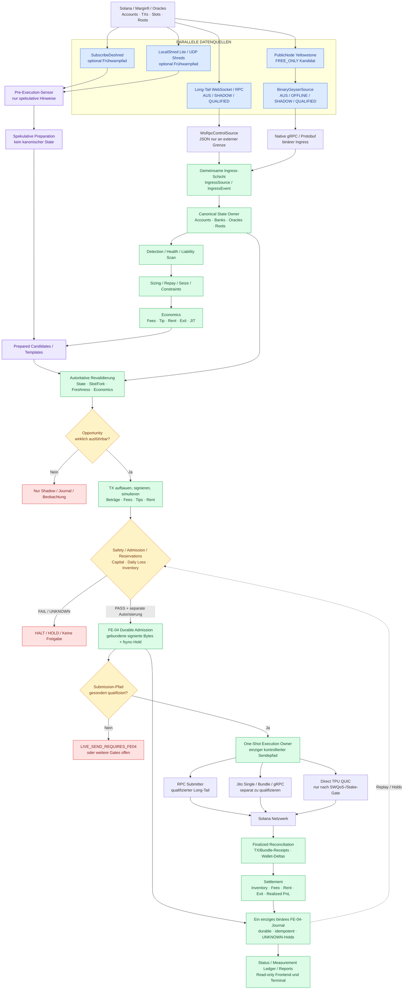

# Project_0 — Solana Liquidator | Repository und Architektur

**Ein produktives System für Marginfi-Liquidationen auf Solana.** Diese README ist der zentrale Einstieg für Menschen und ausführende KI-Agenten: tatsächliche Dateien, Zuständigkeiten, verbindliche Produktphasen, Architekturziel und sichere Arbeitsreihenfolge.

**Gemeinsame Frontend-Übergabe:** [frontend/README.md](../frontend/README.md) gilt auch für Project_0. Das native **P0J**-Journal (Magic `P0JRNL01`, CRC32, verkettetes SHA-256, Bincode für typisierte Schema-2+-Payloads) bleibt intern; nur geprüfte öffentliche Rust-Projektionen gelangen über **Protobuf → denselben Gateway → Protobuf/WebSocket → die fünf Project_0-Reiter**. BSC hat denselben Transport mit eigener DBREC-/DBJNL-Speicherung. Keine zweite fachliche Feldautorität, kein zusätzlicher Frontend-/Gateway-Stack, keine neue LIVE-Freigabe.

**Frontend-/Gateway-Integrationsstand (2026-10-24):** Die gemeinsame F3/F6/F7-Infrastruktur für BSC **und** Project_0 wurde bis zum Paket-Checkpoint `ac0b9da6` auf `main` integriert; Details, Scope und offene Project_0-native Aufgaben stehen im [Project_0-STATUS – Frontend-Übergabe](docs/STATUS.md#gemeinsamer-frontend-gateway-übergabe-checkpoint--2026-10-24-auch-für-project_0-verbindlich). Für Project_0 gilt **die identische F0-VAR-/Source→Protobuf→Reporter→ein Gateway→ein WebSocket→React-Adapter-Methodik**, aber **keine Übernahme der BSC-Fachfelder oder Trading-Gates**. Die bestehenden **fünf Project_0-Reiter und das Graphite-Layout bleiben unverändert**: Variablen werden künftig in deren vorhandene Bereiche eingeordnet, nur nach Rust-Owner-/Proto-/Quality-/Gate-Nachweis. F6 native Receipts, F4 EVENT, zusätzliche P0-Quellen, P0-Polling und visuelles Pixeldiff sind **nicht FINAL**. Protobuf-Schema-ID `68bae95c…` ist gepusht, **kein Deployment**; beide nativen Reporter müssen vor der Inbetriebnahme über `darkbotctl build` → `deploy` gemeinsam zum Schema gebaut werden. Keine Änderung am P0-Hot-Path oder an der GUI, keine neue LIVE-Freigabe.

**Stand: 2026-10-23 (GitHub `main`, geprüfter Code bis `2605556c`).** Der committete Rust-Workspace `native/` umfasst **fünf** Crates: `common`, `solana`, `liquidation`, `runtime`, `reporter`. Die Runtime-Domains `orchestration`, `execution`, `market`, `analytics` und `storage` existieren auf `main`. [Historischer Modularisierungsnachweis](docs/architecture/runtime_modularization_20261016.md); `native → engine` ist keine durchgeführte Migration. Der aktuelle Code- und Gate-Status steht in [STATUS](docs/STATUS.md), nicht im historischen Strukturbericht.

**VERBINDLICHES NEUES DOKUMENT:** [Produktionsarchitektur und vollständiger Ausführungsauftrag](docs/architecture/production_architecture_refactor_contract.md). Der Produkt-[PHASENPLAN v4.5.2](docs/PHASENPLAN.md) und das [Measurement Ledger](docs/MEASUREMENT_LEDGER.md) bleiben fachlich autoritativ. Keine dieser Dokumentationsänderungen autorisiert LIVE, Submission, Paid-Provider oder Mainnet-Runs.

Der Auftrag vom 2026-10-16 zu A0–A7 und sein [historischer Abschlussnachweis](docs/architecture/runtime_modularization_20261016.md) bleiben als Entwicklungshistorie erhalten. Der separate `DarkBot-project0`-Worktree wurde am 2026-10-22 entfernt: maßgeblich ist der Hauptordner `DarkBot` auf `main`. Vor einem lokalen Fast-Forward immer den Arbeitsbaum und parallele BSC-Änderungen prüfen; weder BSC-Dateien noch fremde Änderungen stagen, überschreiben, resetten oder bereinigen.

For the current engineering state and the next technically necessary steps, start here:

> **[Current status — docs/STATUS.md](docs/STATUS.md)**

The 2026-10-05 audit handoff is historical: [docs/development_history/audit_handoff_20261005.md](docs/development_history/audit_handoff_20261005.md).

---

## Architektur- und Ausführungsentscheidung (verbindlich)

Der langfristige Zielaufbau ist absichtlich **klein**: der vorhandene Rust-Workspace mit **fünf Crates** `common`, `solana`, `liquidation`, `runtime`, `reporter` (Reporter für Capture/Verifikation, kein zweiter Trading-Core). Keine zweite Race-/Shadow-/Live-Engine, keine neue Crate ohne nachgewiesenen Bedarf. `runtime` wird **nicht** zu `execution` umbenannt. Die Runtime enthält `orchestration`, `execution`, `market`, `analytics` und `storage`; zusätzlich existieren weitere unterstützende Module. Die frühere Vier-Crate-Aussage ist überholt.

- **`solana/state`** ist der einzige kanonische Chain-/Fork-State. **`runtime/orchestration`** koordiniert Ereignisreihenfolge, Owner, Generationen, Recovery und Kandidaten, ohne einen zweiten State zu erzeugen.
- **`solana/submit`** ist der Blockchain-Submission-Adapter; **`runtime/execution`** orchestriert zulässige Pläne, Build/Sign/Submit, persistente One-Shot-/Wallet-/Inventory-Holds, Reconciliation und tatsächliche Abrechnung.
- **`liquidation/economics`** entscheidet über ausführbare wirtschaftliche Chancen. **`runtime/analytics`** untersucht Markt-/Konkurrenz-Evidence; finale Realized-PnL-Reconciliation ist davon getrennt.
- **Winner-Chain-Nachweis** gehört zur Market-Verifikation, **Winner-Tracker** zur Orchestrierung, statistische Wettbewerbsmodelle zu Analytics. Nichtblockierende Hot-Path-Zeitmessung bleibt bei den produktiven Events; Analytics wertet nur aus.
- **`operations/`** bleibt das Python-Betriebspaket, **`scripts/`** die stabilen Shell-Einstiege. Keine Zusammenführung allein aus kosmetischen Gründen.
- Der gesamte Produktumfang **FE-00…FE-07, S0–S4, S1-RACE, S3.R, P2–P9, C0/C0-E1/H0/T, JIT, Tagger, P6-MT/M4, P8-RES/INV, P7/P4B, K, Frontend, Jito und Binary-Geyser** bleibt im Phasenplan verpflichtend. Geplante Modulnamen sind keine implementierten Features.
- Keine neue Mock-/Fake-/Stub-/Demo-Engine. Echte aufgezeichnete Chain-Daten, erforderliche Protokollkomponenten und historische Evidence dürfen nicht blind entfernt werden. `FREE_ONLY`, LIVE-/Submission-Sperren und Gepinnte-Identitätsverträge bleiben unverändert.


### Systemdiagramm — Gesamtfluss Project_0 (SOLL-Architektur)

Dieses Mermaid-Diagramm zeigt den verbindlich geplanten Gesamtfluss von Solana/Marginfi über **Long-Tail/WSS** und den eigenen **Binary-Geyser-Adapter** bis zu den optionalen **Deshred-/LocalShred-Frühwarnsensoren**, der gemeinsamen Rust-Engine, FE-04 und Settlement. Die Darstellung ist ein **Architekturziel, kein Implementierungs- oder LIVE-PASS**. Insbesondere sind die Quellen-Modi **AUS / SHADOW / QUALIFIED** hier Soll-Zustände und **noch keine nachgewiesen vorhandenen, bedienbaren CLI-/GUI-Schalter**. QUALIFIED bezeichnet ein belegtes Quellengate, nicht automatisch eine LIVE-Freigabe.



**Verbindliche Leserichtung / Safety:** `BinaryGeyserSource` ist ein **Ingress-Client**, kein Submission-Adapter. `SubscribeDeshred` und `LocalShred Lite` sind **spekulative Pre-Execution-Sensoren**; sie dürfen Templates vorwärmen, aber keinen autoritativen Account-State ersetzen und niemals eigenständig Signieren/Senden auslösen. Jede Chance braucht vor einer werttragenden Aktion erneut gültige kanonische Zustände, aktuelle Oracle-/Bank-/Program-Identität, Economics, durable Approval/Reservation und die separaten FE-06-/P8-Freigaben. Der FE-04-Owner bindet **bereits gebaute und signierte Bytes** vor dem Versand an die fsync-bestätigte Reservation; das eine Journal enthält sowohl den Handoff als auch finalisierte Settlement-Transitions. Ein Geyser-Race-Feed entscheidet nur über **Informationseingang/Preparation**, der Versand erfolgt ausschließlich über einen jeweils qualifizierten Submission-Adapter. Jito und Direct TPU sind keine automatisch nutzbaren Wege. `FREE_ONLY` gilt für alle Quellen und Infrastrukturentscheidungen.

**Verbindliche Zuordnung:** S1-02 = Rust-`BinaryGeyserSource`; S1-08 = kostenlose PublicNode-/Alternative-Binary-Quellenqualifikation; K-02 = optionaler `SubscribeDeshred`-Sensor; K-02b = optionaler `LocalShred Lite` UDP-Sensor; K-03 = eigener Raw-Shred-/Validatoraufbau nur bei begründetem Mehrwert. Verbindliche Einzelabnahmen und tatsächliche Implementierungsstände: [PHASENPLAN](docs/PHASENPLAN.md), [STATUS](docs/STATUS.md), [MEASUREMENT_LEDGER](docs/MEASUREMENT_LEDGER.md). Diese README allein erteilt keine Berechtigung zu Mainnet, LIVE, Submission oder Paid-Providern.

**Aktuelle Arbeitspriorität:** Der verbindliche [Phasenplan v4.5.2](docs/PHASENPLAN.md) §8/§13 priorisiert FE-00…FE-07 und die noch offenen Sicherheits-/Economic-Gates; S1-RACE/Geyser bleibt verpflichtender paralleler Produktumfang. Die A0–A7-Folge ist ein **historischer, separater Architektur-Refactoring-Auftrag**, kein neuer Startbefehl. Details: [Architecture Refactor Contract](docs/architecture/production_architecture_refactor_contract.md).

### Lokale Git-Arbeit ist zu schützen

Bevor du die neue Dokumentation lokal übernimmst, prüfe `git status --short` und die gestagten Project_0-Dateien. Insbesondere darf ein Pull weder lokale Änderungen noch `delete/`-Quarantäne überschreiben. Bei Konflikten **STOP und diffen**, nicht resetten/cleannen, keine anderen Projekte stagen.

---

## 1. Start here

| Need | Canonical file / directory |
|---|---|
| Current status, open gates and next steps | **[docs/STATUS.md](docs/STATUS.md)** |
| Documentation navigation | [docs/README.md](docs/README.md) |
| Structure reform handoff and 32-iteration tracker | **[docs/operations/restructure_handoff.md](docs/operations/restructure_handoff.md)** · [32-step plan](docs/architecture/restructure_32_step_plan.md) · **[Target structure and cleanup contract](#3-verbindliche-soll-struktur-nach-iteration-32-und-bereinigungspflichten)** |
| Authoritative production roadmap / architecture | [docs/PHASENPLAN.md](docs/PHASENPLAN.md) | 
| **Binding architecture ownership and AI implementation order (A0–A7)** | **[docs/architecture/production_architecture_refactor_contract.md](docs/architecture/production_architecture_refactor_contract.md)** |
| Measurements, gates and historical decisions | [docs/MEASUREMENT_LEDGER.md](docs/MEASUREMENT_LEDGER.md) |
| Development history (2026-10-05 audit handoff, audits, R127c/R127d changelogs and rollback) | [docs/development_history/](docs/development_history/) |
| Complete Astra audit findings | [docs/evidence/AUDIT_20261005/AUDIT_FINDINGS.md](docs/evidence/AUDIT_20261005/AUDIT_FINDINGS.md) |
| Exact audit commands and results | [docs/evidence/AUDIT_20261005/COMMANDS_AND_RESULTS.md](docs/evidence/AUDIT_20261005/COMMANDS_AND_RESULTS.md) |
| Complete preserved Astra audit bundle | [docs/evidence/AUDIT_20261005/darkbot_audit_bundle_20261005.zip](docs/evidence/AUDIT_20261005/darkbot_audit_bundle_20261005.zip) |
| Rust production workspace | [native/](native/) |
| Runtime orchestration / Mainnet runner | [native/crates/runtime/](native/crates/runtime/) |
| Marginfi / Project 0 domain logic | [native/crates/liquidation/](native/crates/liquidation/) |
| Solana ingress/state/transaction/submission infrastructure | [native/crates/solana/](native/crates/solana/) |
| Shared timing/config/lifecycle primitives | [native/crates/common/](native/crates/common/) |
| Reporting-/Capture-Crate (`darkbot-p0-reporter`) | [native/crates/reporter/](native/crates/reporter/) |
| Qualification and Mainnet-shadow scripts | [scripts/](scripts/) |
| Versioned raw evidence | [docs/evidence/](docs/evidence/) |
| Public/non-secret config | [config/](config/) |
| Local/generated runtime data | [data/](data/) |
| Qualification / gate documentation | [docs/qualification/](docs/qualification/) |
| Project 0 frontend | [../frontend/src/features/project0/](../frontend/src/features/project0/) |
| **Project 0 Frontend V0 Fleet: frozen design, source-bound React tree and implementation plan** | [V0 Graphite design](../frontend/docs/V0_GRAPHITE_FLEET.md), [Fleet source mapping / persistence / refresh](../frontend/docs/V0_FLEET_IMPLEMENTATION_PLAN.md). Multi-bot executable owner remains SOLL, no LIVE approval. |
| **Accepted Graphite V5 UI & portfolio financial KPI contract** | [Graphite V5, latency, Total Capital and Realized Net PnL in Overview and Wallets](../frontend/docs/GRAPHITE_V5_UI_FINANCE_CONTRACT.md); DTOs are SOLL, not existing financial ledger. |
| **Project0 wallet overview / profit treasury roadmap** | [Frontend Wallets & Treasury FEUI-10](../frontend/docs/WALLETS_TREASURY.md), public balances, manual and policy-bound auto-sweeps; no transfers authorized by these docs. |
| **Project0 startup, unbounded run and backtest UX contract** | [Boot-/Address-Integrity/RunHorizon/Replay/Optimizer](../frontend/docs/STARTUP_BACKTEST_OPTIMIZATION.md); planned, not implemented; follows Project_0 FE/JFI/SK gates. |
| **Frontend control / phased implementation plan** | [FEUI-00…09](../frontend/docs/FRONTEND_PHASENPLAN.md), [verified code/variables](../frontend/docs/PROJECT_0_CODE_MAP.md), [proposed control/API contract](../frontend/docs/CONTROL_PROTOCOL.md). New APIs and `p0ctl` remain **SOLL** until tested. |

---

## 2. Canonical read order

When resuming Project 0 after a break, audit, model switch or handoff, read in this order:

```text
1. project_0/README.md
2. project_0/docs/STATUS.md
3. project_0/docs/MEASUREMENT_LEDGER.json, then the newest relevant MEASUREMENT_LEDGER.md entries
4. project_0/docs/PHASENPLAN.json, then the relevant PHASENPLAN.md sections
5. relevant immutable evidence under project_0/docs/evidence/
6. relevant production source under project_0/native/
7. relevant qualification script under project_0/scripts/
8. historical context when needed: project_0/docs/development_history/ and project_0/docs/evidence/AUDIT_20261005/
```

`docs/STATUS.md` summarizes; the newest dated ledger entries and the code remain canonical. Historical documents and measurements are never erased.

**Für historische Nachprüfung der damaligen lokalen Iterationen 30–32**, first read [restructure_handoff.md](docs/operations/restructure_handoff.md) and [32-step progress register](docs/architecture/restructure_32_step_plan.md), then verify their local state; the tracked versions are older than the reported staged work. The follow-on architecture work is defined separately in [production_architecture_refactor_contract.md](docs/architecture/production_architecture_refactor_contract.md). Both are separate from the FE-00…FE-07 product gate.

---

## 3. Verbindliche SOLL-Struktur nach Iteration 32 und Bereinigungspflichten

**HISTORISCHER 32-SCHRITTE-STRUKTURVERTRAG (GitHub-Baseline bis Iteration 29; Iteration 30–32 lokal gemeldet, remote noch nicht prüfbar).** Dies ist die Zielordnung für die
[32-Schritte-Strukturreform](docs/architecture/restructure_32_step_plan.md), **kein Nachweis über
bereits fertiggestellte Dateien oder Tests**. Den tatsächlich erreichten Stand ausschließlich
aus dem [aktiven Struktur-Handoff](docs/operations/restructure_handoff.md), der
[Roadmap](docs/architecture/restructure_32_step_plan.md) und dem aktuellen Code ableiten.
Die fachliche FE-00–FE-07-Roadmap ist davon unabhängig. Die **nachfolgende** interne Architektur-Härtung A0–A7 hat ihren eigenen [verbindlichen Vertrag](docs/architecture/production_architecture_refactor_contract.md); der ältere §3.1-Baum beschreibt nicht die neue interne Modulaufteilung.

### 3.1 Historischer Zielbaum (nach Schritt 32; heutiger Cargo-Workspace hat zusätzlich `reporter`)

~~~text
project_0/
├── README.md
├── .gitignore
├── .env.example
├── config/
│   ├── profiles/                       # typisierte geprüfte Runtime-Profile
│   ├── examples/                       # öffentliche, secret-freie Beispiele
│   └── wallet.public.env
├── native/
│   ├── Cargo.toml
│   ├── Cargo.lock
│   └── crates/
│       ├── common/                      # ehemals darkbot-common
│       ├── solana/                      # ehemals darkbot-solana
│       ├── liquidation/                 # ehemals darkbot-project0
│       ├── runtime/                     # ehemals darkbot-runner
│       └── reporter/                    # darkbot-p0-reporter; heutiges Workspace-Mitglied
├── operations/
│   ├── cli/                             # Python-CLI, ein typisierter Steuerungsvertrag
│   ├── capture/                         # Capture-/Beobachtungsprogramme
│   ├── verification/                    # Chain-Abgleich, Verifikation, Resume
│   ├── reporting/                       # Reporting und Exporte
│   └── qualification/                   # Preflight und Qualifikationslogik
├── scripts/
│   ├── capture.sh                       # stabile Shell-Entrypoints / Kompatibilität
│   ├── smoke.sh
│   ├── verify.sh
│   ├── report.sh
│   └── preflight.sh
├── tests/
│   ├── python/
│   ├── integration/
│   ├── regression/
│   └── fixtures/                        # kleine, synthetische, deterministische Testdaten
├── docs/
│   ├── README.md
│   ├── STATUS.md
│   ├── PHASENPLAN.md / PHASENPLAN.json
│   ├── MEASUREMENT_LEDGER.md / MEASUREMENT_LEDGER.json
│   ├── architecture/
│   ├── operations/
│   ├── qualification/
│   ├── measurements/
│   │   ├── protocols/
│   │   └── historical_reports/
│   ├── development_history/
│   └── evidence/                         # qualifizierte historische Evidence: immutable
├── data/
│   ├── runs/<run_id>/
│   │   ├── manifest.json
│   │   ├── config.json
│   │   ├── capture/
│   │   ├── snapshots/
│   │   ├── verification/
│   │   ├── reports/
│   │   └── logs/
│   └── cache/                            # nur klar als rekonstruierbar bewertete Caches
└── exports/                              # generierte, nicht-kanonische Exporte
~~~

**Präzisierungen:**
- Der Baum zeigt *Verantwortungsbereiche und Zielpfade*, nicht sämtliche künftigen Dateien.
  Rust-Crates behalten eigene `Cargo.toml` und `src/`; ein Ordnername ändert nicht automatisch
  den Cargo-Paketnamen. Inhalte werden nach fachlicher Zuständigkeit aufgeteilt, nicht willkürlich.
- `operations/` enthält Python-Implementierungen; `scripts/` stellt stabile,
  getestete Shell-Einstiegspunkte und erforderliche Kompatibilitätswrapper bereit.
  Kein zweiter Decoder, Verifier, Health-, Economics- oder Routing-Kern.
- `data/runs/` ist das qualifizierte **Ziel**. Historische Layout-V1-Runs und gepinnte
  Spec-/Report-/Resume-Identitäten müssen weiter eindeutig lesbar bleiben; Layout V2 benötigt
  einen eigenen versionierten Vertrag. Der Default darf erst nach Schritt 8b.2/8b.3 umgestellt werden.
- Vorhandene Sonderpfade wie `src/` und `tools/` werden in Schritt 30 per tatsächlichem
  Verbrauchernachweis bewertet, **nicht allein deshalb gelöscht, weil sie in diesem
  vereinfachten Zielbaum fehlen**. Das Frontend außerhalb von `project_0/` bleibt unangetastet.

### 3.2 Verbindliche Altlasten-Bereinigung (Schritte 16–31, Schwerpunkt 30)

**Ergebnisziel:** Eine wartbare, kohärente Codebasis, nicht nur verschobene Dateien.
Jede der folgenden Klassen ist systematisch zu inventarisieren. Bei belegter Unnötigkeit
bereinigen; sonst den Grund der Beibehaltung und den verbliebenen Eigentümer dokumentieren.

| Prüfklasse | Verbindliche Entscheidung |
|---|---|
| Tote Module, Dateien, Funktionen und Ordner | Referenzen/Entrypoints/Tests nachweisen; nur unbenutzten Code entfernen |
| Doppelte Implementierungen | Einen kanonischen Eigentümer festlegen; duplizierte Logik zusammenführen, Aufrufer umstellen |
| Veraltete Python-/Rust-/Shell-Pfade | Alle Imports, Cargo-Pfade, Launcher, CLI-Aufrufe, Links und Testpfade aktualisieren |
| Obsolete Wrapper, Aliase und Legacy-Entrypoints | Nur nach Consumer- und Kompatibilitätsnachweis entfernen; erforderliche Übergänge schmal halten |
| Veraltete Config-Defaults und Beispiele | Einheitlichen typisierten Backend-Konfigurationsvertrag herstellen; doppelte Defaults entfernen |
| Unbenutzte Dependencies, Features und Build-Skripte | Nur nach tatsächlicher Referenz-/Build-Prüfung entfernen; `Cargo.lock` konsistent halten |
| Vermischte Verantwortlichkeiten / übergroße Module | An echten Fachgrenzen teilen; keine zweite Runtime und keine veränderte Execution-Semantik |
| Cache-, Temp-, Export- und Testartefakte im falschen Verzeichnis | Erzeuger und Verbraucher auf den korrekten Zielpfad umstellen, Ignore-Grenzen prüfen |
| Überholte README-, Handoff- und Codeverweise | Aktive Links und Startbefehle auf die kanonischen Dateien ausrichten; Historie erhalten |
| Alte TODOs, Platzhalter und nicht mehr passende Kommentare | Tatsächlichen Umsetzungsstand prüfen; erledigte entfernen, offene Punkte ausdrücklich dokumentieren |

**Nicht als Altlast löschen:** historische Rohdaten (insbesondere lokale Runs unter
`data/econ4h/` und `data/market/`), qualifizierte `docs/evidence/`-Artefakte, Hashes,
Verification-Spec-IDs, Checkpoints, Replay-/Resume-Nachweise, PHASENPLAN/Measurement-Ledger,
notwendige Legacy-Leser oder Sicherheitsgates. Diese Daten und Semantiken sind bewusst
rückwärtskompatibel zu halten; keine unaufgeforderte Migration der etwa 75 GB lokalen Rohdaten.

### 3.3 Wann gilt eine Bereinigung als fertig?

Für jede verschobene oder entfernte Datei und jeden zusammengeführten Codepfad muss
der Arbeitsbericht nachweisen:

1. **Vorher/Nachher-Zuordnung:** alter Pfad, neuer Pfad bzw. Löschgrund, kanonischer Eigentümer.
2. **Vollständige Verbraucherprüfung:** Rust/Cargo, Python-Imports, Shell/CLI, Environment,
   Config, Tests/Fixtures, Reports/Verifier, Dokumentationslinks und Frontend-Vertragsgrenze;
   keine aktiven defekten Referenzen.
3. **Verhaltensparität:** betroffene Einstiege, Flags, Ausgabeformate, Run-/Report-IDs,
   Fehler- und Fail-Closed-Semantik bleiben erhalten oder eine ausdrücklich versionierte
   Migration einschließlich Kompatibilität ist nachgewiesen.
4. **Keine Doppelimplementierung:** Tests und Werkzeuge benutzen die produktive Fachlogik
   statt eigene Health-/Liquidations-/Decoder-/Economics-Regeln.
5. **Gezielte Funktionstests nach Änderungen; Abschlussqualifikation in Schritt 32:**
   Python- und Rust-Regression, Offline-Builds, Shell/CLI, V1/V2-Resume/Reporting,
   relevante Replay-Parität. Keine wiederholten Stresstestkampagnen ohne neuen Befund;
   kein PASS für nicht ausgeführte Tests.
6. **Saubere Git-Grenzen:** ausschließlich freigegebene `project_0/**`-Pfade, keine
   Secrets, lokalen Rohdaten oder historischen Evidence committen; `bsc/**` bleibt unberührt.
7. **Restliste statt Scheinsicherheit:** nicht nachweislich entbehrliche Altlasten
   als `RETAINED` mit Grund und ggf. Folgeticket aufführen, nicht heimlich löschen.

**Nicht zulässig:** `git clean`, Hard-Reset, pauschales Staging, stille Änderung gepinnter
Verifikationslogik, LIVE-/Submission-Aktivierung oder fachliche Gewinnbehauptungen.
`FREE_ONLY`, autorisierte Budget- und Sicherheitsgrenzen gelten weiter.

**Meilensteine:** 8–15 = Runs, Daten, Config, Tests; 16–20 = Python-Operations;
21–25 = Shell-Einstiegspunkte; 26–29 = Rust-Crates; **30 = endgültige
Verbraucher- und Altlastenbereinigung; 31 = sämtliche Verweise; 32 = unabhängige
Endqualifikation**. Eine saubere Ordnerstruktur allein ist noch keine vollständige
Codequalitäts-, Performance- oder Economics-Freigabe.

### 3.4 Historischer Ist-Baum der Migration (aktualisierte Cargo-Mitglieder)

Der folgende Abschnitt bewahrt die damalige Strukturerfassung; er ist **kein vollständiger aktueller Dateibaum**. Die heute vorhandenen Cargo-Mitglieder sind im nachfolgenden `native/crates/`-Ausschnitt aktualisiert. Für den tatsächlichen Stand gelten `native/Cargo.toml`, Quellcode und aktuelle Qualification-Evidence; keine alte Migrationsnotiz ist ein erneuter Arbeitsauftrag.

```text
project_0/
├── README.md                         <- this navigation / placement contract
├── .env.example                     <- non-secret environment template only
│
├── docs/                             <- human-readable Project 0 documentation
│   ├── README.md                     <- documentation navigation
│   ├── STATUS.md                     <- CURRENT STATUS + NEXT STEPS
│   ├── PHASENPLAN.md                 <- authoritative production plan
│   ├── MEASUREMENT_LEDGER.md         <- measurements / gates / decisions
│   ├── architecture/                 <- upstream reuse decisions, parallel execution design
│   ├── operations/                   <- operational configuration: profiles, precedence, budgets
│   ├── qualification/                <- qualification / gate documentation index
│   ├── measurements/
│   │   ├── protocols/                <- P6-LT Shadow, C0-MO, C0-E1 econ4h protocols
│   │   └── historical_reports/       <- FIX-129 cost, C0-E1 implementation/qualification reports
│   ├── development_history/          <- 2026-10-05 audit handoff (historical), audits, work order,
│   │                                    R127c/R127d changelogs and rollback
│   └── evidence/                     <- IMMUTABLE versioned evidence
│       ├── AUDIT_20261005/           <- complete Astra audit corpus
│       ├── R114_*.json
│       ├── R116_*.json
│       ├── R117_*.json
│       ├── R118_*.json
│       ├── R119_*.json
│       ├── R120_*.json
│       ├── R121_*.json
│       ├── R122_*.json
│       ├── R124_*.json
│       ├── R125b_*.json
│       ├── R126b_*.json
│       ├── R127_*.json
│       ├── R127c_*.json
│       ├── R127d_*.json
│       └── other qualified raw evidence
│
├── native/                           <- PRODUCTION RUST WORKSPACE
│   ├── Cargo.toml
│   ├── Cargo.lock                    <- tracked reproducible dependency lock
│   └── crates/
│       ├── common/                   <- package darkbot-common: common runtime primitives
│       ├── solana/                   <- package darkbot-solana: Solana transport/state/tx/submit
│       ├── liquidation/              <- package darkbot-project0: Project 0 protocol/domain logic
│       ├── runtime/                  <- package darkbot-runner: production orchestration/runtime
│       └── reporter/                 <- package darkbot-p0-reporter: reporter/capture tools
│
├── operations/                       <- Python implementations (package `operations`, iterations 16-20)
│   ├── cli/                          <- measurement_cli.py, measurement_contract.py, operational_config.py
│   ├── capture/                      <- run_store.py (run storage/layout contract), c0_census.py
│   ├── verification/                 <- audit_market_quick.py, measurement_verify.py
│   ├── reporting/                    <- market_report.py
│   └── qualification/                <- fe_readonly_preflight.py, fe_candidate_report.py, run_r126/r127_qualify.py
│
├── scripts/                          <- stable shell entry points (iterations 21-25)
│   ├── capture.sh                    <- econ4h typed measurement, econ4h-launcher, market, shadow
│   ├── smoke.sh                      <- controlled gap/reconnect smoke
│   ├── verify.sh / report.sh         <- read-only verification and reports
│   ├── preflight.sh                  <- read-only FE preflight
│   └── compatibility wrappers        <- test.sh, run_*.sh, fe_readonly_preflight.sh, old *.py paths, test_suite.py
│
├── config/                           <- PUBLIC / NON-SECRET versioned config
│   ├── profiles/                     <- typed runtime profiles (single source, embedded in Rust)
│   ├── examples/                     <- secret-free examples, validated by the real parsers
│   └── wallet.public.env
│
├── data/                             <- local/generated runtime datasets (runs/, cache/, legacy roots)
├── exports/                          <- generated exports / reports
├── src/                              <- application/control boundary, not Rust production core
├── tests/                            <- Python tests: python/, integration/, regression/, fixtures/ (tests/README.md)
└── tools/                            <- reserved project-specific tooling area
```

### Structure rule

Do **not** create new top-level Project 0 directories without updating this README.

---

## 4. Production Rust map

The production implementation lives under **[native/](native/)**.

### 4.1 `crates/common` (package `darkbot-common`) — shared infrastructure

Directory: [native/crates/common/](native/crates/common/)

| Area | File |
|---|---|
| bounded channels / overflow semantics | [channel.rs](native/crates/common/src/channel.rs) |
| config parsing | [config.rs](native/crates/common/src/config.rs) |
| typed errors / halt reasons | [error.rs](native/crates/common/src/error.rs) |
| metrics histograms | [histogram.rs](native/crates/common/src/histogram.rs) |
| journal / replay primitives | [journal.rs](native/crates/common/src/journal.rs) |
| lifecycle / run state | [lifecycle.rs](native/crates/common/src/lifecycle.rs) |
| timing vocabulary / timelines | [timing.rs](native/crates/common/src/timing.rs) |

### 4.2 `crates/solana` (package `darkbot-solana`) — Solana infrastructure

Directory: [native/crates/solana/](native/crates/solana/)

| Area | Directory |
|---|---|
| event ingress / WSS / source handling | [src/ingress/](native/crates/solana/src/ingress/) |
| canonical state / recovery | [src/state/](native/crates/solana/src/state/) |
| transaction construction primitives | [src/tx/](native/crates/solana/src/tx/) |
| RPC / Jito submission infrastructure | [src/submit/](native/crates/solana/src/submit/) |
| probes / binaries | [src/bin/](native/crates/solana/src/bin/) |

### 4.3 `crates/liquidation` (package `darkbot-project0`) — Project 0 protocol/domain logic

Directory: [native/crates/liquidation/](native/crates/liquidation/)

| Responsibility | File |
|---|---|
| exact health / Marginfi health integration | [health.rs](native/crates/liquidation/src/health.rs) |
| Bank/Account reverse and threshold indices | [index.rs](native/crates/liquidation/src/index.rs) |
| integration projection/refresh semantics | [integration.rs](native/crates/liquidation/src/integration.rs) |
| state projection | [projection.rs](native/crates/liquidation/src/projection.rs) |
| receivership planning | [planner.rs](native/crates/liquidation/src/planner.rs) |
| receivership instructions / rules | [receivership.rs](native/crates/liquidation/src/receivership.rs) |
| liquidation sizing | [sizing.rs](native/crates/liquidation/src/sizing.rs) |
| deterministic economics / candidate ranking | [economics.rs](native/crates/liquidation/src/economics.rs) |
| funding classification | [funding.rs](native/crates/liquidation/src/funding.rs) |
| execution abstractions | [execution.rs](native/crates/liquidation/src/execution.rs) |
| prepared candidate cache / execution state | [prepared.rs](native/crates/runtime/src/execution/prepared.rs) (älterer unverdrahteter Liquidation-Entwurf entfernt) |
| scheduling logic | [schedule.rs](native/crates/liquidation/src/schedule.rs) |
| safety rules | [safety.rs](native/crates/liquidation/src/safety.rs) |
| protocol constants / IDs | [protocol.rs](native/crates/liquidation/src/protocol.rs) |

### 4.4 `crates/runtime` (package `darkbot-runner`) — production orchestration

Directory: [native/crates/runtime/](native/crates/runtime/)

| Responsibility | File |
|---|---|
| binary entrypoint | [main.rs](native/crates/runtime/src/main.rs) |
| runtime owner / candidate cache / event loop | **[state_owner.rs](native/crates/runtime/src/orchestration/state_owner.rs)** |
| startup / mode lifecycle | [startup.rs](native/crates/runtime/src/orchestration/startup.rs) |
| read-only capture / decoding / verification | [market/](native/crates/runtime/src/market/) |
| market economics / measurement / reports | [analytics/](native/crates/runtime/src/analytics/) |
| receivership builder integration | [builder.rs](native/crates/runtime/src/execution/builder.rs) |
| end-to-end pipeline helpers | [pipeline.rs](native/crates/runtime/src/execution/pipeline.rs) |
| pending candidate handling | [pending.rs](native/crates/runtime/src/execution/pending.rs) |
| Jupiter route integration | [route.rs](native/crates/runtime/src/execution/route.rs) |
| LUT handling | [lookup_tables.rs](native/crates/runtime/src/execution/lookup_tables.rs) |
| winner / competitor matching | [winner.rs](native/crates/runtime/src/market/winner.rs) |
| shadow evidence record model | [record.rs](native/crates/runtime/src/analytics/record.rs) |
| shadow ledger | [shadow_ledger.rs](native/crates/runtime/src/analytics/shadow_ledger.rs) |
| fixture support | [fixture.rs](native/crates/runtime/src/analytics/fixture.rs) |
| remote worker helpers | [remote_workers.rs](native/crates/runtime/src/orchestration/remote_workers.rs) |
| runtime/probe binaries | [src/bin/](native/crates/runtime/src/bin/) |
| typed persistent storage / preflight | [storage/](native/crates/runtime/src/storage/) |

### 4.5 `crates/reporter` (package `darkbot-p0-reporter`) — Reporting/Capture

Directory: [native/crates/reporter/](native/crates/reporter/). Enthält `p0-market-capture-reported` und ein optionales Test-Fixture-Binary. Dieser Workspace-Member ist **keine** zweite State-/Execution-Engine.

---

## 5. Documentation map

Directory: [docs/](docs/)

### Current / authoritative

| File | Purpose |
|---|---|
| **[STATUS.md](docs/STATUS.md)** | Current code/qualification state, FE-00…FE-07, open gates, next steps, known contradictions. **Read first.** |
| [PHASENPLAN.md](docs/PHASENPLAN.md) | Long-term production architecture, phases and constraints. |
| [MEASUREMENT_LEDGER.md](docs/MEASUREMENT_LEDGER.md) | Historical measurements, PASS/FAIL/OPEN decisions and evidence references. |

### Architecture

Directory: [docs/architecture/](docs/architecture/)

| File | Purpose |
|---|---|
| [p0_reuse_matrix.md](docs/architecture/p0_reuse_matrix.md) | P0 reference study and upstream reuse/merge decisions (eva01, marginfi-v2). |
| [parallel_execution_plan.md](docs/architecture/parallel_execution_plan.md) | Parallel execution design and MT0–MT10 sequence (baseline 2026-10-06). |

### Operations

Directory: [docs/operations/](docs/operations/)

| File | Purpose |
|---|---|
| [operational_config.md](docs/operations/operational_config.md) | Operational configuration: inspection commands, precedence, profiles, budgets, authorization limits. |

### Qualification

Directory: [docs/qualification/](docs/qualification/)

| File | Purpose |
|---|---|
| [README.md](docs/qualification/README.md) | Qualification/gate documentation index: where gate definitions, results and raw evidence live. |

### Measurement protocols

Directory: [docs/measurements/protocols/](docs/measurements/protocols/)

| File | Purpose |
|---|---|
| [p6lt_shadow.md](docs/measurements/protocols/p6lt_shadow.md) | P6-LT Shadow phase definition: gates, measurement structures, required ledger fields. |
| [c0mo_market_observer.md](docs/measurements/protocols/c0mo_market_observer.md) | C0-MO unfiltered read-only market observer. |
| [c0e1_econ4h.md](docs/measurements/protocols/c0e1_econ4h.md) | C0-E1 combined economic observation (`P0_MODE=econ4h`). |

### Historical measurement reports

Directory: [docs/measurements/historical_reports/](docs/measurements/historical_reports/)

| File | Purpose |
|---|---|
| [fix129_cost_qualification.md](docs/measurements/historical_reports/fix129_cost_qualification.md) | FIX-129 cost-model qualification history (2026-10-05). |
| [c0e1_implementation_report.md](docs/measurements/historical_reports/c0e1_implementation_report.md) | C0-E1 implementation, validation and qualification history (2026-10-08 to 2026-10-12). |

### Development history

Directory: [docs/development_history/](docs/development_history/)

| File | Purpose |
|---|---|
| [audit_handoff_20261005.md](docs/development_history/audit_handoff_20261005.md) | **Historical** post-audit handoff (2026-10-05, P6-MT override 2026-10-07); superseded by [STATUS.md](docs/STATUS.md). |
| [r127d_changelog_rollback.md](docs/development_history/r127d_changelog_rollback.md) | R127d candidate cache / re-arm change, measured queue PASS, rollback points and post-audit correctness reopening. |
| [r127c_changelog_rollback.md](docs/development_history/r127c_changelog_rollback.md) | R127c batching implementation and rollback. |
| [fable_audit_20261003.md](docs/development_history/fable_audit_20261003.md) | Earlier audit snapshot; historical, not current status. |
| [fable_work_order.md](docs/development_history/fable_work_order.md) | Earlier implementation work order (2026-09-30). |

---

## 6. Evidence map

All versioned Project 0 evidence belongs under:

> **[docs/evidence/](docs/evidence/)**

### Current Astra audit corpus

Directory: **[docs/evidence/AUDIT_20261005/](docs/evidence/AUDIT_20261005/)**

| File | Meaning |
|---|---|
| [AUDIT_FINDINGS.md](docs/evidence/AUDIT_20261005/AUDIT_FINDINGS.md) | Audit findings and limitations. |
| [COMMANDS_AND_RESULTS.md](docs/evidence/AUDIT_20261005/COMMANDS_AND_RESULTS.md) | Commands actually run and observed results. |
| [BUNDLE_README.md](docs/evidence/AUDIT_20261005/BUNDLE_README.md) | Contents and provenance of the complete bundle. |
| [manifest.json](docs/evidence/AUDIT_20261005/manifest.json) | Audit source SHA, reference-repository SHAs and test counts. |
| [cache_counterexamples.txt](docs/evidence/AUDIT_20261005/cache_counterexamples.txt) | Reproduced Candidate Cache correctness/fairness counterexamples. |
| [cache_counterexamples.py](docs/evidence/AUDIT_20261005/cache_counterexamples.py) | Reproducer for the checked-in cache predicate. |
| [history_summary.json](docs/evidence/AUDIT_20261005/history_summary.json) | Summary of six preserved real liquidations. |
| [history_analysis.json](docs/evidence/AUDIT_20261005/history_analysis.json) | Detailed decoded transaction analysis. |
| [recent_liquidation_records.json](docs/evidence/AUDIT_20261005/recent_liquidation_records.json) | Decoded recent liquidation records. |
| [selected_signatures.json](docs/evidence/AUDIT_20261005/selected_signatures.json) | Selected historical signatures / scan context. |
| [drift_dispatch.json](docs/evidence/AUDIT_20261005/drift_dispatch.json) | Drift `Custom(101)` simulation evidence. |
| [tests_health.txt](docs/evidence/AUDIT_20261005/tests_health.txt) | Compact `crate_health` test results. |
| [tests_txv1.txt](docs/evidence/AUDIT_20261005/tests_txv1.txt) | Compact `crate_health,txv1` test results. |
| **[darkbot_audit_bundle_20261005.zip](docs/evidence/AUDIT_20261005/darkbot_audit_bundle_20261005.zip)** | Complete forensic audit package: audited source archive, public reference-source snapshots, raw transaction data, scripts, logs and checksums. |

The six per-signature JSON files in that directory are the preserved raw transaction payloads for the historical receivership examples.

### Runtime / qualification evidence

Important versioned evidence includes:

| Evidence | Purpose |
|---|---|
| [R114_projection_clock.json](docs/evidence/R114_projection_clock.json) | Projection clock/timestamp evidence. |
| [R116_integration_sweep.json](docs/evidence/R116_integration_sweep.json) | Integration sweep. |
| [R117_paced_projection_sweep.json](docs/evidence/R117_paced_projection_sweep.json) | Paced projection sweep. |
| [R118_route_budget.json](docs/evidence/R118_route_budget.json) | Route/account budget evidence. |
| [R119_route_budget.json](docs/evidence/R119_route_budget.json) | Follow-up route budget evidence. |
| [R120_protocol_luts.json](docs/evidence/R120_protocol_luts.json) | Protocol LUT evidence. |
| [R121_sizing_pairs.json](docs/evidence/R121_sizing_pairs.json) | Sizing-pair qualification. |
| [R122_juplend_complete.json](docs/evidence/R122_juplend_complete.json) | JupLend integration evidence. |
| [R124_rpc_economics.json](docs/evidence/R124_rpc_economics.json) | RPC economics evidence. |
| [R125b_oracle_trigger_runtime.json](docs/evidence/R125b_oracle_trigger_runtime.json) | Oracle-trigger runtime evidence. |
| [R126b_scheduler_fairness.json](docs/evidence/R126b_scheduler_fairness.json) | R126b scheduler evidence. |
| [R127_20261005T143113Z.json](docs/evidence/R127_20261005T143113Z.json) | Initial R127 qualification. |
| [R127c_20261005T161806Z.json](docs/evidence/R127c_20261005T161806Z.json) | R127c PARTIAL batching evidence. |
| [R127d_20261005T171043Z.json](docs/evidence/R127d_20261005T171043Z.json) | R127d queue/fanout qualification evidence. |
| [FIX129_fee_sources.json](docs/evidence/FIX129_fee_sources.json) | Fee-source qualification evidence. |

### Evidence rule

Evidence is **append-only / immutable after qualification**.

If a conclusion changes later:

```text
do not overwrite the old evidence
-> add new evidence
-> update MEASUREMENT_LEDGER.md
-> update the relevant changelog/handoff
```

Raw evidence should identify the source commit, run/dataset ID, environment/provider where applicable, and explicitly state non-claims.

---

## 7. Scripts map

Directory: [scripts/](scripts/)

| Entry point | Purpose |
|---|---|
| [capture.sh](scripts/capture.sh) | `capture.sh --duration 10m` typed C0-E1 measurement (verification and report follow); `capture.sh econ4h-launcher`, `capture.sh market` (C0-MO), `capture.sh shadow` (Mainnet Shadow, observe only). |
| [smoke.sh](scripts/smoke.sh) | Controlled gap/reconnect smoke through a market-only loopback proxy. |
| [verify.sh](scripts/verify.sh) / [report.sh](scripts/report.sh) | Read-only historical verification and offline reports for a run id or path. |
| [preflight.sh](scripts/preflight.sh) | Read-only FE preflight and effective-config inspection. |
| [test.sh](scripts/test.sh) | Required PHASENPLAN entrypoint for typed capture. Obsolete forwarding scripts and Python wrappers are inactive in [delete/](delete/README.md); use the six active shell commands or `python3 -m operations.<area>.<module>`. |

Python implementations live in [operations/](operations/): [c0_census.py](operations/capture/c0_census.py) (account census),
[run_r126_qualify.py](operations/qualification/run_r126_qualify.py) and [run_r127_qualify.py](operations/qualification/run_r127_qualify.py)
(historical Shadow qualification harnesses), and the measurement CLI, verifier and report modules listed above.

A qualification script must exercise production components; it must not silently implement a second version of business logic.

---

## 8. Data, exports and generated artifacts

### `data/`

Directory: [data/](data/)

Use for generated/local runtime datasets, shadow output and temporary measurement material that is not yet frozen as canonical evidence.

**Do not treat local `data/` files as durable evidence.**

New econ4h / C0-E1 runs go to `data/runs/<run_id>/` in layout V2 by default (`P0_RUN_STORE=legacy` keeps `data/econ4h/`);
C0-MO market runs keep `data/market/`. Historical runs are not moved and stay readable. See
[docs/operations/run_storage.md](docs/operations/run_storage.md). Run directories are git-ignored.
Reconstructible caches go to `data/cache/`; classes, retention and deletion boundaries are in
[docs/operations/data_policy.md](docs/operations/data_policy.md).

When a run becomes a gate/decision input:

```text
data/... raw/local result
-> validate / summarize
-> copy the required immutable artifact to docs/evidence/
-> reference it from MEASUREMENT_LEDGER.md
```

### `exports/`

Directory: [exports/](exports/)

Generated human/machine exports may live here, e.g. `scripts/report.sh --run <id> --format csv > project_0/exports/<id>.csv`.
They are non-authoritative unless separately frozen under `docs/evidence/` and referenced by the ledger.

### Build artifacts

Rust `target/`, caches, temporary logs and other build outputs are **not repository evidence** and must not be committed merely because they were produced by a test.

---

## 9. Configuration and secrets

### Versioned public config

Directory: [config/](config/)

- [config/profiles/](config/profiles/): typed runtime profiles `smoke`, `standard`, `performance`, `custom`
  (single source of profile values; see [operational config](docs/operations/operational_config.md))
- [config/examples/](config/examples/): secret-free override and provider-qualification examples
- [config/wallet.public.env](config/wallet.public.env): public signer identity
- [.env.example](.env.example): environment template

### Secrets

Never commit:

```text
private keys
seed phrases / mnemonics
API keys
bearer tokens
private RPC URLs containing credentials
real .env files
signing keypair files
```

Public addresses and non-secret configuration may be versioned when useful.

---

## 10. Current Project 0 status

The current status is maintained in:

> [docs/STATUS.md](docs/STATUS.md)

The 2026-10-05 status block that stood here remains in the git history (up to commit `1b87387`); the corresponding
audit-era assessment is in [docs/development_history/audit_handoff_20261005.md](docs/development_history/audit_handoff_20261005.md).
Do not copy status into this README. Update the measurement ledger and `docs/STATUS.md` instead.

---

## 11. Current implementation priority

The current ordered First-Profit path is FE-00 → FE-07 (`PHASENPLAN.json` → `current_prioritized_technical_path`).
Status per ticket and the next technically necessary steps are in [docs/STATUS.md](docs/STATUS.md).

The 32-step restructuring baseline is saved in `c10df8b`; the following runtime-domain migration is implemented and offline-tested in the local working tree. Do not start an unrelated architecture rewrite or alter production semantics without separate evidence and authorization.

---

## 12. File-placement rules

| New artifact | Put it here |
|---|---|
| Production Rust logic | `native/crates/<appropriate-crate>/src/` |
| New executable/probe that belongs to Rust production workspace | appropriate crate `src/bin/` |
| Python operational/qualification implementation (target steps 16–20) | `operations/{cli,capture,verification,reporting,qualification}/` |
| Shell entrypoint and required compatibility wrapper (target steps 21–25) | `scripts/` |
| Current human-readable status / handoff | `docs/` |
| Measured immutable evidence | `docs/evidence/` |
| Audit-specific evidence corpus | `docs/evidence/AUDIT_<date>/` |
| Local generated run data | `data/` |
| Generated export/report | `exports/` |
| Public non-secret configuration | `config/` |
| Gate definition/documentation | `docs/qualification/` |
| Project-wide non-Rust tests | `tests/` |

Rules:

```text
1. Do not scatter evidence across source directories.
2. Do not put generated runtime data into docs/.
3. Do not overwrite old evidence when a later result disagrees.
4. Do not create duplicate implementations of health/economics/routing for test tooling.
5. Do not add new top-level directories without documenting their role here.
6. Every important gate result must be linked from MEASUREMENT_LEDGER.md.
7. Every major architectural/current-state change must update the relevant handoff/changelog.
8. The audit ZIP is forensic backup; normal work should use the extracted/versioned files first.
```

---

## 13. Build and test entry points

Rust workspace:

```bash
cd project_0/native

cargo build --locked --features crate_health
cargo build --locked --features "crate_health txv1"

cargo test --locked --workspace --features crate_health
cargo test --locked --workspace --features "crate_health txv1"

# The runner library without the health engine (`default = []`; only `p0-longtail` requires
# `crate_health`). A workspace build always unifies `crate_health` into the runner (the reporter
# depends on it), so only an isolated package build checks this configuration
# (tests/regression/test_feature_matrix.py).
cargo clippy --locked -p darkbot-runner --all-targets -- -D warnings
cargo test --locked -p darkbot-runner
cargo test --locked -p darkbot-runner --features txv1
```

Mainnet Shadow entry:

```bash
project_0/scripts/capture.sh shadow
```

Qualification:

```bash
python3 project_0/operations/qualification/run_r127_qualify.py ...
```

Do not enable value-bearing LIVE solely because workspace tests are green. Follow the gates in `docs/STATUS.md` and the measurement ledger.

---

## 14. Git / rollback anchors

Project 0 tags (structure reform baselines):

```text
project0-last-qualified-20261014     0782d8b  qualified operational baseline
project0-last-unstructured-20261014  4c271cb  reform start; includes FE-01 WIP
project0-runtime-config-preview-20261014  e01560f  runtime configuration preview
```

The `archive/*` branches named in the 2026-10-05 changelogs no longer exist locally or on `origin`
(checked 2026-10-14). Their documented commits are still reachable from `main`:

```text
archive/r127b-pre-batch-20261005           bdcaa41c2c41eeefdacad08e7a8285a7f1921b79
archive/r127c-batch-partial-20261005       dde69699a9943e376ca4343d454f8e3177ee9b36
archive/r127d-pass-runtime-20261005        cf5085e796b4956fcf2376d08369b2b818dff39a
archive/project0-audit-baseline-20261005   799048f8fa95df4c29f2aa6b35bcc3615405fe19 (audited runtime source)
archive/r127d-initial-64slot-20261005      no commit SHA documented
archive/r127d-1slot-prequal-20261005       no commit SHA documented
```

Use the changelog/rollback documents before reverting runtime behavior:

- [r127c_changelog_rollback.md](docs/development_history/r127c_changelog_rollback.md)
- [r127d_changelog_rollback.md](docs/development_history/r127d_changelog_rollback.md)

---

## 15. Frontend boundary

Project 0 browser/UI code lives outside this directory:

> [frontend/src/features/project0/](../frontend/src/features/project0/)

The frontend must not become a second implementation of protocol health, liquidation sizing, economics, receivership or execution semantics. Production truth remains in the Rust Project 0 core.

---

## 16. Maintenance rule for this README

Update this file whenever any of the following changes:

```text
- a top-level project_0 directory is added/removed;
- a canonical document changes role;
- a production crate is added/removed;
- evidence storage conventions change;
- the role of `docs/STATUS.md` changes;
- the primary build/qualification entry point changes.
```

Keep links relative so they work both on GitHub and in a local clone.

## 17. Unfiltered Live Market Observer (C0-MO)

Measurement protocol (purpose, start, flow, output, verdicts, meaning):
[docs/measurements/protocols/c0mo_market_observer.md](docs/measurements/protocols/c0mo_market_observer.md).

## 18. C0-E1 combined economic observation candidate

Measurement protocol (`P0_MODE=econ4h` entry, defaults, output schema, limitations):
[docs/measurements/protocols/c0e1_econ4h.md](docs/measurements/protocols/c0e1_econ4h.md).
